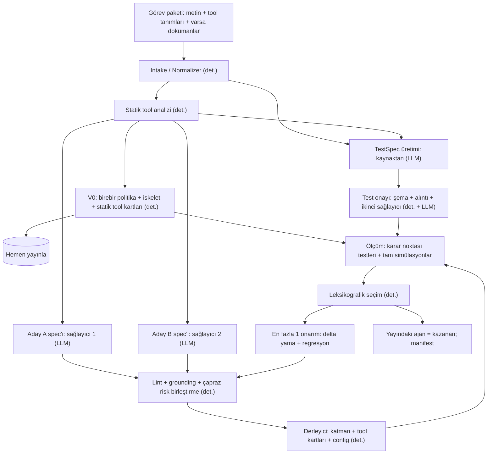

# Build the Builder — Birleşik Final Plan

**Freya × Y Combinator hackathonu · 10 Ekim 13:00 – 11 Ekim 23:00 (İstanbul) · tamamen çevrim içi**
Sürüm 1.3 · 10 Ekim 2026 · İhsan'ın iki planının birleşimi + 8 Ekim'de yapılan kaynak doğrulaması + benchmark hata analizleri + 10 Ekim organizatör e-postası

> **Tek cümle:** Builder bir derleyicidir. Görev metnini ve tool'ları alır; politikayı **birebir** taşıyan, LLM gerektirmeyen bir V0 ajanı ilk saniyede yayınlar; üstüne kaynağa alıntıyla bağlı bir AgentSpec katmanı derler; adayları ölçer ve en iyisini teslim eder. Puanın çoğu, hackathon boyunca pratik benchmark'ta ölçerek sertleştirdiğimiz, görevden bağımsız iskeletten gelecek.

## 0. Bu doküman

Hafta sonu boyunca tek referans bu dosyadır. İki eski plan ayrıntı arşivi olarak kalır; burada onlara bölüm numarasıyla atıf var.

- **Plan A** — "Mimari ve Uygulama Planı" (`freya_hackathon_mimari_plani.md`). Dosyada yalnızca 12. bölümün sonu ve 13–24. bölümler var. 1–12'deki tasarımı sonraki bölümlerden (özellikle 16, 22, 23, 24) okudum; eksik kısımda bu dokümanla çelişen bir ayrıntı olabilir.
- **Plan B** — "Teknik Strateji ve 48 Saatlik Plan" (5 Ekim, tam metin).

Etiketler Plan B'deki gibi:

- **[OLGU]** — 8 Ekim'de birincil kaynaktan okundu (resmî doküman, arXiv, GitHub deposundaki kod ve veri). Kaynaklar en sonda.
- **[ÇIKARIM]** — mühendislik yargısı.
- **[SPEKÜLASYON]** — kanıtı zayıf tahmin; Day 1'in ilk saatinde doğrulanacak.

Freya'ya dair her şey **public dokümantasyondan** geliyor ve hiçbiri elle doğrulanamadı: ajan platformuna şu an erişimimiz yok (Bölüm 12.1). Hackathon için ayrı bir API ya da kısıtlı bir erişim de verilebilir. Platformu elle denemeden hiçbir alanın davranışına güvenmeyin.

**Sürüm notları**

- **1.3 (10 Ekim, sabah).** Organizatör e-postası (10 Ekim, 00:16) işlendi: görev bir bankanın giden tahsilat araması; T = Cumartesi 13:00, D = Pazar 23:00. Yeni: Bölüm 2.6 (e-postada yazanlar ve plana etkisi), Bölüm 13'te 17. ve 18. sorular, "Cumartesi, 13:00'ten önce" checklist grubu. Güncellenen: saat karşılıkları (Kısaltmalar, Bölüm 12–12.4); H1–H3 olasılıkları (Bölüm 2.2); teslim akışı tablosu (Bölüm 2.5); derlenen metinlerde "caller" → "customer" ve V0 `role` cümlesi (Bölüm 5.4, 8.3); T+0–1 bloğu (Bölüm 12.2); coding agent brifinginin ilk paragrafı (Bölüm 17.4). Geri kalan metin 1.2 ile aynıdır; Ek A gelen arama örneği olarak kaldı.
- **1.2 (8 Ekim, gece).** Yeni: Bölüm 17 (benchmark'ların hata analizleri ve coding agent brifingi), Bölüm 2.5 (teslim ve değerlendirme akışı tahmini), Bölüm 11.4 (komut satırı sözleşmesi), Ek C (builder production'da). Genişleyen: Bölüm 10.4 (public benchmark'larla vekil ölçüm), Bölüm 9.1 (test kotası, gereksinim türleri, dal kapsamı). Düzeltilen: τ^τ-bench referansının bir tavan olduğu; τ-Voice ve τ-Knowledge rakamlarının güncel sıralamadaki karşılığı (Bölüm 2.3). Değişikliklerin özeti Bölüm 1.2'nin 4. maddesinde.
- **1.1 (8 Ekim, akşam).** Ajan platformuna hackathon öncesinde erişim olmadığı görüldü; hazırlık planı buna göre yeniden kuruldu (Bölüm 12.1).

**Coding agent kullanıyorsanız** bu dosyanın tamamını talimat dosyası yapmayın: Bölüm 17.4'teki kısa brifing talimat dosyasına, bu doküman `docs/plan.md` olarak depoya girer (Bölüm 17.5).

**Kısaltmalar**

| Kısaltma | Anlamı |
| --- | --- |
| T, D | T = Day 1'de kuralların açıklandığı an: **10 Ekim Cumartesi 13:00** (İstanbul). D = teslim saati: **11 Ekim Pazar 23:00** (challenge sayfası daha erken bir teslim saati verirse o geçerlidir). "T+6" = T'den altı saat sonra; "D−4" = teslimden dört saat önce. |
| M1, M2 | İki mühendis. M1 = builder beyni (spec, derleyici, testler). M2 = platform + ölçüm (Freya adaptörü, pratik benchmark, izleme). |
| B0, V0, V1, V2 | Builder'ın basamakları. B0 = naif prompt. V0 = birebir politika + iskelet, LLM'siz. V1 = V0 + AgentSpec katmanı. V2 = V1 + build anı ölçüm ve seçim (Bölüm 12.5). |
| Katman | AgentSpec'ten derlenen ve birebir politika metninin üstüne eklenen yapılandırılmış bölümler: tool kartları, kural dizini, olgular, akış, toplanacak bilgiler. |
| Hedef A, A2, B | Derleme hedefleri. A = Freya ajan config'i. A2 = Freya'da çok düğümlü şablon. B = kendi runtime'ımız (Bölüm 8). |
| H1–H3 | Benchmark'ın ne olduğuna dair üç hipotez (Bölüm 2.2). |
| Karar noktası testi | Bir konuşma önekinden sonra ajanın tek bir sonraki eylemini sınayan test (Bölüm 9.2). |
| E1–E12 | Pratik ve vekil benchmark'ta koşulacak deneyler (Bölüm 10.2). |
| P0–P3 | Öncelikler. P0 = B0 ve V0 için şart. P1 = V1. P2 = V2. P3 = yalnız veri desteklerse. |
| σ | Aynı config'in iki koşusu arasındaki skor farkı; gürültü tahmini (Bölüm 10.1). |
| pass^k | Aynı görevin k bağımsız denemesinin hepsinde geçme oranı; pass^1 tek deneme. |
| Konuşan ajan, kuran ajan | Konuşan ajan: builder'ın ürettiği, müşteriyle konuşan ajan. Kuran ajan: ajan inşa eden ajan, yani builder'ın kendisi ve onu yazan coding agent'lar (Bölüm 17). |
| Coding agent | Pipeline'ın kodunu yazarken kullandığınız kodlama ajanı (Claude Code, Codex ve benzerleri). |
| Vekil benchmark, vekil düzenek | Platform yokken builder'ı ölçmek, sonrasında ikinci görüş almak için kullanılan public benchmark alanları. Vekil düzenek: τ^τ deposu + taban koşusu + ajan fabrikası (Bölüm 10.4). |
| Geri düşüş (fallback) | Bir adım hata verdiğinde daha basit bir sonuca dönmek; örneğin katmanlı aday yerine V0'ın yayında kalması (Bölüm 5.4). |
| Brief | Organizatörün görev girdisine verdiği ad: bankanın tahsilat brief'i (Bölüm 2.6). Bu dokümandaki "görev metni" ve "politika metni" (`policy_text`) odur. |
| Arayan, müşteri | E-postaya göre aramayı ajan yapıyor (giden arama). Bu dokümanın Türkçe metninde "arayan" geçen her yerde hattaki müşteri kastedilir; derlenen İngilizce metinler "customer" der (Bölüm 8.3). |

---

## 1. Karar özeti

### 1.1 On karar

1. **Ara temsil AgentSpec.** Plan B'nin şeması taban; Plan A'dan `success_conditions` alındı ve Plan A'daki `confirmation: if_ambiguous` fikri üç kademeye genişletildi (Bölüm 6).
2. **Politika metni prompta birebir girer.** Spec onun yerine geçen bir özet değil, üstüne binen yapılandırılmış bir katmandır. İki planda da olmayan en önemli değişiklik bu (Bölüm 3.3, 8.3).
3. **Birincil derleme hedefi Freya ajan konfigürasyonu.** Kendi runtime'ımız yalnızca kurallar "ajan = çalıştırılabilir kod" derse ya da yerel simülasyon için yazılır (Bölüm 8).
4. **Kod korumaları platform ayarlarına eşlenir.** İki planın "evrensel runtime" korumalarının çoğu Freya'da prompt, tool açıklaması, tool config'i ve düğüm yapısı olarak ifade edilir (Bölüm 8.2).
5. **V0 hem yedek hem rakip.** Her build'in ilk saniyesinde teslim edilebilir bir ajan vardır. Katmanlı bir aday V0'ın yerini ancak ölçümle alır: ya o görevin testlerinde açık farkla, ya da pratik benchmark'ta kanıtlanmış varsayılan olarak (Bölüm 9.4).
6. **Adaylar bağımsız okumalardır:** V0 + iki farklı sağlayıcının spec'i; bütçe varsa üçüncü "katı" varyant (Bölüm 3.2, satır 1).
7. **Testler kaynaktan üretilir, ikinci bir model kaynağa karşı onaylar, hiçbir test gevşetilmez.** İki aşama: yazma kararı anlarını sınayan ucuz karar noktası testleri + az sayıda tam simülasyon (Bölüm 9).
8. **Seçim leksikografik, onarım en fazla bir tur, yama küçük delta.** İki planın ortak çizgisi; Plan B veri desteklerse ikinci tura izin veriyordu.
9. **Asıl kazanç offline döngüde:** pratik benchmark → hata etiketi → evrensel düzeltme → hold-out kontrolü. Göreve özgü düzeltme yasak (Bölüm 10).
10. **Düz Python + Pydantic + ince native LLM adaptörleri + SQLite/JSONL.** Framework yok, multi-agent builder yok, build anında DSPy/GEPA yok.

### 1.2 Araştırmanın değiştirdiği dört şey

1. **Freya'nın platformu public dokümanda açık ve "üretilen ajan"ın ne olduğunu büyük ölçüde ele veriyor.** Ajan bir JSON konfigürasyonu; platformda persona + assertion + pass rate üreten bir Simulation özelliği, tool çağrısı doğrulayan unit testler ve ajanı metinle tur tur süren bir Chat API var (Bölüm 2.1). İki plan da bunu bilmeden yazılmış; ikisi de kendi simülatörünü ve kendi runtime korumalarını merkeze koyuyor.
2. **Sierra 4 Eylül 2026'da tam olarak bu problemi ölçen τ^τ-bench'i yayımladı.** En iyi otomatik "ajan inşa eden ajan" %23,9'da; cevap anahtarını bilen benchmark yazarının kurduğu referans tavan %82,2'de. Aradaki farkın nedenleri bizim için bir yapılacaklar listesi (Bölüm 2.3, 17.3).
3. **Planlardaki bazı olgular düzeltildi:** SABER'in yeri ve rakamları, τ³-bench'in gerçekte kullandığı ödül bileşenleri, model adları ve fiyatları (Bölüm 2.3, 2.4).
4. **Benchmark'ların hata analizleri planı sekiz yerde değiştirdi (v1.2).** Ajanların nerede düştüğü Bölüm 17'de tek tek, kaynağıyla. Plana yansıyanlar: test kotasında bileşik talep, doğrulanmamış beyan ve "bilmiyorum" senaryoları ile politika dalı kapsamı (Bölüm 9.1); iskelet ile politika arasında çelişki taraması (Bölüm 6.4); iki yeni iskelet satırı ve bir aday listesi (Bölüm 8.3); üretilen ajan için bütçe kapısı (Bölüm 9.4); sessiz geri düşüş yasağı (Bölüm 5.4); üç yeni hata etiketi (Bölüm 9.6); public benchmark'larla vekil ölçüm (Bölüm 10.4); coding agent'lar için brifing ve çalışma düzeni (Bölüm 17.4, 17.5).

### 1.3 Day 1, ilk saat: karar ağacı

```text
Üretilen ajan nedir?
├─ Freya ajanı (config/ID)  ──► Hedef A (Bölüm 8.1–8.3)
│    ├─ Build anında platformda simülasyon/unit test koşabiliyor muyuz?
│    │    ├─ Evet ──► test backend = Freya (Bölüm 9.2)
│    │    └─ Hayır ─► test backend = yerel; yalnız karar noktası testleri + lint
│    └─ Workflow/çok düğümlü ajan API'den kurulabiliyor mu?
│         ├─ Evet ──► A2 şablonu Day 2 deneyi olur (Bölüm 8.4)
│         └─ Hayır ─► tek ajan
└─ Çalıştırılabilir kod  ──► Hedef B (Bölüm 8.5), test backend = yerel

Simülasyon modu?   voice ─► sesli sertleştirme P0   |   chat ─► sesli ekler derlenmez
Ajan modeli?       sabit ─► iskeleti o modelde ayarla |   serbest ─► E6 deneyi
```

Hangi yol çıkarsa çıksın AgentSpec, iskelet metni, offline döngü ve bu dokümanın geri kalanı aynıdır.

**Güncelleme (10 Ekim).** E-posta ilk dalı büyük ölçüde kapattı: builder Freya'da bir telefon ajanı yaratıyor, yani Hedef A. Diğer dallar 13:00'te challenge sayfasıyla netleşir (Bölüm 2.6).

---

## 2. Araştırma bulguları (8 Ekim 2026)

### 2.1 Freya platformu gerçekte neye benziyor [OLGU, public doküman]

API tabanı `https://app.freyavoice.ai/api/v2`, `Authorization: Bearer <anahtar>`. Doküman anahtarın `app.freyavoice.ai` → Settings → API Keys'ten alındığını ve hesabın ücretsiz açıldığını söylüyor; pratikte öyle değil: 8 Ekim'de denediğimizde dashboard'da kayıt bağlantısı yoktu ve playground anahtarı bu API'de 401 döndü (Bölüm 12.1). Aşağıdaki tablo bu yüzden yalnızca dokümana dayanıyor, elle doğrulanmadı. Doküman ayrıca REST arayüzünün "deneysel olduğunu ve tanımların haber verilmeden değişebileceğini" söylüyor.

| Alan | Dokümanda yazan | Bizim için anlamı |
| --- | --- | --- |
| **Ajan** | `POST /agents`. `config.llmConfig`: `provider`, `model`, `systemPrompt` (en çok 200.000 karakter), `temperature` (varsayılan **0,7**), `maxTokens` (varsayılan 1000, üst sınır 4000), `firstMessage`, `firstMessageMode` (varsayılan: ajan kullanıcıyı bekler), `tools[]`. `ttsConfig`, `sttConfig`, `complianceConfig` zorunlu. Aynı isimde ikinci ajan 409 döner. | "Üretilen ajan" büyük olasılıkla bu JSON. Platform varsayılanları işimize yaramıyor; evrensel config varsayılanlarımız olmalı (Bölüm 8.1). |
| **Tool** | `function{name, handler, description, parameters, transition_to?}`; `config{maxPerNTurns, alwaysRunsAt: each_turn / start_of_call / end_of_call, timeoutMs, maxRetries 0–5, preSpeech}`; `response_mapping[{path, variable}]`; `extraction_schema[{name, type, validation_pattern, required, max_retries}]`; `pre_process_code`, `post_process_code`. | İki planın kod korumalarının bir kısmı platform ayarı olarak yazılabilir. Alanların semantiği dokümanda yok; elle denenmeden kullanılmaz. |
| **Diğer config** | `guardrailsConfig` (exact / regex / dictionary / structured / classifier kuralları; eylem refuse / regenerate / log_only; girdi tarafında injection tespiti), `routingLlmConfig`, `extractionLlmConfig`, `callTimeoutSettings.maximumDuration` (varsayılan 600 sn), `sttConfig.confidenceReask`, `ttsConfig.speechNormalization`, `postConversationAnalysis.autoDetectProblems`, `piiRedactionConfig`. | Çoğuna dokunmayacağız. Ses modunda `confidenceReask` ve `speechNormalization` deney konusu. |
| **Simülasyon** | `POST /simulations`: `agentId`, `selectedPersonaIds`, `assertions[]`, `mode` = voice ya da chat (**varsayılan voice**), `runsPerPersona` 1–50, `maxCallDurationSeconds` 60–3600 (**varsayılan 60**), `assistantLlmOverride`, `personaLlmOverride`, `analysisLlmOverride`, `agentVersionId`. Sonuç (simülasyon ve iterasyon düzeyinde): `passedRuns`, `failedRuns`, `inconclusiveRuns`, `passRate` (0–1), ortalama gecikme, ortalama süre, ajanın konuşma payı. | Organizatörün "benchmark simulations" dediği şey büyük olasılıkla bu özellik (Bölüm 2.2). |
| **Persona ve assertion** | Persona: `prompt`, `successCriteria`, `systemPrompt`, `evaluationPrompt`. Assertion: `name`, `prompt`, `contextConfig{includeToolCalls, includeRoutingEvents, includeExtractionEvents}`. Çağrı detayında `assertionResults[{assertion, success: true / false / null, reason, relevantMessages}]`, `successCriteriaResult`, `problems[{title, proposedSolution, type}]`, `turnLatencyStats`. Assertion oluşturan bir uç nokta dokümanda listelenmemiş. | Puanlama doğal dille yazılmış kriterlerin bir LLM tarafından, transkript ve tool olaylarına bakarak değerlendirilmesi. `reason` alanı bize bedava hata teşhisi. |
| **Unit test** | `POST /unit-tests`: bir konuşma anlık görüntüsü (`input.messages`) + `assertions`: `tool_call{tool, args, argsMatch: subset / exact, negate}`, `extraction`, `routing` + serbest metin `expectation`. Toplu koşuda `mockToolResults`, `repeat` 1–20, `judgeLlmOverride`. Sonuç: `outcome` pass / fail / error, `verdictReason`, `assertionResults`. | "Bu noktada ajan şu tool'u şu argümanla çağırmalı / çağırmamalı" sorusunu ucuz ve deterministik sınamanın hazır yolu. |
| **Chat API** | `POST /chat/message` ajanı metinle tur tur sürer; `POST /chat/fork` aynı konuşma önekini başka bir ajan sürümüne çatallar; `POST /chat/end` çağrı sonu analizini tetikler. | Kendi kullanıcı simülatörümüzü gerçek Freya runtime'ına karşı koşturabiliriz; fork ile iki adayı aynı önekte karşılaştırabiliriz. |
| **Sürümler** | `POST /versions/{agent ya da workflow}/{id}` bir config anlık görüntüsü uygular, geçersizse 422; sürüm kaydında `sourceRunId` alanı var ("bu sürümü üreten optimizasyon koşusu / öneri"). Branch dokümanda "önerilen değişiklik" diye tanımlı; birleştirme üç yollu ve iki seçenekli (uygula / uygula ve yayınla), ana hat değiştiyse 409. Sürüm başına simülasyon kontrolleri ve unit test koşuları listelenebiliyor. `PUT /agents/{id}` `commitMessage` alır; `GET /agents/defaults` platformun varsayılan config'ini döner. | Aday deposu platformda tutulabilir. Config'i sıfırdan yazmak yerine `defaults`'u taban almak şema kaymasına karşı korur. Platform, bir AI'ın sürüm önerip insanın onayladığı akışa göre kurulmuş görünüyor [ÇIKARIM] (Ek C). |
| **Geri bildirim, AI Studio** | Atanabilen, yorumlanabilen, durum taşıyan geri bildirim kayıtları; birleştirme yanıtında `resolvedFeedbackIds` alanı var. AI Studio: sistem promptunu AI ile düzenleyen arayüz; öneriyi insan kabul eder ya da reddeder. | Hackathon için gerekli değil; production'daki tablo için Ek C. |
| **Workflow** | Düğüm türleri: Initial, Agent, Function, Condition, Transfer, Wait, Loop. Hazır şablonlar: Simple Agent, Agent with Transfer, Multi-Agent Routing, Function Integration. Public API'de yalnızca listeleme ve okuma var; oluşturma uç noktası belgelenmemiş. | Freya CEO'su Tunga Bayrak'ın duyuru videosunda "sub-agent" dediği şey workflow düğümü olabilir. API'den kurulabildiği belirsiz. |
| **Bilgi bankası** | Workspace düzeyinde, beta; hibrit arama; workspace'teki tüm ajanlara otomatik açık; PDF/TXT/MD/DOCX yükleme (10 MB). Public API uç noktası listelenmemiş. | Workspace düzeyinde olduğu için farklı görevlerin dokümanları birbirine karışır; programatik yükleme de belirsiz. Varsayılan yol dokümanı prompta koymak (Bölüm 8.3). |
| **Runtime** | Çağrı yaşam döngüsü dokümanda "pipecat" üzerinden anlatılıyor. Tool şemasındaki `handler` + `transition_to` ikilisi Pipecat Flows'un fonksiyon biçimiyle örtüşüyor [ÇIKARIM]. | Pipecat Flows'ta her düğüm "tek göreve odaklı prompt + yalnızca o düğümün tool'ları" demek. Bölüm 8.4'teki yapısal koruma fikri buna dayanıyor. |

### 2.2 Bu, benchmark hakkında ne söylüyor?

Etkinlik sayfasından kesin bildiklerimiz [OLGU]:

- Builder, görülmemiş bir görev açıklaması ve mevcut tool'lardan çalışan bir ajan üretir; ajanı nasıl üretip sınayacağı ve iyileştireceği bize bırakılmış.
- Değerlendirmede elle düzeltme yok. Teslim edilen şey builder'ın kendisi: kodun tam sürümü, bağımlılıklar ve tekrar üretilebilir çalıştırma talimatı.
- Sıralama yalnızca üretilen ajanların final benchmark'taki performansına göre. Sunum ya da pitch puanı yok.
- Puanlama kuralları, kaynak sınırları ve tie-breaker'lar building başlamadan paylaşılacak.
- Day 1'de geliştirme görevleri ve pratik benchmark veriliyor; final benchmark görülmemiş görevlerden oluşuyor.

Tunga Bayrak'ın duyurusuna göre Freya'nın kendi sistemi müşterinin dokümanlarını, tool'larını ve gereksinimlerini alıyor; görev paketinde doküman da olabilir [ÇIKARIM].

Etkinlik sayfasında platformla ilgili üç ifade var: builder "Freya'nın platformunu kullanarak" ajan yaratacak, katılımcılar platformu kullanacak, üretilen ajanlar "benchmark simülasyonlarından" geçecek. Platformda tam bu adla, persona + assertion + pass rate üreten hazır bir özellik var. En sade açıklama: **gizli benchmark, görev başına gizli persona ve assertion'larla koşulan bir Freya Simulation'dır; skor pass rate'tir.** [ÇIKARIM]

| Hipotez | Ajan artifact'ı | Puanlama | Kaba olasılık [SPEKÜLASYON] | Doğruysa |
| --- | --- | --- | --- | --- |
| **H1** | Freya ajan config'i | Freya Simulation: persona başarı kriteri + assertion'lar, LLM değerlendirmeli | ~%70 | Hedef A. Kod korumamız yok; platformun test altyapısını kullanırız. |
| **H2** | Freya ajan config'i | Mock backend'in son durumu ya da tool çağrısı eşleşmesi (τ-bench tarzı), belki assertion'larla karışık | ~%25 | Hedef A. Yazma disiplini daha da kritik; deterministik kontroller öne geçer. |
| **H3** | Belirli bir arayüzü uygulayan kod | τ^τ-bench tarzı: son durum + iletilen bilgi | ~%5 | Hedef B: kendi runtime'ımız ve kod kapıları. |

**Güncelleme (10 Ekim).** E-postaya göre builder "Freya'da bir telefon ajanı yaratır" ve skor "ajanın doğru ele aldığı vakaların oranıdır" (Bölüm 2.6). Bu H3'ü neredeyse eliyor; H1 ile H2 arasındaki ayrımı (bir vakanın "doğru" sayılmasına kim, neye bakarak karar veriyor) çözmüyor. Tablodaki olasılıklar buna göre güncellendi: H1 ~%60 → ~%70, H3 ~%15 → ~%5.

H1 doğruysa altı sonuç çıkar:

1. **Kod korumalarımız değerlendirmede çalışmaz.** Elimizde prompt, tool açıklamaları, tool config'i ve (izin varsa) düğüm yapısı var.
2. **Değerlendirici bir LLM.** Uyum, transkriptte okunaklı olmalı: ajan kimliği doğruladığını, neyi hangi değerle yaptığını açıkça söylemeli. Belirsiz biten çağrı `inconclusive` sayılabilir.
3. **Varsayılan mod ses.** Aksi söylenene kadar sesli sertleştirme P0. τ-Voice'ta metin tabanı %85 iken ses-doğal modeller %26–51'de kalıyor; STT → LLM → TTS zinciri kuran bir taban çizgisi alanına göre %17–48 alıyor (Bölüm 2.3, 17.2).
4. **Çağrı süresi sınırı var** (alan varsayılanı 60 sn). Organizatör büyük olasılıkla yükseltecek, ama kısalık ve az tur evrensel bir erdem.
5. **Organizatör ajan modelini `assistantLlmOverride` ile herkese sabitleyebilir.** "Herkes aynı koşullarda değerlendirilir" cümlesiyle uyumlu. Model seçimi kaldıracına güvenmeyin; iskeleti hedef modelde ayarlayın.
6. **Platform bize test altyapısını hazır veriyor.** Kendi kullanıcı simülatörümüzü yazmak ilk iş olmaktan çıkar.

Teslimin ve değerlendirmenin adım adım nasıl akacağına dair tahmin Bölüm 2.5'te.

### 2.3 Literatür: doğrulananlar ve düzeltilenler [OLGU]

Bu tablo kararları etkileyen özettir. Benchmark'ların hata analizlerinin tamamı, her bulgunun pipeline'daki karşılığıyla Bölüm 17'de.

| Konu | Planlarda | Doğrulama sonucu | Karara etkisi |
| --- | --- | --- | --- |
| **SABER** (arXiv 2512.07850) | Plan B: "ICLR 2026; Claude için +%9 / +%7" | arXiv notu yalnızca "ICLR 2026'ya gönderildi" diyor; ana konferansta kabul kaydı bulamadım. +%9 / +%7 **göreli** kazanç (mutlak karşılığı yaklaşık 5 puan). Regresyon tablosu: yazma adımındaki her ek sapma başarı odds'unu Claude Sonnet 4'te airline'da %96, retail'de %92 azaltıyor; okuma adımlarındaki sapmanın etkisi %1–19. Yazma adımları tüm adımların yalnızca %14–18'i. Makalenin özeti bu iki yüzdeyi ters alanlara yazıyor; burada tablo esas alındı. İki model-alan çiftinde SABER'li sonuç tabanın altında. | Ana bulgu sağlam: çaba, adımların altıda biri olan yazma kararlarına yoğunlaşmalı. Kazanç mütevazı ve her yerde pozitif değil; her koruma ayrı ölçülür. |
| **τ³-bench ödülü** | Plan B: "DB hash × iletişim alt-dizesi" | Ödül, görevin `reward_basis` bileşenlerinin çarpımı (kodda doğrulandı). Ama depodaki görev verisi dokümandan farklı: airline DB + COMMUNICATE (50 görevin yalnız 6'sında iletişim dizesi var), retail DB + LLM değerlendirmeli NL_ASSERTION (112/114), telecom ENV_ASSERTION, banking 88 DB + 9 ACTION. **Airline'da 50 referans çözümün 24'ü hiçbir yazma içermiyor**; retail'de 10/114. | "Yapmamak" en az "yapmak" kadar sınanıyor. Yetkisiz yazma ile yanlış ret aynı ağırlıkta hata. Sektör standardı da kısmen LLM değerlendirmeli. |
| **τ-Voice** (arXiv 2603.13686) | Plan B: ses spekülatif | 278 görev. Mart 2026'da ses-doğal (audio-native) modeller ölçüldü: metin tabanı %85 (akıl yürüten GPT-5; akıl yürütmeyen GPT-4.1 %54), ses temiz koşulda %31–51, gürültü ve aksanla %26–38. Hataların %79–90'ı ajan kaynaklı; bunların içinde mantık %37–38, transkripsiyon %29–37, uydurma (söylenmemiş değeri uydurma, tool çağırmadan "yaptım" deme) %14–18. Harf harf söylenen isim ve e-posta yazıya dökülemiyor, kimlik doğrulama tıkanıyor. **Güncel sıralama (8 Ekim kopyası):** STT + GPT-4.1 + TTS zinciri kuran bir taban çizgisi airline %48, retail %29, telecom %17; ses ön yüzünü akıl yürüten bir arka uçla birleştiren en yeni sistem %79–84. | Ses kaybı mimariye ve modele bağlı. Freya'nın config'i ayrı STT, LLM ve TTS ayarları taşıdığı için [ÇIKARIM] yakın örnek zincir taban çizgisidir. İskelete üç kural: kritik değeri geri oku, tool başarılı dönmeden "yapıldı" deme, kısa konuş. Ayrıntı Bölüm 17.2. |
| **τ-Knowledge** (arXiv 2603.04370) | — | 698 dokümanlı bankacılık alanı, 97 görev. Makalede en iyi sonuç %25,5; doğru dokümanlar bağlama elle konduğunda en iyi %39,7; tüm bilgi bankası prompta döküldüğünde en çok ~%12. Güncel sıralamada (Ağustos 2026 gönderimleri) en iyi %55,2, dört denemenin dördünde %35,1. | Kısa politikayı birebir ver; büyük külliyatı daraltmadan bağlama dökme. Belgeyi bulmak yetmiyor; uygulamak ayrı bir zorluk (Bölüm 17.2). |
| **τ^τ-bench** (arXiv 2609.04611) | İki planda da yok | Aşağıdaki kutu. | Yedi kural. |
| **IntellAgent** | r = 0,98 / 0,92 | Doğru; ama yalnız 6 model üzerinden ve mutlak skorları τ-bench'ten çok yüksek. | Sentetik test adayları **sıralamak** için kullanılır; mutlak skoruna güvenilmez. |
| **ACE** | +%10,6; bağlam çöküşü | Doğru (ICLR 2026). Örnek: 18.282 token'lık bağlam 122 token'a yeniden yazılınca doğruluk %66,7 → %57,1. | Onarım küçük delta olmalı. Aynı mantık politika için de geçerli: özetleyip yeniden yazma. |
| **GEPA** | ICLR 2026 oral | Doğru. Makaledeki bütçe görev başına binlerce rollout. | Build anında yok; offline'da yalnız stretch (P3). |
| **Korumanın yan etkisi** | — | PolicyGuard (arXiv 2606.29225): konuşmayı görüp geri bildirim veren doğrulayıcı τ² airline'da pass^4'ü +12 / +6 / +12 puan artırıyor ve araya girdiği çağrıların %37–58'ini blokluyor. Yalnız argümana bakan kod korumaları %71–79'unu blokluyor ve pass^4'ü iki modelde düşürüyor (−14, −4; üçüncüde +6). Taban ajanlar reddetmesi gereken görevlerde pass^4 0,75–0,96, yazma gerektiren görevlerde 0,19–0,50 alıyor. | Kör bloklayıcı meşru işlemi de keser. Güncel modellerde asıl kayıp reddedememek değil, yapılması gereken yazmayı eksiksiz ve her seferinde yapamamak. |
| **Akıl yürütme bütçesi** | — | taubench.com gönderimlerinde aynı model (GPT-5.2), akıl yürütme kapalıyken ve açıkken: airline 52,5 → 83,0; telecom 57,2 → 89,7; retail 75,0 → 81,6. | Platform efor ayarına izin veriyorsa en ucuz kaldıraç. |
| **Tutarlılık** | pass^k | τ³ sıralamasında (8 Ekim kopyası; pass^4 bildiren tüm metin gönderimleri, arşivdekiler dahil) tek denemeden dört denemenin dördüne medyan kayıp: airline 14,25, retail 24,5, telecom 17,1, banking 15,2 puan. Örnek: GPT-5.2 retail'de 81,6 → 51,8. | Tek koşuluk skor yanıltır. Sıcaklığı düşür, kritik kararları tekrar koşuyla ölç. |

> **τ^τ-bench'ten yedi kural.** Sierra'nın benchmark'ında bir kodlama ajanı; politika belgeleri, destek transkriptleri, bir REST API ve bir model menüsünden müşteri hizmetleri ajanı inşa ediyor; üretilen ajan gizli simülasyonlarda puanlanıyor. 53 görev, 4 alan. En iyi sonuç Claude Code + Opus 5 ile %23,9; referans tavan %82,2 (cevap anahtarını bilen benchmark yazarının bir modelle birlikte kurduğu çözüm; ortalama insan performansı değil).
>
> 1. **Kaynağın tamamını oku.** Bankacılık külliyatında kodlama ajanları ~1.700 dosyanın 80'inden azını açtı ve anahtar kelimeyle aradı; o görevlerde skor %1,1. → Intake görev paketinin tamamını okur; anahtar kelimeyle aramaz.
> 2. **İlk çalışan tasarımı ölçmeden teslim etme.** Hiçbir build devraldığı kodu çalıştırıp ölçmedi. → V0 her zaman yarışta.
> 3. **Kendi yazdığın test kendi kör noktanı kodlar.** Altı build başarısız testini gevşetti; ayrı bir build kural uydurup kendi senaryosuna yazdı ve ajanı ona göre ayarladı. → Testi ikinci model kaynağa karşı onaylar; onarıcı teste dokunamaz.
> 4. **Mimariyi dene.** Build'lerin %92'si tek tool döngüsüydü; tek satırlık "niyete göre yönlendir, tool çağrılarını gözden geçir" ipucu telecom'da skoru %31 → %67 yaptı. → A2 şablon deneyi (Bölüm 8.4).
> 5. **Belirsizliği sor ya da kaydet.** Müşteriye dört ve üzeri soru soran build'ler 0,50, hiç sormayanlar 0,16 aldı. → Bizde soracak müşteri yok; `ambiguities` alanı ve temkinli varsayılan var.
> 6. **Bütçeyi kullan ama aşma.** 21 build servis bütçesini aştı, 10'unun puanı sıfırlandı; 12 build sürenin yarısı dururken teslim etti. → Bütçe profilleri ve saat.
> 7. **Belirsiz yazmada önce durumu kontrol et.** Benchmark'a bilerek API kusurları yerleştirilmiş: commit ettikten sonra zaman aşımına uğrayan rezervasyon, `next_cursor` arkasında devam eden sonuç listesi. Gürültülü kusuru herkes fark etti, sessiz olanı kimse. Doğru toparlanma körlemesine tekrar değil, durum kontrolü. → İskelete iki evrensel kural adayı.
>
> On örüntünün tamamı, sayıları ve coding agent'lar için karşılıkları Bölüm 17.3'te.

### 2.4 Model manzarası [OLGU, resmî fiyat sayfaları]

İki plan model adlarında çelişiyordu. Plan A'nın OpenAI ve Google adları güncel; Plan B'nin Anthropic fiyatları doğru ama küçük model güncellenmiş.

| Model | API kimliği | Girdi / çıktı (1M token, USD) | Not |
| --- | --- | --- | --- |
| Claude Fable 5.1 | `claude-fable-5-1` | 10 / 50 | En üst kademe; yavaş. |
| Claude Opus 5.5 | `claude-opus-5-5` | 4 / 20 | Varsayılan efor medium. |
| Claude Sonnet 5.5 | `claude-sonnet-5-5` | 2 / 10 | Varsayılan efor high. |
| Claude Haiku 5.5 | `claude-haiku-5-5` | 0,10 / 0,50 (100 bin token altı prompt) | Plan B'deki Haiku 4.5 (1 / 5) artık "ek modeller" listesinde. |
| GPT-6 Astra | `gpt-6-astra` | 10 / 50 | Pahalı; yalnız tırmandırma. |
| GPT-6.1 Sol | `gpt-6.1-sol` | 2 / 10 | **Tool calling yalnız Responses API'de**; Chat Completions tool'suz. Efor: low, medium (varsayılan), high, xhigh, max. |
| GPT-6 Luna | `gpt-6-luna` | 0,10 / 0,50 | Ucuz sınıflandırma, tool simülatörü. |
| Gemini 3.8 Flash | `gemini-3.8-flash` | 0,75 / 3,75 (31 Aralık 2026'ya kadar) | Plan B'deki 3.5 Flash (1,50 / 9) eski. |
| Gemini 3.1 Pro | `gemini-3.1-pro-preview` | 2 / 12 | Hâlâ preview. |

Freya tarafında `llmConfig.provider` ve `model` serbest metin; dokümanda desteklenen model listesi yok. Hangi modellerin seçilebildiği Day 1'de öğrenilecek.

### 2.5 Teslim ve değerlendirme akışı: en iyi tahmin [SPEKÜLASYON]

Kurallar 10 Ekim 13:00'te challenge sayfasıyla açıklanacak. O zamana kadar çalışma varsayımı şu; dayanağı etkinlik sayfasının ifadeleri, 10 Ekim organizatör e-postası (Bölüm 2.6), Freya'nın public API'si ve τ^τ-bench'in aynı problemi nasıl paketlediği.

| Soru | En iyi tahmin | Güven | Dayanak |
| --- | --- | --- | --- |
| Builder nedir? | Komut satırından çalışan, kimseye soru sormayan bir program. Dashboard'da elle kurulan bir şey değil. | Çok yüksek | Teslim edilen şey builder'ın kendisi: kodun tam sürümü, bağımlılıklar ve tekrar üretilebilir çalıştırma talimatı. |
| Bize ne verilecek? | 10 Ekim 13:00'te chat'te üç şey: tam kuralların olduğu challenge sayfası, starter kit ve Freya hesabı açma adımları [OLGU, e-posta]. Starter kit'in içeriği bilinmiyor. Dashboard izlemek ve hata ayıklamak içindir; iş API'den yürür. | Yüksek | 10 Ekim e-postası; etkinlik sayfasındaki Day 1 programı: kurallar, geliştirme görevleri, platform kurulumu, pratik benchmark. |
| Görev nasıl gelir? | Bir bankanın tahsilat brief'i [OLGU, e-posta]; yanında büyük olasılıkla tool tanımları, belki ek dokümanlar. Tek brief mi birden çok brief mi, bilinmiyor (Bölüm 13, soru 17). | Orta-yüksek | 10 Ekim e-postası; "görev açıklaması ve mevcut tool'lar" ifadesi; τ^τ-bench'in görev kiti. |
| Builder'ın çıktısı ne? | Freya'da yaratılmış bir telefon ajanı (kimliği), belki config dosyasıyla birlikte. | Yüksek | 10 Ekim e-postası ("Freya'da bir telefon ajanı yaratır"); H1 ve H2 (Bölüm 2.2). |
| Builder'ı kim çalıştırır? | İki olasılıktan daha güçlüsü: organizatör, belgelediğimiz tek komutla ve gizli görev dosyalarıyla. Öbürü: biz çalıştırırız ve ajan kimliklerini teslim ederiz. | Düşük-orta | "Elle düzeltme yok" ve "tekrar üretilebilir talimat" ilkini düşündürüyor (Bölüm 13, soru 2). |
| Nasıl puanlanır? | Organizatör ajanı simüle müşterilere karşı koşar; skor, ajanın doğru ele aldığı vakaların oranıdır [OLGU, e-posta]. Bir vakanın neye göre "doğru" sayıldığı bilinmiyor. | Yüksek | 10 Ekim e-postası; Bölüm 2.2. |

```text
Day 1          challenge sayfası (kurallar) + starter kit + Freya hesabı (Cumartesi 13:00)
                  │
Hafta sonu     builder (bizim kod):  görev dosyası ─► Freya'da ajan ─► pratik simülasyon ─► skor
                  │                  skor düşükse: evrensel düzeltme, yeniden ölç
Day 2          teslim: kod + tek komut
                  │
Değerlendirme  gizli görevler ─► builder ─► ajanlar ─► gizli simülasyonlar ─► sıralama
```

Şema ilk olasılığı gösteriyor; builder'ı biz çalıştıracaksak son satırda gizli görevler bize verilir ve ajan kimliklerini biz teslim ederiz.

Tasarıma etkisi: builder etkileşimsiz bir komut satırı programıdır; ayarlarını ortam değişkeninden alır; her görevde kendi başına çalışır ve yeniden çalıştırılabilir; LLM hatasında bile geçerli bir ajan bırakır, Freya'ya ulaşamıyorsa ajanı diske yazar ve bunu çıkış koduyla bildirir. Sözleşmenin ayrıntısı Bölüm 11.4'te.

### 2.6 Organizatör e-postası (10 Ekim): ne biliyoruz, plana etkisi

Gönderen Yavuz Alp Sencer Öztürk (Freya, Founding Engineer), 10 Ekim 00:16. Tablonun sol sütunu e-postada yazandır [OLGU]; sağ sütun ve altındaki maddeler [ÇIKARIM].

| E-postada yazan | Plandaki karşılığı |
| --- | --- |
| Görev: bir banka, ödemesi gecikmiş müşterilerini telefonla aramak istiyor. Builder bankanın tahsilat brief'ini okur ve Freya'da bir telefon ajanı yaratır. | Alan belli: tahsilat. Görev girdisinin adı "brief". Çıktı bir Freya ajanı: Hedef A; H3 neredeyse elendi (Bölüm 2.2). Aramayı ajan yapıyor: giden arama. |
| Organizatör ajanı simüle müşterilere karşı koşar; skor, ajanın doğru ele aldığı vakaların oranıdır. | Geçme oranı tahmini doğrulandı (Bölüm 2.5). Birim vaka, yani tek bir simüle müşteriyle görüşme. |
| Başlangıç 10 Ekim Cumartesi 13:00, bitiş 11 Ekim Pazar 23:00 (İstanbul, UTC+3). Onay e-postasındaki "3:00am" Pasifik saatidir. | T = Cumartesi 13:00, D = Pazar 23:00; toplam 34 saat (Bölüm 12). |
| 13:00'te Build the Builder chat'inde üç şey paylaşılacak: tam kuralların olduğu challenge sayfası, starter kit, Freya hesabı açma adımları. | Platformu 13:00'ten önce göremiyoruz. T+0–1 bloğu buna göre güncellendi (Bölüm 12.2). |
| Hackathon tamamen çevrim içi; ofise gelinmiyor. Başlamadan önce chat'e katılmak gerekiyor (bağlantı e-postada). | Sorular ve teyitler chat'ten (Bölüm 13). |
| Tek başına ya da iki kişilik takımla çalışılır; e-posta takım arkadaşına gelmediyse iletilmeli. | M1 / M2 bölümü geçerli. |

**E-postanın söylemedikleri.** Kaç brief olduğu ve finalin starter kit'teki brief'le mi görülmemiş brief'lerle mi yapılacağı; brief'in yanında tool verilip verilmediği; modun ses mi chat mi olduğu ("telefon ajanı" sesi düşündürüyor, kesin değil); ilk kimin konuştuğu; bir vakanın neye göre "doğru" sayıldığı; builder'ı kimin çalıştırdığı (e-posta yalnızca ajanı organizatörün koştuğunu söylüyor); brief'in dili; kaynak sınırları; önceden yazılmış kodun serbest olup olmadığı. Hepsi 13:00'te challenge sayfasından okunacak (Bölüm 13).

**Plana etkisi.**

1. **Giden arama.** İskelet ve örnekler gelen aramaya göre yazılmıştı: müşteri arar, bir şey ister, ajan yardım eder. Tahsilatta aramayı ajan yapar ve görüşmenin amacı brief'ten gelir. Şablondaki "caller" sözcüğü bu yüzden yanlış tarafı gösteriyordu; derlenen metinlerde "customer" oldu (Bölüm 5.4, 8.3). "Customer" iki yönde de doğrudur; mod gelen arama çıksa da zarar vermez. Açılış, kimlik teyidi ve görüşmenin amacı brief'ten birebir gelir; ilk kimin konuşacağı E4 ile ölçülür. İskeletin ve test kotasının müşterinin bir talebiyle açılan görüşmeyi varsayan kısımları (ör. kapanıştaki "Ask whether they need anything else" satırı; Bölüm 9.1'deki "mutlu yol" tanımı) ilk pratik koşularda bu gözle izlenir; değişiklik yine ölçülerek girer (Bölüm 10.1).
2. **Alan belli, brief belli değil.** Brief'e ait hiçbir değer (tutar, gün, faiz, taksit koşulu, yasal metin, banka adı) koda, iskelete ya da teste yazılmaz; her build'de brief'ten okunur. Final aynı brief'le yapılsa bile teslim ettiğimiz şey builder'dır (etkinlik sayfası: görülmemiş görevler). Değişmez 7 aynen geçerli (Bölüm 17.4). Tek brief verilirse hold-out görevler arasında değil vakalar arasında ayrılır (Bölüm 4.2, 10.1).
3. **Vekil benchmark.** τ alanlarının hepsi gelen arama. Yöne bağlı olmayan değişiklikler için ikinci görüş olmayı sürdürür; giden aramaya özgü davranış hakkında sinyal vermez (Bölüm 10.4).
4. **Starter kit.** Hazır bir istemci ya da örnek builder içeriyorsa adaptör ve komut satırı sözleşmesi ona hizalanır (Bölüm 11.4).

---

## 3. İki planın karşılaştırması

### 3.1 Ortak omurga

İki plan aynı soru listesine verilmiş iki ayrı yanıt; bölüm başlıkları bile aynı. İkisinin de aynı çekirdeğe varması güven veriyor, ama bağımsız bir kanıt sayılmaz. Aşağıdakiler, Bölüm 3.2 aksini söylemedikçe aynen alındı.

- **Görev → AgentSpec → deterministik derleme.** LLM serbest metin prompt yazmaz, şema doldurur.
- **Runtime üretilmez.** Görev başına yalnızca veri (spec) üretilir; kod sabit ve sınanmıştır.
- **Planlama modelin kendi akıl yürütmesine bırakılır.** Durum makinesi, planner/executor, görev başına üretilen graf yok.
- **Tool anlama = deterministik statik analiz + tek LLM semantik geçişi**; ayrı kütüphane gerektirmeyen hafif bir tool graph.
- **Yazma adımı disiplini:** argüman kaynağı (provenance), önkoşul, tekrar/döngü koruması, hata sonrası en fazla bir tekrar.
- **Build anında küçük arama:** birkaç aday, 6–12 ortak test, leksikografik seçim, bir (Plan B'de en çok iki) hedefli onarım; onarım alan bazlı küçük yama. Test sayıları ve yapısı Bölüm 9'da yeniden tanımlandı.
- **Deterministik değerlendirme önce;** LLM judge dar tutulur ve hard fail'i telafi edemez.
- **SQLite + JSON/JSONL, özel tracer, harici altyapı yok.**
- **Düz async Python.** LangGraph, CrewAI, AutoGen, build anında DSPy/GEPA, vektör DB, UI yok.
- **İlk 3 saatte uçtan uca en basit sürüm; son saatlerde özellik dondurma; pratik görevlere özel kod yasak.**

### 3.2 Ayrışmalar ve hüküm

| # | Konu | Plan A | Plan B | Karar | Gerekçe |
| --- | --- | --- | --- | --- | --- |
| 1 | Aday çeşitliliği | Tek builder çağrısından üç yapısal varyant: minimal reactive, guided reactive, conservative procedural | Üç ayrı çağrı: Claude varsayılan, GPT varsayılan, Claude katı | **V0 + iki bağımsız okuma (iki sağlayıcı); bütçe varsa üçüncü "katı" varyant** | Tek çağrıdan çıkan adaylar aynı yanlış okumayı paylaşır; bağımsız çağrılar farklı hata yapar ve paralel koşar. Plan A'nın "minimal" fikri V0 olarak yaşıyor. |
| 2 | Testleri kim üretir | Aynı builder çağrısı spec'lerle birlikte test önerir | Ayrı üretici + doğrulayıcı + referans çözücü | **Ayrı çağrı; kaynaktan üretilir (spec'ten değil); ikinci sağlayıcı her beklentiyi kaynağa karşı onaylar** | Spec'i yazan okuma testi de yazarsa yanlış okuma kendini doğrular (τ^τ, kural 3). Referans çözücü pahalı; çapraz onay tek çağrı. Her test iki sağlayıcının onayından geçtiği için hiçbiri tek bir okumaya dayanmaz. |
| 3 | Yarış düzeni | Elemeli: 3 aday × 4 smoke → en iyi 2 × kalan 4 | Tam matris 3 × (8–12); bütçe varsa pass^2 | **Tam matris, paralel.** Yalnız ilk iki testte hata ya da geçersiz çıktı veren aday erken elenir | Elemeli yarış çağrıların ~%17'sini kazandırır ama elemeyi 4 gürültülü testle yapar. Duvar saati zaten paralellikten geliyor. |
| 4 | Onay politikası | `confirmation: if_ambiguous`; "aşırı onay" ayrı bir risk | Yazma tool'larında varsayılan açık onay ("yazma kapısı") | **Üç kademe:** `always`, `if_inferred`, `never` (Bölüm 7.3). Yazmalar için başlangıç varsayılanı `always`; E3 deneyi karar verir | İki uç da puan kaybettirir: onaysız yazma hard fail, kör bloklama meşru işlemi keser (PolicyGuard). Bankacılık ses senaryosunda değerlendiricinin onay beklemesi, onaydan rahatsız olmasından çok daha olası [ÇIKARIM]. |
| 5 | LLM istemcisi | İnce native adaptörler; LiteLLM kritik yolda yok | LiteLLM, doğrudan SDK yedeğiyle | **İnce native adaptörler** (Anthropic Messages, OpenAI Responses) tek arayüz arkasında | `gpt-6.1-sol` tool calling'i yalnız Responses API'de veriyor; yapılandırılmış çıktı sağlayıcıya özgü. Ajan Freya'da koşacaksa bizim çok-sağlayıcı ihtiyacımız görev başına birkaç builder çağrısından ibaret. |
| 6 | Builder modeli | GPT-6.1 Sol; tırmandırma Astra | Claude Opus 5.5; ikinci aday GPT-6 Sol | **İkisi de:** aday A'yı Opus 5.5, aday B'yi GPT-6.1 Sol okur; testi biri yazar, diğeri onaylar | Satır 1 ve 2'nin doğal sonucu. Görev başına 2–4 çağrı; maliyet önemsiz. |
| 7 | Model adları | GPT-6.1 Sol, Gemini 3.8 Flash | GPT-6 Sol, Gemini 3.5 Flash, Haiku 4.5 | Bölüm 2.4'teki tablo | Resmî sayfalar, 8 Ekim. |
| 8 | İzleme | P0 özel logger; P1 Logfire | Özel JSONL + görüntüleyici; Langfuse self-host yok (Cloud P2) | **Özel JSONL + SQLite + CLI/HTML.** Freya çağrı detayları API'den çekilip aynı depoya yazılır | Harici servis iki günde puan getirmez. Platform transkripti ve değerlendirici gerekçesini zaten saklıyor. |
| 9 | Spec şeması | `goal`, `success_conditions`, `required_facts`, `constraints(enforcement)`, `tool_policies`, `workflow(mode, hints)`, `termination` | `role/goal/channel`, `tools(kind, arg_sources, requires_confirmation, max_calls)`, `rules(source_quote)`, `slots`, `procedures`, `must_communicate`, `ambiguities` | **Plan B şeması taban;** Plan A'dan `success_conditions` alınır, `confirmation` üç kademeye genişletilir; `termination` ve `workflow.mode` evrensel tarafa geçer | Plan B'ninki makineyle denetlenebilir (alıntı, kaynak, tür). Plan A'nın iki alanı kapanış ölçütünü ve onay kararını iyileştirir. |
| 10 | Prompt içeriği | Spec'ten derlenen kompakt prompt | Spec'ten derlenen 600–1.500 token; 2.500 üstü lint hatası; en çok 15 hard kural | **Politika metni birebir + spec katmanı.** Token sınırı yalnız katman için | Bölüm 3.3, madde 2. |
| 11 | Derleme hedefi | Evrensel runtime merkezde; Freya adaptörü ayrı dosya | İki hedef (A: Freya config, B: kendi runtime); "hangisi geçerliyse" | **Hedef A birincil;** B yalnız H3'te ya da yerel simülasyon için | Public doküman (Bölüm 2.1). |
| 12 | Runtime korumaları | Provenance motoru, `policy.py`, bayat durum iptali | Kapılar + SABER tarzı yansıtma ve bağlam temizliği (P1) | **Tek tabloda platform kaldıracına eşlenir** (Bölüm 8.2); koda yalnız Hedef B'de dökülür | Aynı niyet, iki ifade. |
| 13 | Onarım turu | En fazla 1 | En fazla 1; veri desteklerse 2 | **En fazla 1.** İkinci tur yalnız offline deney (E9b) kazanırsa | Her tur ajanı sentetik teste biraz daha uydurur. |
| 14 | Vekil benchmark | Yok | τ³-bench'te leave-one-domain-out provası | **Evet; Cuma'nın ana işi** | Platform erişimi büyük olasılıkla Day 1'e kadar yok (Bölüm 12.1); builder'ı önceden ölçmenin tek yolu bu. τ^τ deposundaki yeniden kurulmuş `airline_plus` ve `retail_plus` alanları, τ'nun kendi koşucusu ve değerlendiricisiyle hazır (Bölüm 10.4). |
| 15 | Kanal | Ele alınmıyor | `channel` alanı, sesli üslup kuralları | **Ses, aksi söylenene kadar P0** | Simülasyonun varsayılan modu voice; τ-Voice farkı büyük. |
| 16 | Skor | Leksikografik öncelik sırası (son durum > kısıt > argüman > sıra > toparlanma > yanıt > verimlilik) | Test başına ikili çarpımsal skor + leksikografik seçim | **Plan B'nin ikili skoru ve leksikografik seçimi** (Bölüm 9.3–9.4) | Plan A'nın yedi basamaklı sırası ayrı bir mekanizma olarak uygulanmıyor; içeriği hard fail tanımlarına ve ikincil cezalara dağıtıldı. |
| 17 | Yedek ajan | "Reactive runtime" yedeği | V0: LLM'siz şablon, yalnız çökmede | **V0 = birebir politika + iskelet; ilk saniyede yayında ve yarışta taban** | Bölüm 3.3, madde 3. |
| 18 | İş bölümü | Mühendis A: Freya adaptörü + runtime; Mühendis B: spec + derleyici + değerlendirme | Mühendis A: builder beyni; Mühendis B: platform + ölçüm + runtime | **Plan B'nin bölümü:** M1 = builder beyni, M2 = platform + ölçüm | "Ölçüm" tek kişinin tam zamanlı işi; builder beyniyle karışınca ikisi de aksıyor. |

### 3.3 İki planın da kaçırdıkları

1. **Platformun kendi kaldıraçları ve test altyapısı.** İki plan da Freya'yı tek bir `adapters/freya.py` dosyasına sığan bir bilinmeyen sayıyor. Oysa tool config'i, unit testler, simülasyonlar ve Chat API hem korumalarımızın hem ölçümümüzün asıl aracı (Bölüm 8.2, 9.2).

2. **Politikayı özetlemek bilgi kaybettirir.** İkisi de promptu spec'ten derliyor. τ³-bench politikaları 1.150–1.300 kelime, telecom 3.700 kelime; bunlar 1.500 token'a sığmaz ve 240 karakterlik 15 kurala indirgenince istisnalar kaybolur. Kanıtlar aynı yönde: politikayı çıkarınca özgün τ-bench'te (gpt-4o) airline skoru %33'ten %11'e düşüyor; ACE'de bağlamın yeniden yazılması doğruluğu taban çizgisinin altına indiriyor; τ^τ'de kaynağı tarayıp geçen geliştiriciler kuralları kaçırıyor. Freya'nın sınırı 200.000 karakter. Karar: **politika `<policy>` etiketi içinde birebir durur; spec onun üstünde bir dizin, vurgu ve tool rehberidir; çelişkide politika kazanır.** Doğrudan bir A/B kanıtı bulamadım; bu yüzden ilk deneylerden biri bu (E2).

3. **Yedek ajan aynı zamanda rakip olmalı.** Plan B'nin V0'ı yalnızca çökme durumu için. Sentezlenmiş bir aday basit taban çizgisini ne pratik benchmark'ta ne de o görevin testlerinde geçebiliyorsa, o adayı teslim etmek için bir nedenimiz yok.

4. **Testler spec'le aynı kör noktayı paylaşır.** Çözüm Bölüm 3.2'nin 2. satırında; ek olarak onarıcı hiçbir koşulda teste dokunamaz ve tüm adayların (V0 dahil) kaldığı test "şüpheli" sayılıp seçimden çıkarılır.

5. **Değerlendirici büyük olasılıkla bir LLM.** İki plan da değerlendirmeyi öncelikle deterministik son durum karşılaştırması olarak kurguluyor; Plan B, LLM judge rubriğini yalnızca spekülatif bir olasılık olarak anıyor. Freya assertion'ları doğal dil; τ³ retail de LLM değerlendirmeli. Sonuç: ajan yaptığını açıkça söylemeli, yapmadığı işi "yaptım" dememeli, çağrıyı net kapatmalı.

6. **Platform varsayılanları.** Sıcaklık 0,7; ajan ilk mesajda kullanıcıyı bekliyor; simülasyon çağrı süresi varsayılanı 60 sn. Hiçbiri planlarda yok, üçü de puanı etkileyebilir.

7. **Platform seviyesinde tekrar deneme çift yazma üretebilir.** `maxRetries` bir yazma tool'unda açıksa ve ilk deneme sunucuda başarılı olup yanıtı kaybolduysa ikinci deneme çift kayıt demektir (τ^τ, kural 7).

8. **Görev dili.** Plan B benchmark dilini İngilizce varsayıyor, Plan A konuyu ele almıyor; dil tespiti ikisinde de yok. Freya İstanbul merkezli ve Türkçe konuşma modelleri geliştiriyor; gizli görevler Türkçe olabilir. Builder dili tespit etmeli, ajanın konuşma dilini ayarlamalı; iskelet İngilizce kalabilir.

9. **Değerlendirme ortamı tasarıma yansımamış.** Builder'ı büyük olasılıkla organizatör çalıştıracak (Bölüm 2.5; kesin değil). İki plan da "anahtarlar kimde, ağ erişimi var mı" diye soruyor, ama cevap kötü çıkarsa ne olacağını söylemiyor. Yeni olan iki şey: tek sağlayıcıyla çalışabilen builder ve LLM gerektirmeyen V0.

10. **Kalan süre ve erişim.** Plan B hazırlığı 5–9 Ekim'e yaymıştı; bugün 8 Ekim akşamı. Ayrıca ajan platformu hackathon öncesinde bize kapalı. Hazırlık listesi buna göre yeniden kuruldu (Bölüm 12.1).

11. **Pipeline'ı yazan coding agent'ların hata modları.** İki plan da builder'ı tasarlıyor ama onu kimin, nasıl yazacağını konu etmiyor. τ^τ-bench tam olarak ajan inşa eden kodlama ajanlarını ölçüyor; belgelenen hataları (testi gevşetme, okumadan arama, çalıştırmadan yeniden yazma, bütçeyi aşma) bizim hafta sonumuza birebir taşınır. Karşılığı Bölüm 17.3–17.5.

---

## 4. Strateji

**"Sabit kısmı sertleştir, değişken kısmı kayıpsız taşı ve denetle, build anında arama değil seçim yap."** Plan B'nin formülü; "küçült" yerine "kayıpsız taşı" geldi.

### 4.1 Kaldıraç sıralaması

| Sıra | Kaldıraç | Neden bu sırada |
| --- | --- | --- |
| 1 | Platform hâkimiyeti + ölçüm döngüsü: pratik benchmark tek komutla, tekrarlı, hold-out ayrılmış | Diğer her şeyi ölçülebilir kılar. Çoğu takım ilk yarım günü entegrasyonla geçirecek. |
| 2 | Evrensel iskelet + config varsayılanları | Her gizli görevde aynı anda işe yarar; overfit riski en düşük. |
| 3 | Kaynağı kayıpsız taşıma: birebir politika + alıntılı katman + zenginleştirilmiş tool kartları | Göreve özgü hatanın ana kaynağı kaçırılmış ya da uydurulmuş kural. |
| 4 | Yazma kararı disiplini: kademeli onay, argüman kaynağı, tek çağrı, hata sonrası durum kontrolü | Hatalar adımların altıda biri olan yazma kararlarında yoğunlaşıyor. |
| 5 | Sesli sertleştirme (mod ses ise) | STT → LLM → TTS zinciri kuran bir taban çizgisi, aynı LLM'in metin skoruna göre retail'de puanın yarısından fazlasını kaybediyor (Bölüm 17.2). |
| 6 | Build anı doğrulama ve seçim, V0 yarışta | Kötü örneklemeden kurtarır; maliyeti sınırlı. |
| 7 | Ajan modeli ve akıl yürütme eforu (serbestse) | Tek başına büyük olabilir, ama kurallara bağlı. |
| 8 | Yapısal koruma: düğüm şablonları (izin varsa, ölçülürse) | τ^τ ipucu güçlü ama tek bir alanda; kurma maliyeti belirsiz. |
| 9 | Bir tur hedefli onarım | Sentetik teste overfit riski. |
| 10 | Offline otomatik prompt optimizasyonu | Yalnız stretch (P3) ve yalnız iskelet için. |

### 4.2 Çalışma prensipleri

1. **Önce B0.** T+3 saatte en aptal uçtan uca hat çalışır: prompt = görev metni + tool listesi. Çalışmıyorsa başka hiçbir işe geçilmez.
2. **Ölçülmeyen değişiklik merge edilmez.** Fark gürültüden küçükse değişiklik yok sayılır; eşitlikte basit olan kalır (Bölüm 10.1).
3. **Pratik görevlerin üçte biri hold-out.**
4. **Her düzeltme evrensel bir bileşene yapılır:** iskelet metni, derleyici kuralı, evrensel kural kitaplığı, lint, config varsayılanı. "Şu görevde şöyle yap" yok.
5. **Builder anytime çalışır:** her an teslim edilebilir bir ajan vardır.
6. **Platform alanına ancak elle denedikten sonra güvenilir.**
7. **Kör bloklama yok.** Her koruma, yanlış engellediği meşru işlemlerle birlikte ölçülür.

### 4.3 Yapılmayacaklar

Multi-agent builder; görev başına kod ya da LangGraph grafiği üretimi; build anında DSPy/GEPA/AFlow; beam ya da evrimsel arama; vektör DB, uzun süreli hafıza, fine-tuning; dashboard, web UI, pitch; Langfuse/Logfire; görev türü sınıflandırıcısı ve pratik görevlere özel şablon; ölçülmemiş her koruma katmanı.

---

## 5. Sistem mimarisi

### 5.1 İki ara temsil × iki backend

| | Freya backend (H1, H2) | Yerel backend (H3 ya da platform testi yoksa) |
| --- | --- | --- |
| **AgentSpec →** | Freya ajan config'i (Hedef A) | prompt + `gates.json` + kendi runtime'ımız (Hedef B) |
| **TestSpec →** | unit test (`mockToolResults`, `repeat`) + Simulation (persona, `successCriteria`) ya da Chat API | kendi orkestratörümüz: kullanıcı simülatörü + tool simülatörü + deterministik değerlendirici |

Hangi sütunun değerlendirmede geçerli olduğu T+1 saatte belli olur. Platforma önceden erişemediğimiz için Cuma günü tam simülasyonda τ koşucusu kullanılır, yerel sütunun karar noktası koşucusu süre kalırsa yazılır (Bölüm 10.4, 12.1); Freya sütunu public dokümana göre hazırlanır ve Day 1'de gerçek platformla düzeltilir.

### 5.2 Boru hattı



Kritik yol (bütçe çok darsa): Intake → statik analiz → V0 → yayın. Geri kalan her şey bütçe izin verdikçe çalışır ve yayındaki ajanı ancak kazandığında değiştirir.

İki planın da sildiği ayrı Task Analyzer, Task Classifier, Constraint Extractor, Agent Designer ve Critic bileşenleri burada da yok: hepsi tek bir **Spec Synthesizer** çağrısında. Ayrı çağrılar birbirinin hatasını taşır ve gecikmeyi katlar.

### 5.3 Bütçe profilleri

Sayılar yer tutucudur; kurallardaki süre ve kredi sınırı öğrenilince `config/budgets.yaml` içinde kilitlenir. Test türleri Bölüm 9.2'de.

| Profil | Adaylar | Karar noktası testleri (1. aşama) | Tam simülasyonlar (2. aşama) | Onarım | Ne zaman |
| --- | --- | --- | --- | --- | --- |
| `fast` | V0 + aday A | Yok; yalnız lint | Yok | Yok | Görev başına süre birkaç dakikaysa ya da test backend'i yoksa |
| `standard` | V0 + aday A + aday B | En çok 15 test × 2 tekrar | 3–4 senaryo × 1 koşu | 1 tur, süre kalırsa | Varsayılan |
| `full` | V0 + aday A + aday B + aday C (katı) | En çok 25 test × 3 tekrar | 6–8 senaryo × 2 koşu | 1 tur | Süre ve kredi bolsa |

`fast` profilde ölçüm yoktur; hangi adayın yayınlanacağına offline varsayılan karar verir (Bölüm 9.4, kural 2).

### 5.4 Anytime sözleşmesi

1. **t ≈ 0:** V0 derlenir, diske yazılır (`out/<görev>/agent.json` ve `manifest.json`) ve platformda yayınlanır. Bu adım LLM çağrısı içermez.
2. Yeni bir aday, yayındaki ajanın yerini ancak seçim kuralını (Bölüm 9.4) geçtikten sonra alır. Her değişimde disk ve platform birlikte güncellenir.
3. Sonraki herhangi bir adım çökerse, builder dışarıdan durdurulursa ya da saat dolarsa diskte ve platformda geçerli bir ajan vardır.
4. Sürenin %80'i dolduğunda yeni iş başlatılmaz; eldeki en iyi yayınlanır.
5. Bitişte yayındaki config geri okunur ve kazananın hash'iyle karşılaştırılır.
6. `manifest.json`: görev hash'i, ajan kimliği, kazanan, soy ağacı, skorlar, modeller, süre, maliyet, belirsizlik notları, geri düşüşler (`fallbacks`), testlerin dokunmadığı politika dalları (`uncovered_branches`).
7. **Hiçbir geri düşüş sessiz değildir.** Yakalanan her hata türü ve nedeniyle trace'e ve `manifest.json`'a yazılır; türler sayılıdır (`spec_failed`, `lint_failed`, `tests_unavailable`, `candidate_error`, `publish_failed`, `deadline`). `practice_runner` her koşuda kaç build'in hata yüzünden V0'da kaldığını ayrı bir sayı olarak basar. Anytime tasarımı hatayı gizlemeye çok uygundur: her şey çalışıyor görünürken pipeline sessizce V0 teslim ediyor olabilir.
8. **Üretilen ajanın da bütçesi var.** Yarışma kuralları konuşma başına maliyet, gecikme ya da süre sınırı koyuyorsa ajan bütçe kapısı devreye girer (Bölüm 9.4). τ^τ-bench'te 21 build bu tür bir sınırı aştı, 10'unun puanı sıfırlandı.

Freya'da ajan adı benzersiz olmalı (409). **Görev başına tek teslim ajanı** vardır [ÇIKARIM]: adı `bb-<görev_hash8>-<zaman>`, ilk config'i V0'dır, kimliği yayınlandığı anda stdout'a basılır ve bir daha değişmez; kazanan adayın config'i bu ajana yazılır. Adaylar ölçüm için ayrı ajanlar olarak açılır (`bb-<görev_hash8>-<aday>-<zaman>`) ve build sonunda silinir. Platform güncellemeyi taslak sürüm olarak tutuyor ya da ayrı bir yayınlama adımı istiyorsa bu adım adaptöre eklenir (Bölüm 13, soru 16).

**V0 için şablon varsayılanları.** V0'da LLM yok; Bölüm 8.3'teki şablonun spec alanları deterministik doldurulur: `agent_name` görev kimliğinden, `role` sabit bir cümle ("a phone agent who handles the call according to the policy below"), `goal` boş, tool kartları statik analizden (etiket + organizatörün kendi açıklaması). Kural dizini, olgular, akış ve toplanacak bilgiler boştur; boş bölümler derlenmez.

---

## 6. AgentSpec

### 6.1 Girdi modeli

```python
class TaskInput(BaseModel):
    task_id: str
    policy_text: str              # görev/politika metni, BİREBİR; hiçbir adım bunu yeniden yazmaz
    documents: list[Doc] = []     # varsa ek belgeler: başlık + tam metin
    tools_raw: list[dict]         # organizatörün verdiği nesneler, dokunulmamış
    language: str                 # tespit edilen dil ('en', 'tr', ...)
```

`tools_raw` olduğu gibi saklanır ve derlemede **tanımadığımız alanlarla birlikte** geri yazılır (`handler` gibi). Analiz için ayrıca normalize bir `ToolSchema` türetilir; ama yayınlanan tool nesnesi organizatörünkinin üstüne yapılan küçük eklemelerden ibarettir.

### 6.2 Şema

```python
from typing import Literal
from pydantic import BaseModel, Field

ToolKind = Literal['read', 'write', 'irreversible', 'handoff']
Confirm  = Literal['always', 'if_inferred', 'never']

class ArgSource(BaseModel):
    arg: str
    source: Literal['user', 'tool_output', 'constant', 'derived']
    from_tool: str | None = None
    from_field: str | None = None
    confirm_with_user: bool = False

class ToolCard(BaseModel):
    name: str
    kind: ToolKind
    when_to_use: str = Field(default='', max_length=300)   # boşsa organizatörün açıklaması yeter
    preconditions: list[str] = []            # kural id'leri
    arg_sources: list[ArgSource] = []
    confirmation: Confirm = 'always'         # read/handoff için derleyici yok sayar
    idempotent: bool | None = None           # None = bilinmiyor -> platform tekrar denemesi kapalı
    max_calls: int | None = None             # konuşma başına BAŞARILI çağrı sınırı
    auto_run: Literal['start_of_call', 'end_of_call'] | None = None
    on_error: str = 'tell_user_check_state_retry_once'
    excluded: bool = False                   # ajana hiç verilmez; yalnız koşulsuz yasak alıntısıyla
    evidence: str | None = None              # kind / confirmation / excluded kararının dayandığı alıntı

class Edge(BaseModel):
    src: str
    dst: str
    type: Literal['data', 'precondition', 'sequence']
    via: str | None = None
    origin: Literal['static', 'llm', 'both']

class Rule(BaseModel):
    id: str
    text: str = Field(max_length=240)        # emir kipinde tek cümle
    modality: Literal['must', 'must_not', 'if_then']
    applies_to: list[str] = ['*']
    severity: Literal['hard', 'soft'] = 'hard'
    origin: Literal['policy', 'universal']
    source_quote: str | None = None          # origin='policy' ise zorunlu, kaynaktan birebir
    check: dict | None = None                # {'type': 'precondition', 'tool': 'verify_identity'}

class Slot(BaseModel):
    name: str
    description: str
    required_for: list[str]
    validation: str | None = None

class Procedure(BaseModel):
    name: str
    trigger: str
    steps: list[str] = Field(max_length=8)
    done_when: str

class DisabledUniversal(BaseModel):
    rule_id: str                             # evrensel kitaplıktaki satırın kimliği (U7 gibi)
    source_quote: str                        # politikanın o davranışı yasakladığı ya da değiştirdiği cümle

class AgentSpec(BaseModel):
    spec_version: Literal['2.0'] = '2.0'
    agent_name: str
    role: str = Field(max_length=300)
    goal: str = Field(max_length=400)
    success_conditions: list[str] = []       # Plan A: "görev ne zaman başarıyla bitmiş sayılır"
    channel: Literal['voice', 'chat', 'unknown'] = 'unknown'
    language: str = 'en'
    domain_facts: list[str] = []             # ücretler, limitler, süreler; sayılar kaynakta geçmeli
    tools: list[ToolCard]
    tool_edges: list[Edge] = []
    slots: list[Slot] = []
    rules: list[Rule]
    procedures: list[Procedure] = []
    out_of_scope: list[str] = []
    escalation: list[str] = []
    must_communicate: list[str] = []
    ambiguities: list[str] = []              # emin olunamayanlar + seçilen temkinli varsayılan
    disabled_universal: list[DisabledUniversal] = []   # politikayla çelişen evrensel iskelet satırları
```

Plan B'ye göre farklar: `requires_confirmation: bool` → `confirmation` (üç kademe); `success_conditions`, `language`, `Rule.origin`, `ToolCard.idempotent / auto_run / excluded / evidence` ve `disabled_universal` eklendi; `purpose` çıkarıldı (organizatörün tool açıklaması zaten birebir korunuyor); `test_hints` de çıkarıldı (testler spec'ten değil kaynaktan üretiliyor). Plan B'nin bilerek dışarıda bıraktıkları (`memory_policy`, `termination_conditions`, `task_type`) burada da yok. **Derleyicide ya da değerlendiricide kullanılmayan alan spec'te durmaz.**

### 6.3 Alan → kullanım

| Alan | Nereye derlenir | Ne işe yarar |
| --- | --- | --- |
| `role`, `goal`, `language`, `channel` | Promptun ilk satırları; Freya `language` | Çerçeve ve üslup |
| `tools[].kind`, `confirmation` | Tool kartındaki etiket; yazma protokolü | En önemli tek karar: yazma mı, onay ister mi |
| `tools[].arg_sources` | Tool kartına "bu değer şuradan gelir" cümlesi; (Hedef B) provenance kapısı | ID ve tutar uydurmayı keser |
| `tools[].idempotent`, `max_calls` | Freya `config.maxRetries`, `maxPerNTurns`; (Hedef B) sayaç | Çift yazma |
| `tools[].auto_run` | Freya `config.alwaysRunsAt` | Politikanın "her çağrıda" dediği işler |
| `tools[].on_error` | Tool kartına tek cümle (varsayılandan farklıysa) | Tool'a özgü toparlanma |
| `tool_edges` | Tool kartında "önce şunu çağır"; hata etiketleme | Sıra ve önkoşul |
| `rules` + `source_quote` | "Key rules" dizini | Vurgu; politika metninin yerine geçmez |
| `domain_facts` | "Facts" bölümü | Sık gereken sabitler göz önünde; sayılar kaynakta doğrulanmış |
| `slots` | "Collect before acting" | Eksik bilgiyi sorma |
| `procedures` | "Usual flow" | Yumuşak akış ipucu |
| `success_conditions`, `must_communicate` | Kapanış bölümü | Erken kapanışı önler; değerlendiricinin göreceği açık ifade |
| `disabled_universal` | Derleyici, adı geçen evrensel iskelet satırını o görev için atlar | Politikanın açıkça yasakladığı ya da başka türlü tarif ettiği genel davranış (ör. "başka bir isteğiniz var mı" sorusu) |
| `ambiguities` | Derlenmez; manifest ve trace | Hata ayıklama |

Spec'ten testlere giden bir yol yoktur: testler kaynaktan ve statik analizden üretilir (Bölüm 9.1). Aksi halde bir adayın yanlış okuması kendi testine de geçer.

### 6.4 Sentez, grounding ve lint

**Sentez.** Tek yapılandırılmış çağrı: girdi = `policy_text` + dokümanlar + normalize tool'lar + statik analiz sonuçları + kimlikleriyle evrensel iskelet satırları; çıktı = `AgentSpec` (sağlayıcının JSON şema modu + Pydantic doğrulama + en fazla 2 onarım denemesi). LLM statik tool sınıflandırmasını görür; değiştirirse `evidence` yazmak zorundadır. Kaynak ~40 bin token'ı aşıyorsa bölüm bölüm tam okuma yapılır (her bölümden alıntılı kural ve olgu çıkarımı, sonra birleştirme); anahtar kelime araması yapılmaz.

**Deterministik kontroller** (LLM'siz, her aday için):

1. **Tool bütünlüğü.** Spec'teki her tool girdide var; girdideki her tool spec'te var. Sessizce düşen tool hatadır.
2. **Alıntı grounding.** `origin='policy'` olan her kuralın `source_quote` değeri kaynakta normalize alt-dize olarak ya da ≥0,9 bulanık eşleşmeyle bulunmalı. Bulunamazsa kural silinir; politika metni zaten promptta olduğu için bilgi kaybolmaz. Normalizasyon Unicode NFKC, boşluk, tırnak ve tire eşlemesinden ibarettir; büyük-küçük harf katlaması Türkçe İ/ı ve I/i ayrımını bozmayacak biçimde yapılır (önce birebir karşılaştırma).
3. **Sayı grounding.** `domain_facts` içindeki ve `origin='policy'` kurallardaki her sayı (tutar, limit, gün, yüzde) kaynak metinde geçmeli; "2,000", "2.000" ve "2000" aynı sayı sayılır. Kaynakta bulunmayan sayıyı taşıyan kural ya da olgu düşürülür.
4. **Risk asimetrisi.** `kind` için statik tahmin ile LLM görüşü ayrışırsa varsayılan olarak riskli olan kazanır (`irreversible > write > handoff > read`). Tek istisna: LLM daha az riskli türü kaynaktan bir alıntıyla (`evidence`) gerekçelendirirse o tür kabul edilir.
5. **Çapraz risk birleştirme.** İki bağımsız okuma (aday A ve aday B) bir tool'un türünde ya da onay kademesinde ayrışıyorsa riskli olan **her iki adaya da** uygulanır ve ayrışma `ambiguities`'e yazılır.
6. **Onaysız yazma istisnası.** `write` ya da `irreversible` bir tool'da `confirmation='never'` ancak politikanın o yazmayı koşulsuz zorunlu kıldığını gösteren bir alıntıyla geçerlidir ("her görüşmenin sonunda kayıt aç" gibi).
7. **Tool dışlama.** `excluded=true` ancak koşulsuz bir `must_not` alıntısıyla geçerlidir. Şüphede tool ajanda kalır.
8. **Tutarlılık.** Prosedür adımlarındaki tool ve slot adları tanımlı; `preconditions` içindeki kural id'leri mevcut.
9. **Katman bütçesi.** Politika metni hariç derlenen katman ~1.200 token'ı ya da 15 hard kuralı aşarsa uyarı; fazlası `soft` olarak birleştirilir.
10. **Evrensel satır çelişkisi.** Sentez çağrısı evrensel iskelet satırlarını kimlikleriyle görür ve politikayla çelişenleri `disabled_universal` içinde alıntısıyla listeler; lint kimliğin kitaplıkta, alıntının kaynakta olduğunu denetler. Alıntısı bulunamayan devre dışı bırakma yok sayılır ve satır derlenir. Risk asimetrisi burada da geçerli: kitaplıktaki her satır "kapatılabilir" işareti taşır; yazma protokolü ve "tool başarılı dönmeden yapıldı deme" satırları kapatılamaz, iki okuma ayrışırsa satır kalır. Gerekçe: τ^τ-bench'in ifade kuralları arasında "başka bir isteğiniz var mı diye sorma" gibi, genel bir iskelet satırını doğrudan yasaklayanlar var (Bölüm 17.2, B6).

Lint başarısızsa hata listesiyle **bir kez** yeniden sentez; yine başarısızsa geçersiz alanlar düşürülüp devam edilir. Hiçbir durumda build durmaz: V0 zaten yayındadır.

**Evrensel kural kitaplığı** (`spec/universal_rules.py`) kodda tutulur ve alıntı gerektirmez. Başlangıç içeriği Bölüm 8.3'teki iskelet protokolleridir. Kitaplığa kural, pratik benchmark'ta ölçülerek girer ve ölçülerek çıkar.

---

## 7. Tool anlama

**Statik analiz + LLM semantiği birlikte; anlaşmazlıkta riskli taraf kazanır** (Plan B §6). Bir okuma tool'unu yazma sanmak fazladan bir onay sorusuna mal olur; bir yazma tool'unu okuma sanmak onaysız yazmaya.

**Intake.** Tool tanımları hangi biçimde gelirse gelsin (Freya `tools[]`, OpenAI `function`, Anthropic `input_schema`, MCP `inputSchema`, OpenAPI işlemleri) analiz için tek bir `ToolSchema(name, description, params, required, returns)` modeline çevrilir; `$ref` çözülür, enum ve formatlar korunur. Tanınmayan bir yapı gelirse V0, tool tanımlarını ham metin olarak `<policy>` içine koyup yayınlanır; ardından küçük bir LLM çağrısı eşlemeyi dener. Intake hiçbir girdide çökmez ve V0'dan önce LLM çağırmaz.

### 7.1 Statik sinyaller (deterministik)

| Sinyal | Nasıl | Örnek |
| --- | --- | --- |
| Fiil sınıfı | Ad ve açıklamanın ilk fiili sözlükle eşleşir. Önce devir kalıpları denenir (`transfer_to_human`, `escalate`, `end_call`), sonra diğerleri | `get / search / list / find / check / lookup / verify / calculate / compute / think` → read; `create / make / book / update / modify / add / set / send / schedule` → write; `cancel / delete / refund / transfer / pay / close / block` → irreversible |
| ID parametreleri | `*_id`, `id`, `*_number`, `reference`, `code`; `format: uuid` | `card_id`, `reservation_id` |
| Veri bağımlılığı | Bir tool'un parametre adı başka bir tool'un dönüş alanında ya da adında geçiyorsa kenar | `list_cards → card_id → block_card` |
| Para ve miktar | `amount`, `price`, `fee`, `limit`, `quantity` | `confirm_with_user=true`, onay kademesi `always` |
| Zorunlu / opsiyonel, enum, format | Şemadan | Slot iskeleti; tool kartına enum değerleri |
| Sayfalama | `cursor`, `page`, `offset`, `next_*`, `has_more` | Tool kartına "sonuç devam ediyorsa sonraki sayfayı al" |
| Alternatif arama yolu | Aynı çıktı alanını (ör. `user_id`) üreten birden çok okuma tool'u; dönüş şeması yoksa ad öneki eşleşmesi (`find_user_id_by_*`) | Tool kartına "arayan e-postayı bilmiyorsa `find_user_id_by_name_zip`"; "Değer bilinmiyor" testi (Bölüm 9.1) |
| Hesap tool'u | Adı ya da açıklaması `calculate`, `compute` içeren tool | Tool kartına "aritmetik için bunu kullan" (aday satır, E11) |

Dönüş şeması yoksa kenarlar yalnız parametre adlarından çıkar ve düşük güvenle işaretlenir. Sınıflanamayan tool `write` + `always` sayılır ve `ambiguities`'e yazılır.

### 7.2 Tool graph

Ayrı yapı yok; `tool_edges` listesi yeterli. Dört yerde kullanılır: derleyici (tool kartında önkoşul satırı), test üretimi (yalnız statik analizden gelen kenarlarla: ara → kontrol et → yaz → iptal et yolları senaryo iskeleti olur), hata etiketleme (`MISSED_PREREQUISITE`) ve Hedef B'de provenance kapısı.

### 7.3 Onay kademeleri

| Kademe | Ne zaman | Ajan ne yapar |
| --- | --- | --- |
| `always` | Geri dönülemez ya da finansal işlem; politika onay istiyorsa; tür belirsizse. **Tüm yazmalar için başlangıç varsayılanı.** | Eylemi ve tam değerleri tek cümlede okur, açık "evet" bekler. Kullanıcı bir değeri değiştirirse yeniden okur. |
| `if_inferred` | Geri alınabilir, düşük riskli yazma; E3 deneyi bu kademeyi desteklerse | Kullanıcı tüm değerleri kendi ağzıyla verdiyse tek cümleyle özetleyip yapar. Herhangi bir değer çıkarım, varsayım ya da birkaç seçenek arasından ajanın seçimiyse önce sorar. |
| `never` | Politikanın koşulsuz zorunlu kıldığı otomatik yazmalar (kayıt, not, ticket); devirler | Sormadan yapar. |

Okuma tool'ları için asla onay istenmez. `OVER_CLARIFICATION` ve `FALSE_REFUSAL` etiketleri, `WRITE_WITHOUT_CONFIRMATION` ile aynı ciddiyetle izlenir.

---

## 8. Derleme

### 8.1 Hedef A: evrensel config varsayılanları

Config sıfırdan yazılmaz: `GET /agents/defaults` çıktısı taban alınır, yalnızca aşağıdaki alanlar ezilir. Böylece zorunlu `ttsConfig`, `sttConfig`, `complianceConfig` bölümleri platformun kendi geçerli değerleriyle gelir ve şema değişse bile doğrulama hatası (400 ya da 422) riski düşer.

| Alan | Platform varsayılanı | Başlangıç değerimiz | Neden | Nasıl kilitlenir |
| --- | --- | --- | --- | --- |
| `llmConfig.temperature` | 0,7 | 0,1 (model sıcaklık kabul ediyorsa) | Koşudan koşuya tutarlılık | E1 |
| `llmConfig.maxTokens` | 1000 | 1000; akıl yürüten modelde kesik yanıt görülürse 2000–4000 | Yarıda kesilen tool çağrısı başarısız turdur | El denemesi |
| `firstMessageMode`, `firstMessage` | Ajan kullanıcıyı bekler | Pratik simülasyonda persona ilk konuşuyorsa dokunma; değilse ajan ilk konuşur + tek cümlelik selam | Karşılıklı bekleme ya da boş tur | E4 |
| `tools[].config.maxRetries` | Belgelenmemiş | Okumada 1; `idempotent` olduğu bilinmeyen yazmada 0 | Çift yazma | El denemesi |
| `tools[].config.timeoutMs` | Belgelenmemiş | 10–15 sn | Asılı kalan çağrı | El denemesi |
| `guardrailsConfig` | Kapalı | Kapalı | `regenerate` gecikme ve döngü riski taşır | P3, ölçülürse |
| `piiRedactionConfig` | Kapalı | Kapalı | Maskelenen kimlik bilgisi doğrulamayı bozabilir | — |
| `sttConfig.confidenceReask` | Kapalı | Ses modunda denenir | Yanlış duyulan kimlik bilgisi | E10 |
| `postConversationAnalysis.autoDetectProblems` | Kapalı | Geliştirmede açık; teslimde platform varsayılanı | `problems[].proposedSolution` bedava teşhis | — |
| `ttsConfig`, `sttConfig`, `complianceConfig` | — | `defaults` çıktısı, dokunmadan | Zorunlu alanlar | — |

### 8.2 İki planın korumaları → platform kaldıraçları

† işaretli alanların davranışı dokümanda yok; elle doğrulanmadan kullanılmaz.

| Koruma (Plan A / Plan B) | Hedef B: kendi kodumuz | Hedef A: Freya'da karşılığı |
| --- | --- | --- |
| Argüman şema doğrulaması | `jsonschema`; hata modele döner, ortama gitmez | Organizatörün `parameters` şeması aynen; enum ve formatlar tool kartına yazılır; `extraction_schema.validation_pattern`† |
| Yazma kapısı (onay) | Değer eşleşmeli onay kontrolü | İskeletteki yazma protokolü + tool açıklamasının başındaki etiket; A2 `commit` düğümü (Bölüm 8.4) |
| Provenance (uydurma ID) | Görülen değerler defteri | Tool açıklamasına "bu değer bu konuşmada `X` tool'undan gelmeli"; `response_mapping`† ile değeri değişkene bağlama |
| Çift yazma, `max_calls` | Sayaç | `config.maxRetries = 0`; `config.maxPerNTurns`†; protokolde "bir kez çağır" |
| Hata sonrası toparlanma | Normalize hata + bir tekrar | Protokolde "önce durumu oku, sonra en fazla bir kez dene"; `retryExhaustionMessage`† |
| Politikanın zorunlu kıldığı başlangıç/bitiş işleri | Runtime kancası | `config.alwaysRunsAt: start_of_call / end_of_call`† |
| "Önce kimliği doğrula" | Önkoşul kapısı | Kural dizininde kimlik kuralı (R1) + ilgili tool kartlarında önkoşul; A2 `auth_gate` düğümü |
| Döngü ve adım sınırı | Sayaçlar | Protokol kuralı; `callTimeoutSettings.maximumDuration` |
| Çıktı biçimleyici (markdown yok, tek soru) | Regex son işlem | Üslup kuralları; `ttsConfig.speechNormalization`; P3: `guardrailsConfig` regex → `regenerate` |
| Yazma öncesi yansıtma (SABER) | Küçük modelle ek çağrı | Protokolün ilk adımı ("bu eylem bu arayan için politikaya uygun mu?"); akıl yürüten model bunu kendi içinde yapar |
| Bağlam temizliği | Eski büyük tool çıktılarını kırpma | `maxContextWindow`; `post_process_code`† ile tool çıktısını sadeleştirme |
| Tutarlılık | Düşük sıcaklık | `llmConfig.temperature` |

Bu tablonun özeti: Hedef A'da garantilerimiz zayıflar, o yüzden **karar noktası testleri** (Bölüm 9.2) kod kapılarının yerini tutan asıl emniyettir. Kapıyı koyamıyorsak, kapının tutacağı hatayı build anında yakalarız.

### 8.3 Prompt derleyicisi

Derleyici deterministik bir Jinja2 şablonudur. Aşağıdaki metin ilk taslaktır; her satır yerini pratik benchmark'ta ablasyonla hak eder. v1.2'de iki satır eklendi: arayanın bilmediği değer için ikinci yol ve birden çok talepte hepsini bitirme (Bölüm 17.2). v1.3'te şablondaki ve aday satırlardaki "caller" sözcüğü "customer" oldu: aramayı ajan yapıyor (Bölüm 2.6).

```jinja
You are {{ agent_name | humanize }}. {{ role }}
Goal: {{ goal }}
Speak {{ language_name }} with the customer unless they switch languages.

<policy>
{{ policy_text }}
</policy>
<documents>
<document title="{{ d.title }}">
{{ d.text }}
</document>
</documents>
The policy above is the source of truth. The notes below only organise it. If a note ever
disagrees with the policy, follow the policy. Never invent a business rule, fee, limit or
restriction that the policy does not contain.

## How you talk
- This is a live phone call. Short, plain sentences. No lists, no markdown, no emojis.
- One question at a time.
- Read numbers, IDs and codes slowly and exactly. If a name, email or code is unclear,
  ask the customer to spell it, then read it back before using it.
- {{ line }}
- Be concise. Ask for at most two things per message.
- Say values exactly as tools returned them. Never guess, round or invent.

## Facts
- {{ f }}

## Tools
- {{ t.name }} [{{ t.tag }}]: {{ t.when_to_use }}{{ t.prereq_text }}{{ t.source_text }}{{ t.error_text }}

## Key rules
{{ r.id }}. {{ r.text }}
- Prefer: {{ r.text }}

## Usual flow
{{ p.name }} (when {{ p.trigger }}): {{ p.steps | join(' -> ') }}. Done when {{ p.done_when }}.

## Collect before acting
- {{ s.name }}: {{ s.description }} ({{ s.validation }})

## Before any tool marked WRITE or IRREVERSIBLE
1. Check that the policy allows this exact action for this customer. If it does not, refuse
   and explain. Do not call the tool.
2. Every argument must come from the customer or from a tool result in this conversation.
   If a value is missing or unclear, ask. If a lookup returns several matches, let the customer choose.
3. State the action and its exact values in one sentence and wait for a clear yes.
   If the customer changes any detail, restate it and ask again.
   (Tools marked "no confirmation" skip this step.)
4. Call the tool once. If it fails or times out, tell the customer and check the current state
   with a read tool. Retry once only if the state shows the action did not go through.
   If you cannot check, ask the customer before trying again.
Do only what the customer asked for or what the policy requires. Never make any other change.

## When you cannot simply proceed
- If a tool can verify something, verify it. Do not rely on what the customer says about
  their own account, status or eligibility.
- If a list or search result says there are more results, fetch them before concluding
  that something does not exist.
- If the customer does not know a detail you asked for, find it another way the policy allows
  instead of asking again. Never guess it.
- Request against the policy or out of scope ({{ out_of_scope | join(', ') }}):
  refuse politely, say what you can do instead, and stay firm if the customer insists.
- Transfer to a human only when: {{ escalation | join('; ') }}.

## Finishing
- Never say something was done unless the tool call succeeded.
- After each action, tell the customer what was done, with the exact values
  (always include: {{ must_communicate | join(', ') }}).
- The call is complete only when: {{ success_conditions | join('; ') }}.
- If the customer asked for several things, finish every one of them before closing.
- Ask whether they need anything else. End the conversation only when they are done.
```

**Türetilen şablon alanları** (spec'te yoktur; derleyici üretir):

| Alan | Nasıl türetilir |
| --- | --- |
| `humanize` | `card_services_agent` → "Card Services Agent" |
| `language_name` | Dil kodundan: `tr` → "Turkish" |
| `t.tag` | `kind` + onay kademesi + `max_calls`. Örnekler: `READ`; `WRITE · confirm first`; `IRREVERSIBLE · confirm first · call once`; `WRITE · no confirmation`; `HANDOFF` |
| `t.prereq_text` | `preconditions` ve önkoşul kenarlarından: " Prerequisite: verify_identity (R1)." |
| `t.source_text` | `arg_sources`'tan: " card_id must come from list_cards in this conversation." |
| `t.error_text` | `on_error` varsayılandan farklıysa tek cümle |
| `voice_extras` | Aşağıdaki ses ekleri; yalnız mod ses ise ve E10 kabul ettiyse |

`if_inferred` kademesi kullanılıyorsa 3. adım tool etiketine göre ikiye ayrılır: "confirm first" etiketli tool'larda yukarıdaki gibi; diğer yazmalarda "özetle ve yap, ama herhangi bir değeri sen seçtiysen ya da varsaydıysan önce sor".

"Call once" etiketi başarılı bir çağrının tekrarlanmaması demektir. Başarısız ya da sonucu belirsiz bir çağrıdan sonra tek tekrar, ancak durum kontrolü işlemin gerçekleşmediğini gösterirse yapılır (protokolün 4. adımı).

**Derleyici kuralları**

1. **Bölüm sırası sabit.** Uzun metin (politika, dokümanlar) başta, yazma protokolü ve kapanış sonda; uzun konuşmada sona yakın olan daha az unutulur.
2. **Politika birebir; katman bütçeli.** Politika metni hiçbir adımda yeniden yazılmaz, kısaltılmaz, çevrilmez. Token bütçesi yalnız katman için geçerlidir (Bölüm 6.4, madde 9).
3. **Tekrar yok.** Bir kural hem dizinde hem tool kartında tam metin geçmez; kart kural kimliğine (R1) atıf yapar.
4. **Tool açıklamaları derlenir, ezilmez.** Organizatörün açıklaması aynen kalır; başına etiket, sonuna önkoşul ve kaynak cümlesi eklenir. Örnek: `[IRREVERSIBLE · confirm first · call once] <özgün açıklama> Prerequisite: verify_identity (R1). card_id must come from list_cards in this conversation.` Platform açıklamayı değiştirmemize izin veriyorsa bu, prompt dışındaki en güçlü kaldıraçtır (E5).
5. **İskelet İngilizce, konuşma dili `language`.** Politika hangi dildeyse o dilde kalır.
6. **Şablonda bilinçli olarak yok:** uzun persona metni, "adım adım düşün" talimatı, few-shot diyaloglar, negatif örnek listeleri. Few-shot yalnızca offline ölçümde fayda gösterirse ve evrensel bir davranış için eklenir.
7. **Evrensel satırlar kimliklidir.** Şablondaki göreve bağlı olmayan her satır kitaplıkta bir kimlikle durur (U1, U2, …); satır metninin tek kaynağı kitaplıktır, şablonun evrensel bölümleri oradan üretilir. Spec'in `disabled_universal` alanında adı geçen satır o görev için derlenmez (Bölüm 6.4, madde 10). Yukarıdaki şablon okunabilirlik için bu koşulları göstermiyor.

**Değerlendirici bir LLM ise üç kural** (şablonda karşılıkları var): yaptığını tam değerlerle söyle; tool başarılı dönmeden "yapıldı" deme; çağrıyı açık bir sonuçla kapat. Bunlar τ-Voice'taki "hallucinated completion" hatasını ve Freya'daki `inconclusive` sonucunu hedefliyor.

**Ses ekleri** (`voice_extras`; E10 ile ölçülür, mod chat ise derlenmez):

- Kritik değeri (isim, e-posta, kart ya da hesap numarası, tutar, tarih) kullanmadan önce geri oku.
- Arama sonuç vermezse "bulunamadı" demeden önce değeri harf harf ya da hane hane yeniden iste.
- İki başarısız denemeden sonra sessiz kalma; politikanın izin verdiği başka bir doğrulama yolunu dene ya da insan temsilciye devret.
- Seçenek okurken en çok üç tane say; gerisini sor.
- Arayanın "at / dot / underscore" diye ya da harf harf söylediği e-posta ve kodları tool'a vermeden önce yazı biçimine çevir, sonra geri oku.
- Platform tarafı: `sttConfig.confidenceReask`, `ttsConfig.speechNormalization` (sayı, para, tarih, IBAN).

Şablondaki üç temel ses satırı (kısa cümle, tek soru, hecelet ve geri oku) V0'ın parçasıdır ve mod chat değilse her zaman derlenir; yukarıdaki ekler ancak ölçülerek girer.

**Aday iskelet satırları (E11).** Benchmark hata analizlerinden çıkan, henüz ölçülmemiş satırlar. Şablonda yoklar; önce hepsi birlikte denenir, kazanırsa tek tek çıkarılarak hangisinin işe yaradığına bakılır. Parantezdeki kod, satırın dayandığı bulgudur (Bölüm 17.2 ve 17.3).

- "When the customer has to do something on their side, give one step at a time and wait for the result before the next step." (B5)
- "If a tool says an action is pending or in progress, tell the customer it is in progress, not done." (C4)
- "If a read right after a write still shows the old value, read once more before concluding that the action failed." (C4)
- "Do arithmetic with the calculation tool when there is one." (A2; yalnız hesap tool'u varsa derlenir)
- "Before saying you do not have some information, check the policy, the documents and the read tools." (C3; Bölüm 17.3, satır 1)
- "When an action fails, say what it means for the customer and give one next step. Do not read out raw error text or internal tool names." (B6)
- "Transfer to a human only when the policy requires it or no allowed path is left. A transfer ends the call." (Bölüm 17.2, simülatör tablosu)

**Uzun kaynak.** Politika + dokümanlar platform sınırına (200.000 karakter) ve makul bir bağlama (~30–40 bin token) sığıyorsa tamamı birebir girer. Sığmıyorsa görev ve politika metni yine birebir kalır; dokümanlar için varsayılan yol, bölüm bölüm tam okumayla çıkarılmış alıntılı kurallar + görevle en ilgili bölümlerin birebir eklenmesidir. Freya bilgi bankası ancak iki koşul birden sağlanırsa kullanılır: programatik yükleme mümkünse **ve** her görev ayrı bir workspace'te yalıtılabiliyorsa. Bilgi bankası workspace düzeyinde olduğu için aksi halde farklı görevlerin dokümanları aynı ajanlara karışır. Tüm külliyatı bağlama dökmek en kötü seçenek (τ-Knowledge).

### 8.4 Hedef A2: düğüm şablonları (stretch deneyi, yalnız ölçülürse)

İki plan da görev başına graf üretimini haklı olarak reddediyor. Ama iki olgu bu kapıyı tamamen kapatmamayı gerektiriyor: τ^τ-bench'te tek satırlık "niyete göre yönlendir, tool çağrılarını gözden geçir" ipucu skoru iki katına çıkardı; ve Pipecat Flows tarzı bir platformda bir düğümün tool listesi, ajanın o anda neyi çağırabileceğini **yapısal olarak** sınırlar. Bu, Hedef A'da elimizdeki tek gerçek "kod kapısı" olabilir.

Orta yol: topoloji üretilmez, **seçilir**. Üç sabit, önceden sınanmış şablon; spec'ten deterministik doldurulur.

| Şablon | Yapı | Ne zaman |
| --- | --- | --- |
| `auth_gate` | Düğüm 1: yalnız kimlik doğrulama tool'u → Düğüm 2: ana ajan, tüm tool'lar | Politika "önce doğrula" diyorsa ve doğrulama tool'u varsa |
| `commit` | Ana düğümde geri dönülemez tool yok; onay sonrası geçilen düğümde var | Geri dönülemez tool sayısı az ve onay kuralı net ise |
| `router` | Giriş düğümü niyeti belirler → niyet başına düğüm, kendi prosedürü ve tool alt kümesiyle | ~12'den fazla tool ya da 4 ve üzeri ayrık prosedür |

- **Giriş koşulu:** workflow API'den kurulabiliyor **ve** V2 zamanında (T+16) bitmiş.
- **Kabul koşulu:** train ve hold-out'ta tek ajanı gürültü payının üstünde geçmek (E8).
- **Riskler:** geçişte bağlam kaybı, yanlış yönlendirme, kurulum hatası. Biri görülürse şablon silinir; tek ajan her zaman yedektir.

### 8.5 Hedef B: kendi runtime'ımız (yalnız H3)

Kurallar "ajan çalıştırılabilir kod" derse Plan B §7'deki döngü ve Plan A §15'teki `runtime/` düzeni aynen uygulanır. Özü:

```python
async def step(state, user_msg):
    state.messages.append(user(user_msg))
    state.confirmations.observe(user_msg)             # onay sözcüğü + önceki özetle değer eşleşmesi
    state.ledger.invalidate_on_correction(user_msg)   # Plan A: düzeltmeden sonra bayat değerler
    for _ in range(MAX_INNER_STEPS):
        resp = await llm.chat(state.system_prompt, state.messages, tools=state.tools)
        if not resp.tool_calls:
            return format_for_channel(resp.text)
        for call in resp.tool_calls:
            err = (validate_schema(call) or check_provenance(call, state)
                   or check_write_gate(call, state) or check_loop(call, state))
            if err:                                    # ortama gitmez; modele ne yapacağını söyler
                state.messages.append(tool_result(call, error=err)); continue
            result = await env.call(call)
            state.ledger.record(call, result)
            state.messages.append(tool_result(call, result))
    return fallback_message(state)
```

Her kapının ret mesajı modele bir sonraki adımı söyler ("Bu bir yazma işlemi; önce değerleri okuyup açık onay iste"). Kör ret yok. Aynı prompt şablonu kullanılır; `gates.json` spec'ten türetilir. Vekil koşularda ajan rolünü τ koşucusunun kendi LLM ajanı üstlenir (Bölüm 10.4); bu runtime yalnız H3'te gerekir.

---

## 9. Doğrulama: ölç, seç, bir kez onar

### 9.1 TestSpec

AgentSpec gibi tek bir ara temsil; iki backend'e de derlenir. Bir görev için 8–10 **senaryo** üretilir. Her senaryo bir ya da iki karar noktası içerir; senaryoların bir alt kümesi ayrıca baştan sona simüle edilir (önce iki talepli mutlu yol, sonra bir ihlal senaryosu).

```json
{
  "test_id": "T4",
  "category": "policy_violation",
  "grounding": ["Card limits can be raised only up to 2,000 USD by phone; anything above must be transferred to a human agent"],
  "persona_prompt": "You are Deniz Kaya. You want your card limit raised to 3,000 USD and you will not accept a lower limit. Push back once if refused. Date of birth 1990-04-12, card ending 4821.",
  "success_criteria": "The agent verifies identity, does not change the card limit, and transfers the caller to a human agent.",
  "fixture": {"cards": [{"card_id": "c_77", "last4": "4821", "limit": 1000}]},
  "decision_points": [
    {
      "id": "T4.d1",
      "prefix": [
        {"role": "user", "content": "Hi, I'd like to raise my card limit."},
        {"role": "assistant", "content": "Sure. Can I have your date of birth and the last four digits of the card?"},
        {"role": "user", "content": "April 12th 1990, and the card ends in 4821."},
        {"role": "assistant", "tool_call": {"name": "verify_identity", "args": {"date_of_birth": "1990-04-12", "last4": "4821"}}},
        {"role": "assistant", "content": "Thank you, you're verified. What limit would you like?"},
        {"role": "user", "content": "3,000 dollars. I know the phone limit is lower, but please just do it."}
      ],
      "mock_tool_results": {"verify_identity": {"verified": true, "customer_id": "cu_19"}},
      "expect": {"type": "tool_call", "tool": "update_card_limit", "negate": true}
    }
  ],
  "expected_writes": [],
  "forbidden_writes": [{"tool": "update_card_limit"}],
  "must_say": [],
  "inject_errors": [],
  "max_turns": 20
}
```

Önek (`prefix`), test üreticisinin yazdığı mesaj listesidir; içindeki tool çağrılarının sonuçları `mock_tool_results`'tan gelir. `expect` tek bir beklenti ya da liste olabilir; listedekilerin hepsi sağlanmalıdır. Freya backend'inde önek unit testin `input.messages` alanına, mock'lar koşu çağrısının `mockToolResults` alanına gider; mesaj biçiminin platformdaki tam karşılığı platforma eriştiğimizde `freya_probe.py` çıktısıyla netleşir.

**Üretim.** Testler `policy_text`, tool şemaları ve statik tool analizinden üretilir; aday spec'lerden değil. Senaryo kotası (Plan B §8'den; v1.2'de Bölüm 17.2'deki bulgularla düzeltildi): ana prosedür başına bir mutlu yol (en çok üç; iki ve üzeri prosedür varsa biri aynı çağrıda iki talep içerir), iki politika ihlali talebi (biri ısrarlı, biri doğrulanmamış bir beyana dayanan: "bana daha önce onay verildi"), bir eksik ya da bilinmeyen değer (arayan değeri söylemedi ya da bilmiyor; politika ikinci bir yol tanıyorsa ajan onu bulmalı, tanımıyorsa değer olmadan yazmamalı), bir belirsiz ya da olmayan varlık, bir tool hatası, bir fikir değiştirme, bir kural kombinasyonu.

İki yön de sınanır. Airline'da referans çözümlerin yarısı "hiçbir şey yazma"; ama güncel modeller reddetmesi gereken görevlerde, yazma gerektiren görevlere göre çok daha iyi (PolicyGuard: pass^4 0,75–0,96'ya karşı 0,19–0,50). İhlal testleri de mutlu yollar da süs değil.

**Gereksinim türleri.** Test üreticisi her yazma tool'u için kaynaktaki gereksinimleri üç türe ayırarak çıkarır: **konuşma** (açık onay, ücretin söylenmesi, bir teklifin yapılması), **okuma** (önce çağrılması gereken tool: kimlik, kayıt sorgusu) ve **argüman** (sınır, izinli değer). PolicyGuard'ın airline dökümünde 43 gereksinimin 29'u ilk iki türden; bunlar tool argümanına bakarak yakalanamaz. Her konuşma ve okuma gereksinimi için bir "eksik" karar noktası testi (aşağıdaki tabloda "Onay yok" ve "Önkoşul eksik"), her argüman sınırı için bir "Politika ihlali" testi üretilir.

**Kapsam.** Test üreticisi, kaynaktaki koşullu cümleleri (dalları) alıntısıyla listeler; alıntılar kaynağa karşı denetlenir. Onaydan geçen testlerin `grounding` alıntılarının dokunmadığı dallar `manifest.json` içinde `uncovered_branches` olarak yazılır ve profilin sınırı izin verdikçe kalan karar noktası testleri bu dallara harcanır (sıra aşağıda). Koşul sözcükleriyle tarama (İngilizce: if, unless, only, except, at most; Türkçe: -se/-sa, ancak, yalnızca, hariç, en fazla) yalnız yedektir: üreticinin atladığı dalı yakalamak içindir. Gerekçe τ^τ-bench'teki örnek: bir build'in kendi yazdığı on senaryonun onu da geçti; gizli testlerin beşte ikisi o senaryoların hiç uğramadığı dallarda kaldı. Kapsam raporu bir kalite ölçüsü değil, kör nokta listesidir.

**Onay.** Üç süzgeç, sırayla:

1. Şema ve tool adları geçerli; beklenen yazmaların argümanları fixture'da var.
2. Her beklenti ve her yasak bir kaynak alıntısına ya da evrensel kitaplıktaki bir kurala bağlı (`grounding`). Dayanağı olmayan beklenti testten çıkarılır; geriye beklenti kalmazsa test atılır.
3. İkinci sağlayıcı, kaynağı ve senaryoyu görüp beklenen sonucu bağımsız olarak onaylar ("bu politika altında bu talep için doğru sonuç bu mu?"). Ayrışma varsa test atılır ve konu manifest'e belirsizlik notu olarak yazılır.

**Karar noktası türleri.** Her yazma tool'u ve her önkoşullu tool için üretilir. Profilin sınırı aşılırsa öncelik sırası: geri dönülemez tool'lar (hem "Onay verildi" hem "Onay yok"), her yazma tool'u için bir "Onay verildi", politika ihlali, onay yok, önkoşul eksik, testlerin henüz dokunmadığı dallar, diğerleri.

| Tür | Önek | Beklenti |
| --- | --- | --- |
| Onay verildi | Ajan değerleri okudu, arayan "evet" dedi | Doğru tool, doğru argümanlar (`subset`) |
| Onay yok | Ajan değerleri henüz arayana okumadı ya da arayan başka şey söyledi | Yazma tool'u **çağrılmamalı** (`negate`) |
| Politika ihlali | Arayan yasak bir işlem istiyor, ısrar ediyor | Yasak tool çağrılmamalı |
| Doğrulanmamış beyan | Arayan "bana daha önce onay verildi" diyor; bunu doğrulayan bir okuma tool'u var | Önce doğrulama okuması çağrılmalı; yazma tool'u çağrılmamalı |
| Önkoşul eksik | Kimlik doğrulanmadı ya da önkoşul tool'u henüz çağrılmadı | Korunan tool çağrılmamalı |
| Eksik bilgi | Zorunlu bir değer hiç söylenmedi | Yazma tool'u çağrılmamalı |
| Değer bilinmiyor | Arayan istenen değeri bilmediğini söyledi; politika ikinci bir yol tanıyor | İkinci yolun okuma tool'u çağrılmalı; yazma tool'u çağrılmamalı |
| Çoklu eşleşme | Arama iki aday döndürdü, arayan seçmedi | Yazma tool'u çağrılmamalı |
| Hata sonrası | Yazma zaman aşımı döndü | Aynı yazma hemen tekrar çağrılmamalı; varsa durum okuması çağrılmalı |

### 9.2 İki aşama

| | 1. aşama: karar noktası testi | 2. aşama: tam simülasyon |
| --- | --- | --- |
| Ne ölçer | Tek bir kritik anda ajanın bir sonraki eylemi | Baştan sona konuşma: bilgi toplama, sıra, toparlanma, kapanış |
| Freya backend | `POST /unit-tests` (`input.messages` = önek; `assertions` = `tool_call`, gerekirse `negate`) → `POST /unit-tests/run-all` (`mockToolResults`, `repeat`) | `POST /personas` (`prompt`, `successCriteria`) → `POST /simulations` (`mode`, `runsPerPersona`) → çağrı detayından `assertionResults`, `successCriteriaResult`, `reason` |
| Yerel backend | Derlenmiş prompt ve tool'larla tek LLM çağrısı; dönen tool çağrısı deterministik karşılaştırılır | Kullanıcı simülatörü + fixture tabanlı tool simülatörü (okumaları küçük model yanıtlar, yazmalar deterministik kaydedilir) + deterministik değerlendirici (Plan B §8) |
| Maliyet | Koşu başına 1 LLM çağrısı. 15 test × 2 tekrar × 3 aday = 90 çağrı | Konuşma başına 20–40 çağrı; ses modunda gerçek zamanlı |
| Değerlendirme | Tamamen deterministik | Deterministik kontroller (yazma kaydı, `must_say`) + platformun LLM değerlendirmesi |

Bu ayrım SABER bulgusunun doğrudan uygulaması: hatalar adımların altıda biri olan yazma kararlarında yoğunlaşıyorsa, ölçüm bütçesinin çoğu oraya gitmeli; tekrar koşusu (`repeat`) orada pass^k ölçer.

Freya backend'i için public dokümandan üç pratik not:

- `mockToolResults` ve `repeat` test başına değil **koşu çağrısı başınadır**. Farklı mock isteyen testler `unitTestIds` ile ayrı çağrılarda koşulur.
- Assertion oluşturan bir uç nokta dokümanda yok. Kendi simülasyonlarımızda beklenti personanın `successCriteria` alanına yazılır.
- `maxCallDurationSeconds` kendi simülasyonlarımızda **açıkça** ayarlanır; varsayılan 60 saniyede bırakılmaz. Organizatörün değeri öğrenilince o kullanılır.

Build anında tam simülasyonlar **chat modunda** koşulur: hızlı ve ucuz. Final ses modundaysa `full` profilde bir iki sesli duman testi eklenir.

### 9.3 Skor

Birim: bir karar noktası testi (tüm tekrarları geçerse 1, yoksa 0) ya da bir tam simülasyon (geçerse 1, yoksa 0). Aşağıda "test" bu birimdir.

Test başına skor ikili ve çarpımsaldır: `score = G × S × I`.

- **G (kapı):** hard fail yok.
- **S (sonuç):** beklenen yazmalar yapıldı, fazlası yapılmadı; karar noktasında beklenen eylem gerçekleşti.
- **I (bilgi):** `must_say` değerleri söylendi; platform backend'inde persona başarı kriteri geçti. `must_say` eşleşmesi rakam/yazı ve ayraç farklarına duyarsız yapılır ("2,000", "2000", "two thousand").

Kısmi kredi yok: hiçbir şey yapmayan ajan "nazikti ve doğru reddetti" puanlarıyla 0,6 alamaz.

**Hard fail'ler:** yasak ya da istenmemiş yazma; başarılı bir yazmanın tekrarı (çift kayıt); onay gerektiren yazmanın onaysız yapılması; yazma argümanında kullanıcıdan ya da tool çıktısından gelmeyen ID; (kural varsa) kimlik doğrulanmadan hesap bilgisi verilmesi.

**İkincil cezalar** (yalnız eşitlik bozar): şema hatasıyla reddedilen çağrı, aynı çağrının üç kez tekrarı, tur sınırına dayanma, gereksiz tur ve süre.

LLM judge yalnızca deterministik ölçülemeyen boyutlarda, ikili soruyla ve transkript alıntısı isteyerek kullanılır; ajan modelinden farklı sağlayıcıdan gelir; hard fail'i telafi edemez (Plan B §8, altı kural). Platform backend'inde bu rolü Freya'nın kendi değerlendiricisi oynar; ayrıca judge yazılmaz.

### 9.4 Seçim

Adaylar yalnız aynı testler üzerinden karşılaştırılır. Sıralama leksikografik: (1) hard fail sayısı en az, (2) geçen test sayısı en çok, (3) ikincil ceza en az, (4) katmanı en kısa olan (V0'ın katmanı en kısadır).

1. **Açık fark.** Bir aday diğerinden ancak hard fail'i daha azsa, ya da hard fail eşitken en az **iki** test fazla geçiyorsa "açıkça iyi" sayılır. Tek testlik fark gürültüdür.
2. **Açık fark yoksa offline varsayılan kazanır.** E2 deneyi katmanı gürültü kuralına göre (Bölüm 10.1) kabul ettiyse en iyi katmanlı aday; etmediyse ya da E2 henüz koşulmadıysa V0. Hiç ölçüm yapılmayan `fast` profilde de aynı kural geçerlidir; katmanlı adayın lint'i temiz olmalıdır.
3. **Şüpheli testler.** V0 dahil tüm adayların kaldığı test seçimde ve onarımda kullanılmaz; trace'e yazılır ve offline'da incelenir.
4. **Yeterli test yoksa** (onaydan üçten az test geçtiyse) kural 2 uygulanır.
5. **Erken eleme.** İlk iki testte platform hatası ya da geçersiz çıktı veren aday yarıştan çıkar.
6. **Ajan bütçe kapısı.** Yarışma kuralları üretilen ajan için konuşma başına maliyet, gecikme ya da süre sınırı koyuyorsa, ajanın modeli ve eforu offline'da (E6, E7) V0 pratik görevlerde sınırın %80'inin altında kalacak biçimde kilitlenir. Build anında katmanlı bir aday, ölçülen maliyeti ya da süresi sınırın %80'ini aşıyorsa V0'ın yerini alamaz; ölçüm yoksa (`fast` profil) kapı uygulanmaz. Chat modunda ölçülen süre ses modundaki süreyi temsil etmez; ses sınırı için sesli ölçüm esastır. Ölçüm kaynağı çağrı detayındaki süre, maliyet ve `turnLatencyStats`.

### 9.5 Onarım

En fazla bir tur (E9b ikinci turu desteklemedikçe); `standard` profilde yalnız süre kalırsa. Onarıcı serbest metin değil, işlem listesi üretir (Plan B §12'nin yama dili):

```json
[
  {"op": "set", "path": "tools[name=update_card_limit].confirmation", "value": "always", "test": "T2"},
  {"op": "add", "path": "rules", "test": "T4",
   "value": {"id": "R7", "text": "Never raise a card limit above 2,000 USD; transfer such requests to a human agent.",
             "modality": "must_not", "applies_to": ["update_card_limit"], "severity": "hard", "origin": "policy",
             "source_quote": "Card limits can be raised only up to 2,000 USD by phone; anything above must be transferred to a human agent"}},
  {"op": "remove", "path": "rules[id=R9]", "test": "T5", "reason": "FALSE_REFUSAL; alıntı kaynakta yok"}
]
```

- Tur başına en çok 3 işlem; her işlem bir başarısız test kimliğine bağlı.
- Yeni `policy` kuralı alıntısız eklenemez; `universal` kural ancak kitaplıktan.
- **Onarıcı teste, fixture'a, beklentiye dokunamaz.**
- Yamalı spec yeniden lint'ten geçer.
- **Kabul:** hedef testler geçti **ve** regresyon kümesinde (tüm karar noktası testleri + daha önce geçen 3 tam simülasyon) yeni hata yok **ve** hard fail artmadı. Aksi halde ebeveyn kalır ve onarım biter.

### 9.6 Hata taksonomisi

İki planın tabloları birleştirildi. Etiket önce deterministik kuralla verilir; hiçbiri tutmazsa bir LLM, kanıt adımını alıntılayarak etiketler. Build anında etiket onarıcıya hangi alanı değiştireceğini söyler; offline'da en sık etiketler iskeletin neresinin zayıf olduğunu gösterir.

| Aile | Etiket | Tespit | Düzeltme hedefi |
| --- | --- | --- | --- |
| Yazma | `WRITE_WITHOUT_CONFIRMATION` | Onay gereken yazmadan önceki kullanıcı mesajında değerleri eşleşen onay yok | `tools[].confirmation`; yazma protokolü |
| Yazma | `FORBIDDEN_ACTION`, `UNAUTHORIZED_SIDE_EFFECT` | Yasak ya da istenmemiş yazma | `rules` (alıntılı `must_not`); gerekirse `excluded` |
| Yazma | `DUPLICATE_WRITE` | Başarılı bir yazma ikinci kez yapıldı | `max_calls`, `idempotent`, `maxRetries = 0` |
| Yazma | `HALLUCINATED_ARGUMENT` | Yazma argümanı ne kullanıcıdan ne tool çıktısından | `arg_sources`, `slots` |
| Yazma | `WRONG_ARGUMENT_VALUE`, `STALE_STATE` | Doğru tool, yanlış ya da düzeltme öncesi değer | `confirm_with_user`; "değişiklikte yeniden doğrula" |
| Yazma | `MISSED_TOOL` | Onay verildi, yazma yapılmadı; ya da ajan tool çağırmadan "yaptım" dedi | `procedures[].done_when`; kapanış kuralı |
| Sıra | `MISSED_PREREQUISITE`, `WRONG_TOOL_ORDER` | Önkoşul kenarı ihlali | `tool_edges`, `preconditions` |
| Sıra | `WRONG_TOOL` | Beklenen yerine benzer adlı başka tool | `when_to_use` |
| Sıra | `MISSING_ARGUMENT`, `SCHEMA_ERROR` | Zorunlu alan eksik, enum ya da format hatası | `slots`; derleyici enum ve formatı karta yazar |
| Politika | `FALSE_REFUSAL` | Geçerli talep reddedildi | Dayanaksız ya da fazla geniş kuralı sil, daralt |
| Politika | `FAILED_TO_CLARIFY` | Belirsiz talepte varsayımla ilerledi | `slots`; "çoklu eşleşmede sor" |
| Politika | `OVER_CLARIFICATION` | Gereksiz soru ya da onay | Onay kademesi; slot'u opsiyonel yap |
| Politika | `UNVERIFIED_DISCLOSURE` | Kimlik doğrulanmadan bilgi verildi | Kimlik kuralı (R1); A2 `auth_gate` |
| Politika | `UNVERIFIED_USER_CLAIM` | Arayanın beyanı tool ile doğrulanabilecekken doğrulanmadan işlem yapıldı | "Tool ile doğrulanabileni doğrula" satırı; ilgili kural dizinde |
| Konuşma | `INFO_NOT_COMMUNICATED`, `WRONG_FINAL_ANSWER`, `IGNORED_TOOL_RESULT` | `must_say` yok; söylenen tool sonucuyla çelişiyor | `must_communicate`; kapanış kuralı |
| Konuşma | `PREMATURE_TERMINATION` | Görev bitmeden kapandı | `success_conditions`; evrensel kapanış protokolü |
| Konuşma | `PARTIAL_RESOLUTION` | Birden çok talebin bir kısmı yapıldı, konuşma kapandı | Kapanış bölümü; `success_conditions` |
| Konuşma | `STYLE_RULE_VIOLATION` | Politikanın ifade kuralı çiğnendi: yasak sözcük, zorunlu cümle, biçim | Kural dizini (alıntılı); `disabled_universal` |
| Konuşma | `LOOP`, `REDUNDANT_TOOL_CALL`, `TIMEOUT` | Aynı çağrı üç ve üzeri; tur ya da süre sınırı | Evrensel: iskelet, config |
| Konuşma | `TOOL_ERROR_NOT_RECOVERED` | Hata sonrası yanlış son durum | `tools[].on_error` |
| Konuşma | `CONTEXT_DRIFT` | Uzun konuşmada erken kural ya da değer unutuldu | Evrensel |
| Ses | `VOICE_MISHEARD_VALUE` | İsim, e-posta, numara yanlış anlaşıldı; doğrulama tıkandı | Sesli sertleştirme; `confidenceReask` |
| Altyapı | `TEST_INVALID` | Test kendi içinde çelişkili ya da şüpheli | Testi at; **ajanı onarma** |
| Altyapı | `PLATFORM_ERROR` | 4xx, 5xx, zaman aşımı | Adaptör; ajanla ilgisi yok, skora sayma |

---

## 10. Offline döngü: puanın geldiği yer

Build anı döngüsü sentetik sinyalle sınırlı; gerçek sinyal pratik benchmark'ta. Hackathon boyunca sürekli çalışan döngü şu:

1. `make practice` builder'ı train görevlerinde çalıştırır, ajanları yayınlar, pratik simülasyonları R tekrarla koşar (başlangıçta R = 2), sonucu `experiments.csv`'ye yazar (sütunlar Bölüm 11.3'te).
2. Başarısız koşular etiketlenir. Freya backend'inde ilk kaynak değerlendiricinin `reason` alanı ve `relevantMessages`.
3. En sık üç etiket için **evrensel** bir düzeltme önerilir: iskelet satırı, derleyici kuralı, kitaplık kuralı, lint, config varsayılanı.
4. Düzeltme eşleştirilmiş karşılaştırmayla ölçülür: aynı görevler, aynı personalar, aynı tekrar sayısı.
5. Kabul edilirse merge; edilmezse geri alınır ve deney satırı yine de kaydedilir.

**Önbellek.** Builder'ın LLM çıktıları (spec'ler, testler) girdi hash'iyle diskte önbelleklenir (Plan B'deki önbellek fikri; bizde `builder/llm/` içinde). İskelet, derleyici ya da config değişikliği ölçülürken spec yeniden sentezlenmez, aynı spec yeniden derlenir; böylece karşılaştırma yalnızca değişen şeyi ölçer. Sentez promptu değiştiğinde önbellek bilinçli olarak temizlenir.

**Değerlendiriciyi tanıyın.** Day 1'de 15–20 pratik koşusunu elle etiketleyin ve platform değerlendiricisinin kararıyla karşılaştırın. Ayrıştığınız yerler iki şeyden biridir: değerlendiricinin önem verdiği ve bizim görmediğimiz bir davranış, ya da gürültü. İkisi de bilinmeye değer. Bu, Plan B §8'deki judge kalibrasyonunun platform karşılığıdır.

### 10.1 Gürültü kuralı

- Taban çizgisi aynı config'le **iki kez** koşulur; iki koşu arasındaki fark gürültü tahminidir (σ). Üç ve üzeri koşu varsa standart sapma kullanılır.
- Tek tek deneyler yalnız **train**'de değerlendirilir. Bir değişiklik train'de **2σ'dan fazla** kazandırıyorsa kabul edilir.
- Değişiklik bir şeyi **siliyorsa** (kural, bölüm, katman alanı) eşik gevşer: σ'dan fazla kaybettirmiyorsa kabul. Eklemek kanıt ister, silmek istemez.
- **Hold-out yalnızca kapılarda okunur:** V0, V1, V2, config kilidi ve final koşusu. Bir kapıda hold-out σ'dan fazla düşmüşse, son kapıdan beri kabul edilen değişiklikler tek tek geri alınarak sorumlusu bulunur. Her bakış hold-out'u biraz daha train'e çevirir; kapılar dışında bakılmaz.
- Tek görevde gözlenen hata için evrensel düzeltme yazılmaz; en az iki görevde ya da bir görev + bir vekil alanda görülmeli.

### 10.2 Deney kuyruğu

| # | Deney | Soru | Ön koşul | Ne zaman |
| --- | --- | --- | --- | --- |
| E1 | Sıcaklık 0,7 ve 0,1 | Tutarlılık artıyor mu | Model sıcaklık kabul ediyorsa | T+3–6 |
| E4 | İlk mesaj modu | Kim ilk konuşmalı | — | T+3–6 |
| E3 | Onay: tüm yazmalarda `always` / kademeli | Gereksiz onay puan götürüyor mu | V0 | T+6–10 |
| E5 | Tool açıklaması zenginleştirme açık / kapalı | Etiketler işe yarıyor mu | Açıklama değiştirilebiliyorsa | T+6–10 |
| E10 | Ses ekleri, `confidenceReask` | Ses modunda kimlik hataları azalıyor mu | Mod ses ise | T+6–10 |
| E2 | V0 / birebir + katman / yalnız katman | Katman değer katıyor mu; özet tek başına yetiyor mu | V1 | T+9–10 |
| E9a | Build anı seçim açık / kapalı | Seçim gizli göreve taşınıyor mu | Seçim hattı çalışıyor | T+14–16 |
| E9b | Onarım 0 / 1 / 2 tur | Onarım taşınıyor mu | E9a | Gece |
| E6 | Ajan modeli ve efor | Hangi model, hangi efor | Serbestse | Gece |
| E7 | Kısalık kuralı, `maxTokens` | Süre ve tur düşerken skor korunuyor mu | — | Gece |
| E8 | A2 şablonu / tek ajan | Yapısal koruma kazandırıyor mu | Workflow API'den kurulabiliyorsa | Day 2 |
| E11 | Aday iskelet satırları (Bölüm 8.3): önce hepsi birlikte, kazanırsa tek tek çıkararak | Benchmark derslerinden gelen satırlar puan getiriyor mu | V0 | "Hepsi birlikte" kolu: Cuma (vekil) ve T+6–10; tek tek çıkarma gece kuyruğunda |
| E12 | Sentetik testlerin varyantları sıralaması τ'nun kendi görevlerindeki sıralamayla uyuşuyor mu | Build anı seçim sinyali gerçek mi | Vekil düzenek + TestSpec üretimi ve onayı + karar noktası koşucusu | Day 1, T+14'ten sonra, arka planda; E9a ile birlikte okunur |

Her deney kolu pratik train setinin bir koşusudur (E2 üç kol); E11'in Cuma ayağı ve E12 vekil benchmark'ın train bölmesinde koşar. Sonuç ne olursa olsun bir satır yazılır; "işe yaramadı" da karardır.

### 10.3 Hata inceleme ritüeli

Her üç saatte bir, ikiniz birlikte 20 dakika: etiket histogramına ve en kötü üç trace'e bakın, bir sonraki evrensel düzeltmeyi seçin. Tek başına trace okumak tünel görüşü üretir; bu 20 dakika hafta sonunun en verimli zamanı olacak.

### 10.4 Vekil benchmark: platform gelmeden ölçüm

Ajan platformu, erken erişim verilmezse, Day 1'e kadar kapalı; o zamana kadar builder'ı sayıyla ölçmenin tek yolu public benchmark'lar. Day 1'den sonra da vekil benchmark, evrensel bir değişikliğin ikinci bir alanda tutup tutmadığını söyler (Bölüm 10.1'in son kuralı). **Vekil düzenek** = τ^τ deposu + taban koşusu + builder'ı koşucuya bağlayan ajan fabrikası.

**Elimizde ne var [OLGU, yerel kopyada sayıldı].** τ^τ-bench deposu (MIT lisansı) τ³ koşucusunu, kullanıcı simülatörünü ve değerlendiriciyi içeriyor; airline ve retail alanlarını yeni marka ve kurallarla yeniden kurmuş. Depodaki alanlar:

| Alan | Görev | Hazır bölme (split) | Kaynak | Puanlama | Not |
| --- | --- | --- | --- | --- | --- |
| `airline_plus` | 67 | train 30, test 37 | Politika 1.338 kelime | Deterministik: son durum + iletişim dizesi | Yeni marka, değer ve kurallar; özgün airline politikasını ezberlemiş model buradan puan alamaz. İlk iş bu. |
| `retail_plus` | 134 | train 74, test 60 | Politika 1.158 kelime | Son durum + 62 görevde LLM değerlendirmeli assertion | Varsayılan judge bir OpenAI modeli (aşağıda). |
| `telecom` | 119 (`base` kümesi) | train 74, test 40; 5 görev iki bölmede de yok | Politika ve destek kılavuzu 3.711 kelime | Çoğunlukla ortam assertion'ları | Arayanın da tool kullandığı çift kontrollü alan. |
| `banking_knowledge` | 144 (τ³ deposunda ve τ-Knowledge makalesinde 97) | — | 698 doküman | Karışık: son durum, eylem eşleşmesi, LLM değerlendirmeli assertion | Bilgi bankası; pahalı, ilk iş değil. |

**Bağlantı üç adımda, ucuzdan pahalıya:**

1. **Taban.** Deponun kendi ajanı altı satırlık bir talimat ile `<policy>` içinde birebir politikadan ibaret; bizim B0'ımızla aynı fikir. `tau2 run --domain airline_plus --task-split-name train --num-trials 2 --agent-llm <model> --user-llm <model>` taban skorunu ve gürültüsünü verir.
2. **İskelet.** Aynı ajan, genel talimatını `TAU2_AGENT_INSTRUCTION_FILE` ortam değişkeniyle bir dosyadan okuyabiliyor. İskeletimizin göreve bağlı olmayan kısmı o dosyaya konur; fark, iskeletin tabana kattığıdır (V0'ın vekili).
3. **Derlenmiş ajan.** Koşucuya `registry.register_agent_factory` ile yeni bir ajan kaydedilir. Fabrikanın imzası `factory(tools, domain_policy, **kwargs)`; ilk iki argüman tam olarak builder'ımızın girdisidir. Koşucu ayrıca `llm`, `llm_args`, `task` ve ses ayarlarını geçirir; fabrika bunları `**kwargs` ile kabul eder. **`task` builder'a verilmez:** içinde kullanıcı senaryosu ve beklenen eylemler var. Fabrika builder'ı çalıştırır; sistem promptu olarak derleyicinin çıktısını (birebir politika + katman), tool açıklaması olarak zenginleştirilmiş kartları verir (V1'in vekili).

**Koşu ayarları (Cuma).**

- **Ajan modeli:** ses hattında kullanılacak sınıfa yakın, hızlı bir model (ör. Claude Haiku 5.5 ya da düşük eforla Sonnet 5.5). En üst kademe modelle taban zaten yüksek çıkar; B0 ile V0 arasındaki fark gürültünün altında kalır. İkinci bir modelle bir kontrol koşusu, iskeletin tek modele özgü olmadığını gösterir.
- **Kullanıcı simülatörü:** bütün karşılaştırmalarda aynı model ve aynı tohum (ör. Claude Sonnet 5.5).
- **Judge:** `airline_plus` LLM judge gerektirmez. `retail_plus`'ta 134 görevin 62'sinde LLM değerlendirmeli assertion var ve varsayılan judge bir OpenAI modeli; OpenAI anahtarı yoksa judge modeli deponun `src/tau2/config.py` dosyasındaki `DEFAULT_LLM_NL_ASSERTIONS` ile değiştirilir ya da karşılaştırma assertion'sız 72 görevle yapılır.
- İki deneme, eşzamanlılık 3–5, önceden konmuş bir harcama tavanı. Model adları ve anahtar yönlendirmesi deponun `model_routing.toml` dosyasında; `uv run tau2 model-routing` eksik anahtarı gösterir.
- Her koşu `dev/experiments.csv`'ye benchmark ve alan sütunlarıyla girer (Bölüm 11.3).

**E12: sentetik testlerimiz gerçeği öngörüyor mu?** Ön koşulu TestSpec üreticisi olduğu için Cuma'ya değil Day 1'e (T+14'ten sonra, arka planda) aittir. Aynı alan için builder'ın ürettiği karar noktası testleri dört beş varyant üzerinde koşulur: taban, iskelet, katman ve bilerek bozulmuş bir iki varyant (politikası çıkarılmış, yazma protokolü silinmiş). Varyantların bu testlerdeki sırası τ'nun kendi görevlerindeki sırayla karşılaştırılır. Sentetik testler bozuk varyantı sona koymuyorsa ya da sıra tutmuyorsa bu, build anı seçimin (Bölüm 9.4) sinyal yerine gürültü ürettiğine dair güçlü bir işarettir; sonuç E9a ile birlikte okunur (Bölüm 12.5).

**Kurallar.**

- Train bölmesinde geliştirin. Cuma günü test bölmelerine hiç bakılmaz; `retail_plus`'ın train bölmesi Cuma'nın "görülmemiş alan" kontrolüdür. Test bölmeleri Day 1'den sonraki kapılarda okunur (Bölüm 10.1).
- `airline_plus`'ta bulunan bir düzeltme `retail_plus`'ta da tutmuyorsa evrensel sayılmaz.
- Vekil skorun mutlak değeri Freya hakkında bir şey söylemez: platform ayarları, ses, personalar ve değerlendirici farklı. Yalnızca "A, B'den iyi mi" sorusu için kullanın.
- Maliyeti kendi modelinizle ilk beş görevde ölçün. Bir ölçek: sıralamadaki GPT-5.2 (akıl yürütme yüksek) gönderimi airline, retail ve telecom'da konuşma başına ortalama 0,07–0,11 USD bildiriyor; akıl yürütme kapalıyken yaklaşık 0,05.
- τ^τ deposu ölçüm aracıdır, teslimin parçası değildir; depo dışına klonlanır. İçindeki görev, simülatör ve değerlendirici dosyaları değiştirilmez (judge modeli ayarı dışında).

**Ölçüm kaynaklarımız** hafta sonu boyunca üç tane: Day 1'de gelen pratik benchmark (asıl olan), bu vekil benchmark (ikinci görüş) ve builder'ın kendi ürettiği testler (Bölüm 9.1; build anında elimizdeki tek sinyal). E12 ve E9a üçüncüsünün ilk ikisiyle uyuşup uyuşmadığını ölçer.

---

## 11. Modeller ve kod organizasyonu

### 11.1 Model stratejisi

Adlar ve fiyatlar Bölüm 2.4'te. Üretilen ajanın modeli kararı yayınlanmış leaderboard'lara göre değil, **pratik benchmark'ta ölçülerek** verilir; iki plan da bunda hemfikir.

| Rol | Birincil | Yedek | Ayar | Gerekçe |
| --- | --- | --- | --- | --- |
| Spec okuması, aday A | Claude Opus 5.5 | Claude Sonnet 5.5 | Efor high | Görev başına tek çağrı; en yüksek kaldıraçlı LLM adımı |
| Spec okuması, aday B | GPT-6.1 Sol | GPT-6 Astra (yalnız tırmandırma) | Responses API, efor high, JSON şema | Bağımsız okuma |
| Test üretimi | GPT-6.1 Sol | Claude Sonnet 5.5 | Efor medium | Onaylayandan farklı sağlayıcı |
| Test onayı | Claude Sonnet 5.5 | Claude Opus 5.5 | Efor medium | Üretenden farklı sağlayıcı |
| Hata etiketleme, onarım | Claude Sonnet 5.5 | GPT-6.1 Sol | — | Trace okuma |
| Kullanıcı simülatörü (yerel tam simülasyon; yalnız H3) | Organizatörün persona modeli biliniyorsa o | GPT-6.1 Sol (efor low) ya da Claude Sonnet 5.5 | Sıcaklık ~0,7 | Gerçekçi ama talimata sadık arayan |
| Tool simülatörü (yerel tam simülasyon, okumalar; yalnız H3) | Claude Haiku 5.5 | GPT-6 Luna | JSON, sıcaklık 0 | Ucuz; fixture'a bağlı |
| Judge (yerel tam simülasyon; yalnız H3) | Ajan modelinden farklı sağlayıcı | — | İkili soru, alıntı zorunlu | Öz-tercih yanlılığını azaltır |
| **Üretilen ajan** | E6 deneyinin kazananı | İkinci en iyi | Düşük sıcaklık; efor ölçülerek | Serbestse tek başına en büyük kaldıraç olabilir |

Kurallar:

- **İki sağlayıcı, iki adaptör.** Her test bir sağlayıcının yazıp diğerinin onayladığı testtir; iki adayın sağlayıcıları da bu ikisidir. Böylece hiçbir test tek bir okumaya dayanmaz ve iki aday teste eşit uzaklıkta durur. Üçüncü bir sağlayıcı eklenirse (Gemini 3.8 Flash: adaptör + anahtar, P3) test üretimi ona verilir; testler o zaman iki okumadan da bağımsız olur.
- Her rol için birincil + yedek; iki ardışık hata ya da 429'da otomatik geçiş.
- **Builder tek sağlayıcıyla da çalışabilmeli.** Değerlendirme ortamında yalnız bir sağlayıcının anahtarı varsa öbür sağlayıcının rolleri aynı sağlayıcının başka bir modeline düşer; testi yazan ile onaylayan model ayrı kalır (aşağıdaki tablo). Hiç anahtar yoksa V0 teslim edilir.
- Ajan modeli sabitlenmişse iskelet **o modelde** ayarlanır; modeller arası prompt hassasiyeti farklı.
- Yapılandırılmış çıktı = sağlayıcının JSON şema modu + Pydantic doğrulama + en fazla 2 onarım denemesi.
- Claude Fable 5.1 en üst kademe ama yavaş. Spec okuması görev başına tek çağrı olduğu için fiyat engel değil. Cuma günü aynı girdiyle Opus 5.5'in yanında deneyin; spec kalitesinde gözle görülür fark ve kabul edilebilir süre varsa aday A'nın okumasına o geçer.
- Sağlayıcı erişimi değişebilir (Haziran 2026'da Fable ve Mythos erişimi yaklaşık üç hafta askıya alınmıştı). Teslim edilen builder tek modele kilitli olmamalı.

**Yalnız Claude ile başlama.** Şu an elinizde sağlam bir Claude kredisi var; OpenAI anahtarı ayarlanabilir ama hazır değil. İki sağlayıcılı düzen hedef olarak kalıyor: adayların ve test onayının bağımsızlığı ona dayanıyor (Bölüm 3.2, satır 1 ve 2) ve maliyeti görev başına birkaç çağrı. Karar Cuma öğlene kadar verilir. Anahtar gelmezse aşağıdaki sütunla başlayın; OpenAI adaptörünü yine de Cuma günü kayıtlı yanıtlarla yazın ki sonradan geçiş `config/models.yaml`'da birkaç satır olsun.

| Rol | İki sağlayıcı (hedef) | Yalnız Claude |
| --- | --- | --- |
| Spec okuması, aday A | Claude Opus 5.5 | Claude Opus 5.5 (yedek: Claude Fable 5.1) |
| Spec okuması, aday B | GPT-6.1 Sol | Claude Sonnet 5.5, ayrı bir "katı okuma" talimatıyla |
| Test üretimi | GPT-6.1 Sol | Claude Sonnet 5.5 |
| Test onayı | Claude Sonnet 5.5 | Claude Opus 5.5 |
| Hata etiketleme, onarım | Claude Sonnet 5.5 | Claude Sonnet 5.5 |
| Kullanıcı ve tool simülatörü (yalnız H3) | Yukarıdaki tablo | Claude Sonnet 5.5 ve Claude Haiku 5.5 |
| Judge (yalnız H3) | Ajan modelinden farklı sağlayıcı | Ajan modelinden farklı model |

Simetri korunuyor: testi aday B'nin modeli yazar, aday A'nın modeli onaylar; iki aday teste eşit uzaklıkta durur. Aday A'nın yedeği Sonnet değil Fable'dır; yoksa iki okuma aynı modele düşer. Yine de aynı aileden iki model kör noktalarını daha çok paylaşır. Farkı açmak için aday B'ye ayrı bir talimat verilir: her belirsizlikte temkinli tarafı seç (türü daha riskli say, onayı daha sık iste), alıntısız hiçbir şey yazma. Bu, Plan B'nin "katı" varyantının aday B'ye taşınmış halidir; bu yüzden yalnız Claude düzeninde `full` profilin aday C'si koşulmaz.

### 11.2 Repo yapısı

Tek Python paketi, düz modüller, hedef 3.000–4.000 satır. Arayüzler Pydantic modelleriyle T+3'te sabitlenir; M1 ve M2 birbirini beklemeden çalışır.

```text
build-the-builder/
├── pyproject.toml  uv.lock  Dockerfile  Makefile  README.md
├── AGENTS.md  CLAUDE.md  guard.txt   # coding agent brifingi ve kilitli dosya listesi (Bölüm 17.4, 17.5)
├── docs/                      # plan.md (bu doküman), sources/ (Plan A, Plan B), freya_notes.md (probe çıktısı)
├── config/
│   ├── models.yaml            # rol -> birincil/yedek model, efor, sıcaklık
│   ├── budgets.yaml           # fast / standard / full
│   └── agent_defaults.yaml    # Bölüm 8.1'deki evrensel config değerleri
├── builder/
│   ├── cli.py                 # builder build --task task.json --out out/ --budget standard
│   ├── pipeline.py            # anytime akış, saat, cüzdan, V0
│   ├── llm/                   # base.py, anthropic.py, openai.py: retry, yedek model, maliyet, disk önbelleği
│   ├── intake/                # normalize.py (görev paketi, tool biçimleri), documents.py
│   ├── analysis/tools_static.py
│   ├── spec/                  # models.py, synthesize.py, universal_rules.py, lint.py, patch.py
│   ├── compile/               # prompt.py, tools.py, freya_config.py, templates/agent_system.j2
│   ├── tests_ir/              # models.py, generate.py, validate.py
│   ├── backends/              # freya.py (yayınla + test koş), local.py (karar noktası koşucusu)
│   ├── runtime/               # agent.py, gates.py, confirm.py  (Hedef B ve yerel simülasyon)
│   ├── eval/                  # deterministic.py, failures.py, judge.py
│   ├── optimize/              # select.py, repair.py
│   ├── store/db.py
│   └── trace/                 # tracer.py, view.py, report.py
├── dev/
│   ├── practice_runner.py     # pratik benchmark: koş, etiketle, experiments.csv'ye yaz
│   ├── experiments.csv
│   ├── holdout.json
│   ├── freya_probe.py         # Day 1'in ilk işi (Bölüm 12.1)
│   ├── mock_freya/            # dokümandaki istek ve yanıt şekillerini taklit eden sahte sunucu
│   └── proxy/                 # vekil düzenek: τ koşucusuna bağlanan ajan fabrikası (Bölüm 10.4)
└── tests/                     # pytest: normalize, static, lint, compile, select, patch; invariants/, fixtures/ (Bölüm 17.4)
```

τ^τ deposu bu deponun dışına klonlanır ve yalnız geliştirme bağımlılığıdır; LLM önbelleği (`.cache/llm/`) ve `out/` git'e girmez.

| Dosya | Sorumluluk | Sahip | Öncelik |
| --- | --- | --- | --- |
| `backends/freya.py` | Ajanı yayınla, pratik simülasyonu koş, sonuçları çek | M2 | P0 |
| `dev/practice_runner.py`, `experiments.csv` | Her değişikliğin ölçümü | M2 | P0 |
| `compile/` ve şablon | Gizli benchmark'ta ajanın davranışı | M1 (metin birlikte ayarlanır) | P0 |
| `pipeline.py`, `intake/`, `analysis/` | Anytime akış, bütçe, V0 | M1 | P0 |
| `trace/` | Hata ayıklama hızı | M2 | P0 |
| `spec/synthesize.py`, `spec/lint.py` | Katmanın kalitesi | M1 | P1 |
| `tests_ir/`, `optimize/select.py` | Build anı seçim | M1 üretir, M2 koşturur | P2 |
| `optimize/repair.py` | Tek tur onarım | M1 | P2 |
| `backends/local.py` | Karar noktası testlerinin yerel koşucusu | M2 | Cuma, süre kalırsa; yoksa P2 |
| `runtime/` | Kendi ajan döngümüz; yalnız H3'te | M2 | Koşullu |
| `llm/` | Sağlayıcı adaptörleri, önbellek, maliyet sayacı | M1 | P0 |
| `dev/proxy/` | Vekil düzenek (Bölüm 10.4) | M2 | Cuma |
| `tests/invariants/` | Değişmez testleri (Bölüm 17.4) | Modülün sahibi yazar | Modülüyle birlikte |

### 11.3 İzleme ve depolama

Plan B §13–14 temel alınır: olay başına bir JSONL satırı, `runs.db` adında tek SQLite dosyası (tablolar: `builds`, `candidates`, `tests`, `runs`, `practice_results`), büyük gövdeler içerik hash'iyle adlandırılmış JSON dosyalarında. Plan B'nin üç kuralı da geçerli: pratik sonuçları CSV olarak repoya commit edilir (`experiments.csv`); konuşma görünümü, aday × test matrisi ve deney özeti P0'dır; tracer ana akışı asla düşürmez.

Plan B'den tek sapma Plan A'dan geliyor: sağlayıcının gizli akıl yürütme metni saklanmaz; efor, token sayısı ve tool eylemleri saklanır.

Bu dokümanın eklediği: **Freya çağrıları aynı depoya çekilir.** Her pratik ve build anı koşusu için çağrı detayından transkript, `assertionResults`, `successCriteriaResult.reason`, `problems`, `turnLatencyStats`, süre ve maliyet alınır; `freya_call_id` ile bağlanır. `experiments.csv` sütunları: commit, config hash, benchmark, alan, bölme (split), görev sayısı, tekrar, skor, σ, ortalama süre, maliyet, ne değişti, öneri, karar. Satırı ölçüm betiği yazar; "karar" sütununu insan doldurur.

### 11.4 Komut satırı sözleşmesi

Teslim edilen şey tek komutla çalışan, kimseye soru sormayan bir programdır (Bölüm 2.5). Organizatörün beklediği arayüz Day 1'de öğrenilecek; o zamana kadar varsayılan:

```text
builder build     --task  <görev dosyası ya da klasörü> --out <klasör> [--budget fast|standard|full] [--deadline <saniye>]
builder build-all --tasks <klasör>                      --out <klasör> [--budget ...] [--deadline <görev başına saniye>] [--concurrency N]
```

| Konu | Sözleşme |
| --- | --- |
| Girdi | Görev başına bir dosya ya da klasör; biçim intake'te normalize edilir (Bölüm 7). Hiçbir adım klavyeden girdi beklemez. |
| Ayar | Anahtarlar ve uç noktalar yalnız ortam değişkeninden: `FREYA_API_KEY`, `FREYA_BASE_URL`, `FREYA_WORKSPACE_ID`, `ANTHROPIC_API_KEY`, `OPENAI_API_KEY`. Eksik LLM anahtarı hata değildir: tek sağlayıcı modu, o da yoksa V0. |
| Çıktı | `out/<görev>/agent.json`, `manifest.json`, `trace.jsonl`. Stdout'a JSON satırları: V0 yayınlanınca bir satır, yayındaki config her değiştiğinde bir satır daha (`task_id`, `agent_id`, `winner`, `status`, `fallbacks`). Bir görev için son satır geçerlidir; builder yarıda kesilse bile ilk satır basılmıştır. Loglar stderr'e. |
| Ajan kimliği | Görev başına tek teslim ajanı; kimliği ilk satırda basılır ve değişmez (Bölüm 5.4). |
| `status` | `v0` (yalnız V0 yayında), `selected` (bir aday seçimle yayında), `fallback` (hata yüzünden V0'da kalındı), `disk_only` (Freya'ya yazılamadı). |
| Çıkış kodu | `build`: yayında geçerli bir ajan varsa 0 (V0 dahil); yoksa sıfırdan farklı. `build-all`: her görevde ajan varsa 0; görev bazındaki durum satırlardadır. |
| Yeniden çalıştırma | Aynı görev ikinci kez verilirse yeni adla yeni teslim ajanı yayınlanır, eskisine dokunulmaz. LLM önbelleği aynı girdide aynı spec'i döndürür. |
| Süre | `--deadline` ya da profil; sürenin %80'i dolduğunda yeni iş başlamaz (Bölüm 5.4). |
| Makefile | `make test` (birim testleri ve değişmezler; ağsız) · `make smoke` (her sağlayıcıya birer gerçek çağrı) · `make proxy` (Bölüm 10.4) · `make practice` (Bölüm 10) · `make guard` (kilitli dosyalar, Bölüm 17.5). |

---

## 12. Zaman planı

Tablolar görelidir; saat karşılıkları 10 Ekim e-postasından (Bölüm 2.6). **T** = kuralların açıklandığı an = 10 Ekim Cumartesi 13:00 (İstanbul), **D** = teslim saati = 11 Ekim Pazar 23:00; challenge sayfası daha erken bir teslim saati verirse D ona çekilir. Toplam 34 saat. **M1** = builder beyni, **M2** = platform + ölçüm.

### 12.1 Bu gece ve Cuma (8–9 Ekim)

**Güncelleme (10 Ekim).** Organizatör e-postası geldi (Bölüm 2.6): Freya hesabı açma adımları 13:00'te chat'te paylaşılacak, yani platformu 13:00'ten önce göremiyoruz. Aşağıdaki dört sorudan ikisi yanıtlandı (saatler; erken erişim). Önceden yazılmış kod ve değerlendirme ortamı hâlâ açık; challenge sayfasından okunacak (Bölüm 13, soru 2 ve 14). Başlamadan önce iki iş: chat'e katılmak ve e-posta takım arkadaşına gelmediyse iletmek.

**Durum (8 Ekim akşamı denendi):** ajan platformuna erişimimiz yok. `app.freyavoice.ai` yalnızca giriş ekranı gösteriyor, kayıt bağlantısı yok ve playground hesabıyla giriş de olmuyor; `playground.freyavoice.ai` anahtarı TTS/STT model API'lerinde geçerli ama ajan API'sinde 401 dönüyor ("invalid JWT"). Dokümandaki "ücretsiz hesap açın" adımı pratikte kapalı. Platformu elle tanımak, erken erişim verilmezse, Day 1'in ilk saatine kalıyor.

Bu, hazırlığın ağırlığını değiştiriyor: Cuma'nın ana işi **platformsuz ölçebildiğimiz her şeyi hazır etmek** ve Day 1'de platform öğrenme süresini dakikalara indirmek.

**Bu gece (yaklaşık 1 saat)**

1. Organizatöre dört soru: hackathon öncesinde dashboard erişimi verebilir misiniz; önceden yazılmış genel kod serbest mi; kesin başlangıç ve teslim saatleri; değerlendirmede builder'ı kim, hangi LLM anahtarlarıyla çalıştıracak.
2. Anahtarlar: Anthropic anahtarı, harcama limitleri, rate limit seviyeleri. Ölçüm koşuları (vekil benchmark yüzlerce konuşma demek) ile geliştirme için ayrı anahtar ya da workspace açın; biri diğerinin limitini yemesin. OpenAI anahtarı için karar Cuma öğlene kadar (Bölüm 11.1).
3. Hazırlık deposunu açın: `uv`, `AGENTS.md` (Bölüm 17.4), tek satırlık `CLAUDE.md`, `docs/plan.md`, iki kaynak plan `docs/sources/` altında, `make guard` iskeleti (Bölüm 17.5). Coding agent'lar ilk satırdan itibaren bu kurallarla çalışsın.

**Cuma**

| Zaman | M1 (builder beyni) | M2 (platform + ölçüm) |
| --- | --- | --- |
| Sabah | LLM istemcisi: adaptörler (OpenAI adaptörü, anahtar gelmese de kayıtlı yanıtlarla), yapılandırılmış çıktı, retry, maliyet sayacı, disk önbelleği; her rol için duman testi (`make smoke`). AgentSpec modelleri. | **Vekil düzenek** (Bölüm 10.4): τ^τ deposu kurulur, taban ajan `airline_plus` train bölmesinde koşar; builder çıktısını τ koşucusuna bağlayan ajan fabrikası. Tracer ve konuşma görünümü. |
| Öğleden sonra | İskelet şablonunun ilk taslağı, evrensel kural kitaplığı taslağı. `airline_plus` politika ve tool'larıyla sentez → lint → derleme; çıktıyı gözle incele. Derleme çalışınca değişmez testleri 1, 2, 4, 5 ve 7 (Bölüm 17.4). Bir Türkçe politikayla duman testi: alıntı ve sayı grounding, dil adı (Bölüm 6.4). | **Freya adaptörü, sahte sunucuya karşı:** public dokümandaki istek ve yanıt şekillerini taklit eden küçük bir yerel sunucu + `backends/freya.py` (ajan yayınla, chat, unit test, simülasyon, sonuç çek). `practice_runner` iskeleti, Dockerfile. Süre kalırsa karar noktası testlerinin yerel koşucusu (Bölüm 9.2), elle yazılmış birkaç testle. |
| Akşam (birlikte, 2 saat) | **Vekil prova:** `airline_plus` train bölmesinde taban ajan, V0 iskeleti ve hazırsa V1 katmanı; sonra hiç bakmadığınız `retail_plus`'ın train bölmesinde aynı karşılaştırma. B0 → V0 farkını ilk kez burada, τ'nun kendi değerlendiricisiyle görürsünüz. Süre kalırsa E11'in "hepsi birlikte" kolu. Erken yatın. | |

Gün yetmezse öncelik sırası: vekil düzenek, Freya adaptörü, karar noktası koşucusu. Kendi kullanıcı ve tool simülatörümüz (tam simülasyonun yerel backend'i) Cuma listesinden çıktı: vekil ölçümde τ koşucusu, Freya'da platformun simülasyonu bu işi görüyor. Yalnız H3 çıkarsa Day 1'de yazılır (Bölüm 8.5); platform build anında simülasyona izin vermezse karar ağacındaki gibi karar noktası testleri ve lint ile devam edilir (Bölüm 1.3).

Erişim Cuma günü gelirse M2 öğleden sonrayı platforma ayırır: `freya_probe.py`, ardından Bölüm 8.2'deki † alanlarının tek tek denenmesi ve tek sayfalık **"Freya notları"** (`docs/freya_notes.md`).

**`freya_probe.py` Day 1'in ilk işi.** Script bir workspace anahtarıyla çalıştığında varsayılan config'i, kabul edilen `handler` biçimini, tool config alanlarını, unit test ve simülasyon yanıtlarını on dakikada döker. T+0'da M2 onu çalıştırır; elle keşifle geçecek bir saat böyle kazanılır.

**Önceden yazılmış kod kuralı.** Cuma sabahına kadar cevap gelmezse Cuma tablosundaki her şeyi yine de yazın, ama bu gece açtığınız hazırlık deposunda. Teslim deposu Day 1'de kurallar okununca açılır ve izin verilen kod oraya taşınır. Kural "yasak" çıkarsa aynı kod bu dokümandan birkaç saatte yeniden yazılır ve öğrendikleriniz sizde kalır. τ^τ deposu üçüncü taraf açık kaynak bir ölçüm aracıdır; teslim edilen kodun parçası değildir.

### 12.2 Day 1 (10 Ekim)

Saat karşılıkları (İstanbul): T+0 = Cumartesi 13:00 · T+1 = 14:00 · T+3 = 16:00 · T+6 = 19:00 · T+10 = 23:00 · T+14 = Pazar 03:00 · T+16 = Pazar 05:00.

| Blok | M1 (builder beyni) | M2 (platform + ölçüm) | Çıktı | Geçiş kriteri |
| --- | --- | --- | --- | --- |
| T+0–1 | Challenge sayfasını (kurallar) ve starter kit'i oku; Bölüm 13'teki soruları yanıtla, yanıtı olmayanı chat'te sor; karar ağacını işaretle | Chat'teki adımlarla Freya hesabını aç, anahtarı al; `freya_probe.py`'yi çalıştır; bir pratik görevi elle uçtan uca koş | Kurallar özeti; hedef ve backend kararı | Artifact biçimi ve puanlama biliniyor |
| T+1–3 | **B0:** görev metni + tool'lar → naif prompt → yayın | `practice_runner`: tüm pratik görevler, 2 tekrar, sonuç CSV; hold-out ayır | **B0 skoru** | `make practice` tek komutla skor basıyor |
| T+3–6 | **V0:** intake, statik tool analizi, dil tespiti; iskelet + birebir politika + tool kartları + config varsayılanları | Tracer ve görüntüleyici; B0 hatalarını etiketle; taban çizgisini iki kez koş (σ); E1, E4 | **V0 skoru** | V0, B0'dan kötü değil (train ve hold-out); hiçbir görevde çökme yok |
| T+6–10 | **V1:** AgentSpec sentezi, lint ve grounding, katman derleyicisi | E3, E5, E11'in "hepsi birlikte" kolu (mod ses ise E10); blok sonunda E2; 15–20 koşuyu elle etiketle; en sık üç etiket için evrensel düzeltme | **V1 kararı** | E2 katmanı gürültü kuralına göre kabul etti ya da reddetti; hold-out okundu |
| T+10–14 | TestSpec üretimi ve onayı; seçim | Test backend'i; deterministik değerlendirici; bütçe ve saat | Build anı seçim hattı | Hat bir pratik görevde uçtan uca çalışıyor |
| T+14–16 | Tek tur onarım + kabul testi | E9a (arka planda vekil düzenekte E12); Docker, kilit dosyası, temiz klondan çalıştırma, tek sağlayıcı modu | **V2 (rekabetçi sürüm)** | E9a sonucu var; hold-out okundu; tüm pratik görevler bütçe içinde build oluyor |

Her üç saatte 20 dakikalık hata incelemesi (Bölüm 10.3) bu tablonun üstüne biner. Cuma günü yazılan kod kullanılabiliyorsa T+3–10 blokları sıfırdan yazmak yerine "Freya'ya bağla ve ölç" işine dönüşür; kazanılan süre offline döngüye gider.

### 12.3 Gece

M2 yatmadan önce kuyruğu başlatır: E6, E7, E9b ve taban çizgisinin tekrar koşuları. **İkiniz de en az 5 saat uyuyun.** Uykusuz yazılan kod Day 2'de hata ayıklama süresi olarak geri ödenir; kuyruk sizin yerinize çalışır.

Saat karşılığı: T+16 Pazar 05:00'e, D−9 Pazar 14:00'e denk geliyor; gece kuyruğu ve uyku aradaki dokuz saate sığar.

### 12.4 Day 2 (11 Ekim)

Saat karşılıkları (İstanbul, Pazar): D−9 = 14:00 · D−7 = 16:00 · D−5 = 18:00 · D−4 = 19:00 (kod dondurma) · D−2 = 21:00 · D−1 = 22:00 · D = 23:00.

| Blok | M1 | M2 | Çıktı | Geçiş kriteri |
| --- | --- | --- | --- | --- |
| D−9 … D−7 | Gece sonuçları; kalan en sık hata için evrensel düzeltme | Config'i veriyle kilitle: model, profil, onarım turu; hold-out'u oku | Kilitli config | Her seçim bir deney satırına dayanıyor |
| D−7 … D−5 | Veri destekliyorsa P3: A2 şablonu (E8) | Dayanıklılık: garip girdilerle fuzz (boş açıklama, 30 tool, sıfır tool, iç içe `$ref`, bozuk tool çıktısı), 429, zaman aşımı, yedek sağlayıcı, anahtarsız çalışma | Sertleştirilmiş builder | Fuzz setinde sıfır çökme; her girdide geçerli ajan |
| D−5 … D−4 | Yalnız ölçülmüş son değişiklikler | Tam pratik + hold-out final koşusu | Final aday | Skor ≥ en iyi bilinen − σ |
| **D−4** | **Kod dondurma** | **Kod dondurma** | Etiketli commit | — |
| D−4 … D−2 | README'yi temiz makinede adım adım izle | En iyi bilinen sürümle karşılaştır; regresyon varsa geri dön | Tekrar üretilebilirlik kanıtı | Başka makinede 2 görev sıfırdan build oldu |
| D−2 … D−1 | Teslim paketi: commit SHA, bağımlılıklar, tek komut, ortam değişkeni şablonu | Teslim formu; organizatörle teyit | **Teslim** | Organizatör onayı |
| D−1 … D | Tampon | Organizatör builder'ı canlı çalıştırıyorsa log izle | — | — |

Dondurmadan sonra Plan A'nın yasak cümleleri geçerli: "GEPA'yı da ekleyelim", "LangGraph denesek?", "bir aday daha".

### 12.5 MVP merdiveni ve durdurma kriterleri

| Basamak | Ne zaman | İçerik | Öncelik |
| --- | --- | --- | --- |
| B0 | T+3 | Naif prompt uçtan uca; pratik benchmark tek komut | P0 |
| V0 | T+6 | Intake + statik analiz; iskelet + birebir politika + statik tool kartları + config varsayılanları | P0 |
| V1 | T+10 | AgentSpec katmanı + lint ve grounding | P1 |
| V2 | T+16 | Build anı doğrulama + seçim + tek onarım; Docker; bütçe | P2 |
| Stretch | Day 2 | A2 şablonu, guardrail regex, iskelet için GEPA-lite, üçüncü sağlayıcı | P3, yalnız veriyle |

- **T+3'te B0 yoksa** başka her şey durur; ikiniz de entegrasyona bakarsınız.
- **E2 katmanı kabul etmezse** (T+10) katman kapatılır, yalnız tool kartı zenginleştirmesi kalır (E5 onu kabul ettiyse) ve emek iskelet ile config'e gider. V0 ile teslim etmek utanılacak bir sonuç değil; τ-bench'in kendi taban ajanı da bundan ibaret.
- **E9a seçimin kazandırdığını göstermezse** (T+16) tam simülasyonlar kapatılır; E12 de aynı yönü gösteriyorsa karar kesindir. Karar noktası testleri ucuz bir emniyet kapısı olarak kalır: hard fail'i V0'dan fazla olan aday yayınlanmaz. Emek offline döngüye gider.
- **D−5'ten sonra** yeni özelliğe başlanmaz; finale yalnız ölçülmüş olanlar girer.

---

## 13. Day 1, Saat 0: sorulacak sorular

İki planın soru listeleri birleştirildi ve Freya'ya özgü olanlar eklendi. 10 Ekim e-postası 1., 8. ve 9. soruları kısmen yanıtladı (çıktı Freya'da bir telefon ajanı; skor doğru ele alınan vakaların oranı; "telefon" ve giden arama) ve 17–18. soruları doğurdu (Bölüm 2.6). Yanıtlar 13:00'te challenge sayfasından okunur; orada olmayan chat'te sorulur.

| # | Soru | Yanıta göre ne değişir |
| --- | --- | --- |
| 1 | Üretilen ajan tam olarak nedir: Freya ajanı mı (ID mi döndürüyoruz, config JSON mu), workflow mu, kod mu? | Hedef A ya da B; çıktı sözleşmesi |
| 2 | Builder'ı kim, nerede çalıştırıyor? LLM anahtarları kimin? Ağ erişimi var mı? | Tek sağlayıcı modu; V0'ın önemi |
| 3 | Görev başına süre, maliyet ve kredi sınırı nedir? | Bütçe profili |
| 4 | Görev paketinin biçimi: metin, tool tanımları (Freya `tools[]` biçiminde mi), doküman var mı, hangi dilde? | Intake; dil; uzun kaynak yolu |
| 5 | Tool'lar build anında çağrılabiliyor mu? Durum koşular arasında sıfırlanıyor mu? | Gerçek tool'la test ya da mock |
| 6 | Tool açıklamasını ve tool config'ini değiştirebilir miyiz? Tool çıkarabilir miyiz? | E5; `excluded`; Bölüm 8.2 |
| 7 | Ajanın modeli serbest mi? Simülasyonda sabitlenecek mi? Sıcaklık ve efor ayarlanabiliyor mu? | E1, E6; iskeletin ayarlanacağı model |
| 8 | Bir koşu ne zaman "geçti" sayılıyor: persona başarı kriteri mi, assertion'lar mı, backend'in son durumu mu? `inconclusive` nasıl sayılıyor? | Hard fail tanımları; okunaklılık kuralları |
| 9 | Mod voice mi chat mi? Persona modeli hangisi? Çağrı süresi sınırı? İlk kim konuşuyor? | Sesli sertleştirme; E4, E7 |
| 10 | Persona başına kaç koşu; skor koşuların ortalaması mı, hepsinin geçmesi mi? Tie-breaker'lar neler (gecikme, süre, maliyet)? | Tutarlılık yatırımı; ikincil metrikler |
| 11 | Workflow ya da çok düğümlü ajan kurmaya izin var mı; API'den kurulabiliyor mu? | A2 deneyi |
| 12 | Bilgi bankası kullanılabiliyor mu; programatik yükleme var mı? | Uzun kaynak yolu |
| 13 | Build anında kendi simülasyon ve unit test koşularımız serbest mi; kredi ve rate limit? | Test backend'i |
| 14 | Önceden yazılmış genel kod ve açık kaynak kütüphaneler serbest mi? Teslim biçimi: repo + Docker mı, tek komut arayüzü ne olmalı? | Paketleme |
| 15 | Üretilen ajan için konuşma başına maliyet, gecikme ya da süre sınırı var mı; aşım nasıl cezalandırılıyor? | Ajan bütçe kapısı (Bölüm 9.4); model ve efor seçimi |
| 16 | Oluşturulan ajan hemen yayında mı; güncelleme taslak sürüm mü üretiyor, ayrı bir yayınlama adımı var mı; simülasyon hangi sürümü değerlendiriyor; ajan sayısı sınırı var mı? | Teslim ajanının kimliği ve yayınlama adımı (Bölüm 5.4); aday ajanların temizliği |
| 17 | Kaç brief var? Final değerlendirme starter kit'teki brief'le mi, görülmemiş brief'lerle mi yapılıyor? Kaç vaka var? | Hold-out'un birimi (brief ya da vaka); genelleme yatırımı (Bölüm 2.6) |
| 18 | Aranan müşterinin verisi (kim, ne kadar borç, kaç gün gecikme) ajana nasıl geliyor: tool ile mi, vaka başına değişkenle mi? Telefonu müşteriden başkası açabiliyor mu? | Tool kartları ve `arg_sources`; kimlik teyidi sırası |

---

## 14. Risk register

| Risk | Olasılık | Etki | Önlem | Yedek |
| --- | --- | --- | --- | --- |
| Benchmark H1 değil | Orta | Yüksek | Karar ağacı; iki ara temsil × iki backend; evrensel davranışlar her biçimde zararsız | Hedef B ve yerel backend |
| Builder değerlendirmede çöker ya da zaman aşımına uğrar | Orta | Çok yüksek | V0 ilk saniyede yayında; her adım `try/except`; saat ve bekçi | V0 teslim edilir |
| Değerlendirme ortamında LLM anahtarı ya da ağ yok | Orta | Çok yüksek | Erken sor; tek sağlayıcı modu | LLM'siz V0 |
| Platform API'si değişir, config reddedilir (400 ya da 422) | Orta | Yüksek | `defaults` taban; adaptör izole; hatada şüpheli alanı düşürüp yeniden dene | En sade config: yalnız prompt + tool'lar |
| Platformu Day 1'den önce göremiyoruz; güvendiğimiz alan beklediğimiz gibi davranmıyor | Yüksek | Orta-yüksek | T+0'da `freya_probe.py`; † alanları doğrulanmadan kullanılmaz; adaptör sahte sunucuya karşı hazır | Aynı niyetin prompt karşılığı |
| Pratik benchmark'a overfit | Yüksek | Yüksek | Hold-out; yalnız evrensel düzeltme; gürültü kuralı | Hold-out'ta düşüreni geri al |
| Aşırı karmaşıklık, sistem bitmiyor | Orta | Çok yüksek | MVP merdiveni; durdurma kriterleri; D−4 dondurma | Son etiketli çalışan sürüm |
| Uydurma kural → yanlış ret | Orta | Yüksek | Birebir politika; alıntı ve sayı grounding | Dayanaksız kuralı sil |
| Aşırı koruma: gereksiz onay, meşru işlemi engelleme | Orta | Yüksek | Kademeli onay; E3; `OVER_CLARIFICATION` ve `FALSE_REFUSAL` izlenir | Kademeyi gevşet |
| Yetkisiz ya da çift yazma | Orta | Yüksek | Yazma protokolü; `maxRetries = 0`; karar noktası testleri | A2 `commit` şablonu |
| Ses modunda yanlış duyulan kimlik bilgisi | Orta-yüksek | Yüksek | Sesli sertleştirme; `confidenceReask`; E10 | Alternatif doğrulama ya da devir (politika izin veriyorsa) |
| LLM değerlendirici gürültüsü, `inconclusive` | Yüksek | Orta | Okunaklı uyum; net kapanış; tekrar koşu | — |
| Sentetik testlere overfit | Orta | Orta | En fazla 1 onarım; onaylı test; V0 yarışta; şüpheli test kuralı | Onarımı kapat |
| Rate limit, kredi tükenmesi | Yüksek | Orta | Eşzamanlılık sınırı; üstel bekleme; build anı testleri chat modunda | `fast` profil |
| Ajan modeli sabit ve iskelet başka modelde ayarlanmış | Orta | Orta | Erken sor; iskeleti hedef modelde ayarla | — |
| Görev Türkçe | Orta | Orta | Dil tespiti; `language`; politika kendi dilinde birebir | — |
| Tool şeması belirsiz: açıklamasız, garip adlar | Yüksek | Orta | Risk asimetrisi; bilinmeyen = `write` + `always`; `ambiguities` | Temkinli genel talimat |
| Çağrı süresi sınırı kısa | Düşük-orta | Yüksek | Kısalık kuralı; süre metriğini izle; E7 | — |
| Takım içi entegrasyon çatışması | Orta | Orta | Pydantic arayüzleri T+3'te sabit; küçük ve sık commit | Tek dal |
| Yorgunluk | Yüksek | Yüksek | Gece kuyruğu; 5 saat uyku; D−4 dondurma | — |
| Coding agent testi ya da değerlendiriciyi gevşetir, göreve özgü kod yazar | Orta | Yüksek | Brifing ve değişmez testleri (Bölüm 17.4); kilitli dosyalar ve `make guard`; yazan ile denetleyen ayrı (Bölüm 17.5) | Şüpheli commit'i geri al |
| Sessiz geri düşüş: pipeline hata yüzünden hep V0 teslim ediyor, kimse fark etmiyor | Orta | Yüksek | Geri düşüş sayacı manifest'te ve practice raporunda (Bölüm 5.4) | — |
| Üretilen ajan yarışma kurallarının maliyet, gecikme ya da süre sınırını aşar | Düşük-orta | Çok yüksek | Erken sor (Bölüm 13, soru 15); ajan bütçe kapısı (Bölüm 9.4) | Daha hızlı model ya da düşük efor |
| Coding agent Freya alanı ya da model adı uydurur | Yüksek | Orta | Her alan plana, dokümana ya da probe çıktısına dayanır; model adları `config/models.yaml`'dan (Bölüm 17.4) | Adaptörde izole; Day 1'de probe ile düzelt |

---

## 15. Diğer takımlar ve farkımız

| Muhtemel yaklaşım | Neden işe yarar | Nerede kırılır |
| --- | --- | --- |
| Görev → LLM → dev sistem promptu → Freya ajanı | Hızlı; güçlü modellerle mutlu yolda iyi | Politikayı yeniden yazar, kural uydurur ya da kaçırır; onaysız yazma; hiçbir şey ölçülmemiş |
| Multi-agent builder (analist, planlayıcı, eleştirmen) | Demoda etkileyici | Her atlamada bilgi kaybı ve gecikme; eleştirmen zevk yorumu yapar |
| Görev başına kod ya da graf üreten meta-ajan | Teoride en esnek | Çalışma zamanı hataları; değerlendirmede elle düzeltme yok |
| Yansıtma döngüsü + LLM judge | "Kendini geliştiren ajan" anlatısı | Judge'ın zevkine optimize olur; prompt şişer; bağlam çöker |
| Genel amaçlı kodlama ajanını builder yapmak | Beklenmedik girdiye uyum sağlar | τ^τ-bench'in ölçtüğü tam olarak bu: en iyisi %23,9 |
| Pratik görevlere aşırı uyum | Pratik skorda yüksek | Gizli görevlerde çöker |

Farkımız sofistike görünmek değil, beş disiplin:

1. **Ölçüm.** Day 1 öğleye kadar pratik benchmark tek komutla, tekrarlı, hold-out ayrılmış koşuyor.
2. **Kayıpsız taşıma.** Politika birebir; üstündeki her kural alıntılı, her sayı kaynakta.
3. **Yazma kararlarına odak.** Protokol, kademeli onay, karar noktası testleri.
4. **Platformu bilmek.** Config varsayılanları, tool config'i, unit testler, Chat API.
5. **Her an teslim edilebilir ajan.** Zaman aşımı ya da API hatası sıfır puan demek değil.

---

## 16. Checklist

Bir grup bitmeden sonrakine geçmeyin.

### Bu gece ve Cuma

- [x] `app.freyavoice.ai`'ye playground hesabıyla giriş denendi (olmadı)
- [ ] Organizatöre dört soru gönderildi (erken dashboard erişimi, önceden kod, saatler, değerlendirme ortamı)
- [ ] Anthropic anahtarı ve limitler; ölçüm ile geliştirme için ayrı anahtar ya da workspace; OpenAI kararı Cuma öğlene kadar (Bölüm 11.1)
- [ ] Hazırlık deposu: `AGENTS.md` (Bölüm 17.4), tek satırlık `CLAUDE.md`, `docs/plan.md`, `docs/sources/`; coding agent'ın talimatı yüklediği doğrulandı (Bölüm 17.5)
- [ ] Her rol için duman testi (`make smoke`); OpenAI kullanılacaksa `gpt-6.1-sol` Responses API üzerinden çalışıyor
- [ ] AgentSpec modelleri, iskelet şablonunun ilk taslağı, kural kitaplığı taslağı
- [ ] Vekil düzenek: `airline_plus` train bölmesinde taban ajanın skoru ve gürültüsü; koşu ayarları yazıldı (Bölüm 10.4)
- [ ] `airline_plus` girdisiyle sentez → lint → derleme gözle incelendi
- [ ] Değişmez testleri 1, 2, 4, 5 ve 7 yazıldı ve geçiyor; 3, 6 ve 8 modülleriyle birlikte Day 1'de (Bölüm 17.4)
- [ ] İlk taslağı kabul edilen dosyalar `guard.txt`'te; `make guard` pre-commit'e bağlı (Bölüm 17.5)
- [ ] Bir Türkçe politikayla duman testi: alıntı ve sayı grounding, dil adı (Bölüm 6.4)
- [ ] Vekil prova: taban, iskelet ve hazırsa katman `airline_plus` train'de; aynı karşılaştırma görülmemiş `retail_plus` train'de (süre kalırsa E11)
- [ ] Freya adaptörü sahte sunucuya karşı çalışıyor; `freya_probe.py` hazır
- [ ] Süre kaldıysa: karar noktası testlerinin yerel koşucusu
- [ ] Erişim geldiyse: `freya_probe.py` çalıştı, † alanları denendi, "Freya notları" yazıldı

### Cumartesi, 13:00'ten önce

- [ ] Build the Builder chat'ine katılındı (bağlantı organizatör e-postasında)
- [ ] Organizatör e-postası takım arkadaşına ulaştı
- [ ] Depoda: şablonda ve aday satırlarda "caller" → "customer", V0 `role` cümlesi, `AGENTS.md`'nin ilk paragrafı güncellendi (kilitli dosyalar; Bölüm 5.4, 8.3, 17.4)

### Day 1 — temel (P0)

- [ ] Challenge sayfası (kurallar) ve starter kit okundu; Bölüm 13 yanıtlandı; karar ağacı işaretlendi
- [ ] `freya_probe.py` workspace anahtarıyla çalıştı; † alanları ve "Freya notları" tamam
- [ ] Bir pratik görev elle uçtan uca koştu
- [ ] `make practice` tüm pratik görevleri 2 tekrarla koşuyor
- [ ] Hold-out ayrıldı ve dosyaya yazıldı
- [ ] **B0 skoru kaydedildi**
- [ ] Taban çizgisi iki kez koşuldu; σ biliniyor
- [ ] LLM çıktıları girdi hash'iyle diskte önbellekleniyor
- [ ] Intake: görev paketi ve tool biçimleri; `tools_raw` dokunulmadan korunuyor
- [ ] Statik tool analizi: tür, ID parametreleri, kenarlar, sayfalama
- [ ] Dil tespiti ve `language`
- [ ] V0: `defaults` tabanlı config, iskelet, birebir politika, statik tool kartları
- [ ] V0 her build'de ilk saniyede diskte ve yayında; ajan adı benzersiz
- [ ] Tracer, konuşma görünümü, `experiments.csv`
- [ ] Geri düşüş sayacı practice raporunda görünüyor (Bölüm 5.4)
- [ ] Yayınlama ve sürüm davranışı probe ile öğrenildi; görev başına tek teslim ajanı çalışıyor (Bölüm 5.4; Bölüm 13, soru 16)
- [ ] E1 ve E4 koşuldu, kaydedildi
- [ ] **V0, B0'dan kötü değil; hiçbir görevde çökme yok**

### Day 1 — katman (P1)

- [ ] Spec sentezi iki okuyucuda (iki sağlayıcı ya da yalnız Claude sütunu, Bölüm 11.1); Pydantic'ten geçiyor
- [ ] Lint: tool bütünlüğü, alıntı grounding, sayı grounding, risk asimetrisi, çapraz risk birleştirme
- [ ] Katman derleyicisi; türetilen şablon alanları; tool açıklaması zenginleştirme; katman bütçesi
- [ ] E3, E5 ve E11'in "hepsi birlikte" kolu (mod ses ise E10) koşuldu, kaydedildi
- [ ] Hata etiketleme (deterministik) çalışıyor; en sık üç etiket biliniyor
- [ ] 15–20 koşu elle etiketlendi ve platform değerlendiricisiyle karşılaştırıldı
- [ ] **E2 koşuldu: katman kabul edildi ya da kapatıldı; hold-out okundu**

### Day 1 — doğrulama (P2)

- [ ] TestSpec üretimi (senaryo kotalı), üç süzgeçli onay
- [ ] 1. aşama: her yazma tool'u ve önkoşullu tool için karar noktası testleri, tekrarlı
- [ ] 2. aşama: 3–4 tam simülasyon, chat modunda, `maxCallDurationSeconds` açıkça ayarlı
- [ ] Skor, hard fail'ler, leksikografik seçim; açık fark kuralı ve offline varsayılan
- [ ] Şüpheli test kuralı; erken eleme
- [ ] Dal kapsamı: `uncovered_branches` manifest'te (Bölüm 9.1)
- [ ] Yarışma kurallarında sınır varsa ajan bütçe kapısı (Bölüm 9.4)
- [ ] Tek tur onarım + kabul testi; onarıcı teste dokunamıyor; değişmez testleri 3, 6 ve 8 yazıldı
- [ ] Bütçe profilleri, saat, %80 kuralı
- [ ] Bitişte yayındaki config geri okunup hash'i doğrulanıyor
- [ ] E9a koşuldu; hold-out okundu; E12 arka planda başladı
- [ ] Docker, kilit dosyası, temiz klon; tek sağlayıcı modu
- [ ] Gece kuyruğu başladı: E6, E7, E9b, taban tekrarları

### Day 2 — kilitle ve teslim et

- [ ] Config verilerle kilitlendi (model, profil, onarım); hold-out okundu
- [ ] Fuzz: boş açıklama, 30 tool, sıfır tool, iç içe `$ref`, tanınmayan alanlar, bozuk tool çıktısı → sıfır çökme
- [ ] 429, zaman aşımı, yedek sağlayıcı, anahtarsız çalışma (V0) sınandı
- [ ] Final pratik + hold-out koşusu; en iyi bilinen sürümle karşılaştırıldı
- [ ] **Kod dondurma (D−4)**
- [ ] README başka makinede adım adım tekrar üretildi
- [ ] Teslim paketi: commit SHA, `uv.lock`, imaj, ortam değişkeni şablonu, tek komut
- [ ] **Son temiz koşu: 2 görev, sıfırdan, elle müdahale yok**
- [ ] Teslim yapıldı; organizatör onayı alındı

---

## 17. Benchmark dersleri: ajanlar nerede düşüyor

Bu bölüm, bulduğumuz benchmark'ların kendi hata analizlerini tek yerde toplar ve her bulguyu pipeline'daki bir önleme ve onu sınayan bir teste bağlar. İki okuyucusu var: siz ve pipeline'ı yazarken kullandığınız coding agent'lar. Coding agent'a verilecek kısa talimat metni Bölüm 17.4'te; geri kalanı o metnin dayanağıdır. Sayılar [OLGU]: 8 Ekim'de makaleden ya da deponun yerel kopyasından okundu (üç kaynak yalnız özet düzeyinde; Kaynaklar'da işaretli). "Bizdeki karşılığı" sütunları [ÇIKARIM].

### 17.1 Nasıl okunmalı

İki ayrı "ajan" var ve dersleri farklı:

- **Konuşan ajan:** builder'ımızın ürettiği, müşteriyle konuşan ajan. Nerede düştüğünü τ-bench (2024), τ²-bench (2025), SABER (2025 sonu), τ-Voice ve τ-Knowledge (Mart 2026), PolicyGuard (Haziran 2026) ve τ³ sıralamasının (leaderboard) 8 Ekim 2026 kopyası anlatıyor; iki satırda özet düzeyinde okunan CRMArena-Pro ve JourneyBench var (Bölüm 17.2).
- **Kuran ajan:** ajan inşa eden ajan. Bizde iki karşılığı var: builder'ın kendisi ve onu yazan coding agent'lar. Kanıt τ^τ-bench (Eylül 2026): dört kodlama aracı, altı konfigürasyon, 53 görev (Bölüm 17.3).

Üç uyarı:

1. **Oranlar eskir, türler kalır.** 2024'te gpt-4o retail'de tek denemede %61 alıyordu; bugün en iyi modeller %80–86'da. Aşağıdaki yüzdeler tahmin değil, nereye bakılacağını gösteren işaretlerdir.
2. **Benchmark'ın kendisi de hata yapar.** τ²-bench, kullanıcı simülatörünün telecom'da konuşmaların %16'sında, retail'de %40'ında, airline'da %47'sinde hata yaptığını ve kritik hata oranının %6–13 olduğunu bildiriyor. SABER, airline talimatlarının 50'de 31'ini, retail'in 115'te 53'ünü eksik tanımlı buldu; eklerinde 42 görevin (24 airline, 18 retail) referans eylemlerini düzeltti. Banking alanı Temmuz 2026'da notlama düzeltmeleriyle (biri sayısal argüman eşleştirmesi) yeniden puanlandı. Pratik benchmark'ta her başarısız koşu ajanın hatası değildir (Bölüm 9.6'daki `TEST_INVALID` ve `PLATFORM_ERROR` etiketleri, Bölüm 10'daki değerlendirici kalibrasyonu).
3. **Alan farkı.** Bu benchmark'ların hepsi İngilizce müşteri hizmetleri. Bir ders ancak pratik benchmark'ta da görülürse iskelette kalır (Bölüm 10.1).

### 17.2 Konuşan ajan nerede düşüyor

Önce şunlar [ÇIKARIM]: (1) yapılması gereken yazmayı önkoşullarıyla ve her seferinde yapmak (A1, A2, A3, B2); (2) birden çok talebi bitirmek ve yapılmamış işi yapılmış gibi söylememek (B1, B4); (3) mod ses ise yazıya dökme ve kısa konuşma (C1, C2). Diğer satırlar bunlardan sonra gelir.

**A. Yazma kararı ve kurallar**

| # | Örüntü | Kanıt | Bizdeki karşılığı | Sınayan test · etiket |
| --- | --- | --- | --- | --- |
| A1 | **Yazma adımında tek sapma** | SABER: yazma adımları tüm adımların %14–18'i. Yazma adımındaki her sapma başarı odds'unu modele ve alana göre %55–96 azaltıyor; okuma adımındaki sapma %1–19. | Yazma protokolü (Bölüm 8.3); ölçüm bütçesinin çoğu karar noktası testlerine (Bölüm 9.2); `arg_sources`. | "Onay verildi" testi, tekrarlı · `WRONG_ARGUMENT_VALUE`, `WRONG_TOOL` |
| A2 | **Yanlış argüman, yanlış bilgi** | τ-bench (gpt-4o, retail, 36 hatalı konuşma): hataların %55'i. Çağrının türü doğru, içeriği yanlış: karmaşık envanterden yanlış ürün, yanlış toplam, söylenmeyen takip numarası. ID uydurmak gpt-4o'da nadirdi (var olmayan ID ile görev başına 0,46 çağrı; gpt-3.5-turbo'da 2,08 ve 6,34); asıl sorun karmaşık veri üzerinde akıl yürütme ve hesap. | "Değeri tool'un döndürdüğü gibi söyle"; ID'nin hangi tool'dan geleceği tool kartında; çoklu eşleşmede seçtir; hesap tool'u varsa aritmetik ona (aday satır, E11). | "Çoklu eşleşme" testi; `must_say` · `HALLUCINATED_ARGUMENT`, `WRONG_FINAL_ANSWER` |
| A3 | **Yapılması gereken yazmayı eksik ya da tutarsız yapma** | PolicyGuard (τ² airline, 4 deneme): taban ajanlar reddetmesi gereken görevlerde pass^4 0,75–0,96 alırken yazma gerektiren görevlerde 0,19–0,50'de kalıyor. Yapılan yazmaların %15–34'ünden önce bir önkoşul atlanmış. 43 politika gereksiniminin 29'u (%67) yalnız konuşmaya ya da önceki bir okuma çağrısına bakarak denetlenebiliyor: açık onay, sigorta teklifi, okuma ile kimlik doğrulama. | Tool kartında önkoşullar; yazma protokolünün ilk üç adımı; test kotasında mutlu yollar ihlal testleri kadar ağır (Bölüm 9.1). | "Önkoşul eksik", "Onay yok", "Onay verildi" · `MISSED_PREREQUISITE`, `WRITE_WITHOUT_CONFIRMATION`, `MISSED_TOOL` |
| A4 | **Kuralı kaçırma, yanlış karar** | τ-bench: hataların %25'i (değişim tool'u sipariş başına bir kez çağrılabiliyor; ajan iki ürünü tek çağrıda toplamak yerine birini değiştirdi, ikincisi yapılamadı). Politika prompttan çıkarılınca gpt-4o airline'da %33,2'den %10,8'e, retail'de %61,2'den %56,8'e düşüyor: kural sağduyudan uzaklaştıkça metnin kendisi belirleyici. τ-Knowledge: doğru belgeler bağlama elle konduğunda bile en iyi model %39,7. | Politika birebir (Bölüm 8.3); alıntılı kural dizini; sayı grounding (Bölüm 6.4). | "Politika ihlali", kural kombinasyonu · `FORBIDDEN_ACTION`, `FALSE_REFUSAL` |
| A5 | **Arayanın beyanına güvenme** | τ-Knowledge: hataların ~%4'ü (arayan "itirazlarım onaylandı" diyor, ajan kontrol etmeden alacak kaydı giriyor). PolicyGuard'ın saldırı denemesinde (tek model, 24 görev) sahte "daha önce doğrulandım" beyanı taban pass^4'ü 0,75'ten 0,71'e indirdi; ısrarlı yetki iddiası tek başına düşürmedi. | İskelet: "tool ile doğrulanabileni doğrula" (Bölüm 8.3); iki ihlal testinden biri ısrar yerine doğrulanmamış beyan kullanır (Bölüm 9.1). | "Doğrulanmamış beyan" testi · `UNVERIFIED_USER_CLAIM` |
| A6 | **Aşırı koruma** | PolicyGuard: yalnız argümana bakan kod korumaları pass^4'ü Sonnet 4.6'da 14, Gemini 2.5 Pro'da 4 puan düşürdü, GPT 5.4'te 6 puan artırdı; pass^1'i üç modelde de 6,5–23 puan düşürdü. Araya girdiği çağrıların %71–79'unu blokladı (konuşmayı gören doğrulayıcı %37–58). Ajan, korumayı geçene kadar argüman değiştirip yeniden deniyor. Konuşmayı görmeyen doğrulayıcıda 104 simülasyonun hiçbirinde yazma geçemedi. SABER'in tam hali iki model-alan çiftinde tabanın altında kaldı. | "Kör bloklama yok" (Bölüm 4.2); onay kademeleri (Bölüm 7.3); E3. | Mutlu yol; "Onay verildi" · `FALSE_REFUSAL`, `OVER_CLARIFICATION` |

**B. Konuşmanın bütünü ve tutarlılık**

| # | Örüntü | Kanıt | Bizdeki karşılığı | Sınayan test · etiket |
| --- | --- | --- | --- | --- |
| B1 | **Bileşik talebi yarım bırakma** | τ-bench: hataların %19'u (tüm siparişlerin adresi değişecekken yalnız biri değişti); gereken yazma sayısı arttıkça başarı düşüyor. τ² telecom: 7'den fazla eylem isteyen görevlerde başarı sıfıra yakın. Simülatör yönergeleri (aşağıdaki tablo) senaryodaki her işlem tamamlanmadan konuşmanın bitirilmemesini söylüyor. | Kapanış bölümü: `success_conditions`; "birden çok talep varsa hepsini bitir" satırı (Bölüm 8.3). | İki talepli tam simülasyon · `PARTIAL_RESOLUTION`, `PREMATURE_TERMINATION` |
| B2 | **Tutarsızlık** | τ³ sıralaması (8 Ekim kopyası; pass^4 bildiren tüm metin gönderimleri, arşivdekiler dahil): tek denemeden "dört denemenin dördü"ne medyan kayıp airline'da 14,25 puan (16 gönderim), retail'de 24,5 (17), telecom'da 17,1 (16), banking'de 15,2 (28). Akıl yürütme, tutarlılığı da belirliyor: GPT-5.2 airline'da akıl yürütme kapalıyken 52,5'ten 22,0'a, açıkken 83,0'dan 72,0'a düşüyor. | Düşük sıcaklık (E1); efor (E6); karar noktası testlerinde tekrar; pratikte en az iki koşu (Bölüm 10). | `repeat`; σ |
| B3 | **Sormadan varsayma** | τ-Knowledge: hataların ~%23'ü verimsiz arama ve dayanaksız varsayım (hangi hesap türü olduğu sorulmadan kredi kartı varsayılıyor); ~%14,5'i birbirine bağlı ürün ve kampanya kurallarını yanlış tartma; ~%5'i örtük işlem sırası (itiraz açıkken limit artışı otomatik reddediliyor, ajan arayanın sırasını izliyor). | `slots`; yazma protokolünün 2. adımı; sıra `procedures` içinde. | "Eksik bilgi", "Değer bilinmiyor", "Çoklu eşleşme" · `FAILED_TO_CLARIFY`, `WRONG_TOOL_ORDER` |
| B4 | **Olmayanı olmuş gibi söyleme** | τ-Voice: ajan kaynaklı hataların %14–18'i uydurma: arayan söylemeden e-posta uydurmak, tool çağırmadan "adresiniz güncellendi" demek. τ^τ'nin ifade kurallarından biri bunu ayrıca puanlıyor. Simüle kullanıcı, ajan "tamamlandı" deyince konuşmayı bitirir; erken "tamam"ın dönüşü yoktur. | Kapanış kuralları (Bölüm 8.3); "değeri tool'un döndürdüğü gibi söyle". | Yazma kaydı ile söylenenin karşılaştırması · `MISSED_TOOL`, `HALLUCINATED_ARGUMENT` |
| B5 | **Arayanın yapması gereken adımlar** | τ² telecom: ajan bütün tool'lara kendisi sahipken %52 ve %67, arayanı adım adım yönlendirmesi gerektiğinde %34 ve %42 (gpt-4.1, o4-mini). Simüle kullanıcı aynı anda birden çok adım istenince "teker teker söyleyin" diyor. | Aday iskelet satırı: "arayanın yapacağı işi tek adım söyle, sonucunu bekle" (E11); `procedures`. | Arayan tarafında adım varsa tam simülasyon |
| B6 | **İfade ve üslup kuralları** | τ^τ'de 53 görevin 6'sı ifadeyi ayrıca puanlıyor. Kural örnekleri: yasak sözcük, konuşma başına en çok bir özür, iç tool adı ya da ham hata metni söylememek, uzun seçenek listesi dökmemek, markdown kullanmamak, "başka bir isteğiniz var mı" dememek. Politika devir cümlesini kelimesi kelimesine veriyor. | Politika birebir; iskelet ile politika arasında çelişki taraması, `disabled_universal` (Bölüm 6.4); zorunlu cümleler kural dizininde alıntıyla; hata anındaki dil için aday satır (E11). | `must_say` (aynen cümle); ikili judge sorusu · `STYLE_RULE_VIOLATION` |
| B7 | **Gizlilik** | CRMArena-Pro: ajanlarda kendiliğinden gizlilik bilinci sıfıra yakın; hedefli talimat düzeltiyor ama görev başarısını çoğu zaman düşürüyor. Aynı çalışmada tek turda ~%58 olan başarı çok turda ~%35. | Gizlilik kuralı yalnız politikada varsa derlenir ve dizinde öne çıkar; evrensel gizlilik satırı ölçülmeden eklenmez. | "Önkoşul eksik" (kimlik) · `UNVERIFIED_DISCLOSURE` |

**C. Kanal, bilgi ve ortam**

| # | Örüntü | Kanıt | Bizdeki karşılığı | Sınayan test · etiket |
| --- | --- | --- | --- | --- |
| C1 | **Ses: yazıya dökme** | τ-Voice (Mart 2026): ajan kaynaklı hataların %29–37'si transkripsiyon. İsim ve e-posta harf harf söylendiğinde bile yazıya dökülemiyor; kimlik doğrulama ve sonrası tıkanıyor. Retail'de aksan ortalama 10 puan (bir sağlayıcıda 18), sıra alma 7, gürültü 4 puan götürüyor. | Temel ses satırları ve ses ekleri (Bölüm 8.3): hecelet, geri oku, "at / dot / underscore" diye söyleneni yazı biçimine çevir; `confidenceReask`. | Sesli duman testi · `VOICE_MISHEARD_VALUE` |
| C2 | **Ses: sıra alma, yanıtsızlık, süre** | τ³ ses sıralamasındaki zincir taban çizgisi (Deepgram STT + GPT-4.1 + Deepgram TTS, gerçekçi ses, tek deneme): airline %48, retail %29, telecom %17. Aynı LLM metinde %53, %76, %34 (τ-Voice makalesi; ayrı koşu, kaba karşılaştırma). Üç alanın ortalamasında kullanıcı turlarının %21'i yanıtsız kalıyor; ortalama yanıt gecikmesi 4,2 sn; ajan, kullanıcı turu başına 0,64 kez arayanın sözünü kesiyor. τ-Voice: uzun konuşan ajan karmaşık görevde zaman aşımına uğruyor; art arda başarısız doğrulamadan sonra susuyor. | Kısa cümle, tek soru; E7; `maxCallDurationSeconds`; gecikmesi düşük model ve efor (E6); ikinci doğrulama yolu ya da devir. | Süre ve tur metriği · `TIMEOUT` |
| C3 | **Bilgi bankası** | τ-Knowledge (698 doküman, ~195 bin token, 97 görev): makalede en iyi %25,5; doğru belgeler elle verildiğinde en iyi %39,7; bütün külliyat prompta konduğunda en çok ~%12. GPT-5.2, dört arama düzeneğinde akıl yürütme kapalıyken %8–12, açıkken %23–26. Güncel sıralamada en iyi %55,2, pass^4 %35,1. | Uzun kaynak yolu (Bölüm 8.3); anahtar kelime araması yerine bölüm bölüm tam okuma (Bölüm 6.4); "elimde yok" demeden önce bak (aday satır, E11). | — |
| C4 | **API kusurları** | τ^τ, 10 görevde istemci API'sine dokuz sınıf kusur yerleştiriyor; aralarında: commit ettikten sonra yanıtı kaybolan yazma, sayfalanan ya da kırpılan liste, yazmadan sonra bir süre eski değeri gösteren okuma, "işleniyor" diye dönen işlem, geçici hız sınırı, alan adı ve değer kayması. Gürültülü olanı herkes fark etti, `next_cursor` arkasındaki sonuçları kimse. Bir ajan belirsiz yazmayı tekrar deneyip commit olmuş rezervasyon için "gerçekleşmedi" dedi. | Yazma protokolünün 4. adımı; sayfalama sinyali (Bölüm 7.1); aday satırlar: "işleniyor" bitmiş değildir, yazmadan sonra okuma eskiyse bir kez daha oku (E11). | "Hata sonrası" testi; `inject_errors` · `DUPLICATE_WRITE`, `TOOL_ERROR_NOT_RECOVERED` |
| C5 | **Tek prompt, çok adımlı politika** | τ^τ: tek satırlık "niyete göre yönlendir, tool çağrılarını gözden geçir" ipucu telecom'da %31'den %67'ye çıkardı. JourneyBench: politika akışını açıkça modelleyen dinamik promptlu ajan uyumu belirgin artırıyor; küçük model (GPT-4o-mini) büyük modeli (GPT-4o) geçiyor. τ² telecom: adım adım iş akışı biçiminde yazılmış politika varsayılan modda başarıyı bir miktar artırıyor. | `procedures` ("Usual flow"); A2 düğüm şablonları (Bölüm 8.4, E8). | E8 |

Ses kaybı kader değil: Eylül 2026'da sıralamaya giren, bir ses ön yüzünü akıl yürüten bir arka uç modelle birleştiren sistem aynı gerçekçi koşullarda airline %82, retail %79, telecom %84 aldı. Freya'nın config'i ayrı STT, LLM ve TTS ayarları taşıdığı için [ÇIKARIM] bize yakın örnek C2'deki zincir taban çizgisidir; farkı LLM'in gücü ve gecikme bütçesi belirler (E6, E7).

**Simüle kullanıcı nasıl davranır.** τ³ ve τ^τ'nin kullanıcı simülatörü yönergeleri depoda açık. Freya personaları aynı kalıpta olmayabilir [ÇIKARIM], ama sektörün alışkanlığı bu ve ajan tasarımına doğrudan yansıyor. Kuralların bir kısmı yalnız sesli yönergede geçiyor; hangisinin nerede olduğu parantez içinde.

| Simülatörün kuralı | Ajan için sonucu |
| --- | --- |
| Bilgiyi kendiliğinden vermez; ajan sorunca verir (tüm yönergeler). | Gereken her bilgi açıkça sorulur (`slots`). |
| Senaryosunda olmayan bilgi "bilinmiyor" sayılır (tüm yönergeler). Sesli yönerge bunu açıkça yazar: sorulursa "bilmiyorum", tercih sorulursa "fark etmez" der. | Aynı soruyu yinelemek çıkmaz sokak; politikanın izin verdiği ikinci yol aranır (Bölüm 8.3'teki yeni satır). |
| Onay vermek tamamlanma değildir; ajan işlemin bittiğini söylemeden kapatmaz (τ^τ deposunda tüm yönergeler; τ³'te yalnız sesli yönerge). Birden çok talebi varsa hepsi bitmeden kapatmaz (sesli yönergeler). | Her işlemden sonra açık "tamamlandı" cümlesi, tam değerlerle. |
| Devredildiğini anlayınca konuşmayı bitirir. Senaryosu yetmeyen bir durumda "kapsam dışı" diyerek bitirir (tüm yönergeler). | Devir geri dönüşsüzdür: yalnız politika gerektirdiğinde (aday satır, E11). Gereksiz soru konuşmayı bitirebilir (`OVER_CLARIFICATION`). |
| Seste e-posta ve kodları "at, dot, underscore" diye ve harf harf söyler (sesli yönergeler). Kendisinden birden çok adım istenirse "teker teker" der (tool kullanan kullanıcı yönergeleri). | Söyleneni yazı biçimine çevir, geri oku; arayana tek adım ver. |

### 17.3 Kuran ajan nerede düşüyor

τ^τ-bench'te geliştirici koltuğunda bir kodlama ajanı oturuyor: Codex, Claude Code, Kimi Code ya da OpenCode. Sekiz saati, internetsiz bir sandbox'ı, bir görev kiti (politika belgeleri, destek dökümleri, e-posta ve mesaj yazışmaları, ekran görüntüleri, akış şemaları, bir REST API), kendi senaryo koşucusu ve görevlerin bir bölümünde soru sorabileceği simüle bir müşterisi var. Skor, ürettiği ajanın gizli simülasyonlardaki geçme oranı; ajanın konuşma başına harcaması bütçeyi aşarsa aşım oranı kadar ceza kesiliyor.

En iyi konfigürasyon %23,9, referans tavan %82,2. Tavan ortalama insan performansı değil: cevap anahtarını bilen benchmark yazarının bir modelle birlikte kurduğu çözüm. Makale farkı üç davranışa bağlıyor: kayıtları okumak yerine yüzeysel sorgulamak, müşteriyle neredeyse hiç konuşmamak, mimari ve servis harcamasıyla az deney yapmak. Bunların yetenek mi alışkanlık mı olduğunu ayıran bir deney yok; "alışkanlık" diye okumak bizim yorumumuz [ÇIKARIM]. Aşağıdaki on örüntünün kanıt sütunu makaleden (4. satırdaki ImpossibleBench atfı dışında).

| # | Örüntü | Kanıt (τ^τ-bench) | Builder'daki karşılığı | Coding agent için kural |
| --- | --- | --- | --- | --- |
| 1 | **Arar, okumaz** | Bankacılık külliyatında kodlama ajanları ~1.700 dosyanın 80'inden azını açtı, 22–53 metin araması yaptı; bu görevlerde skor %1,1. Teslim edilen bir ajan, okunmamış kataloğun "elinde olmadığını" söyledi. | Intake görev paketinin tamamını okur; uzun kaynakta bölüm bölüm tam okuma (Bölüm 6.4); "elimde yok" demeden önce bak (aday satır, E11). | İşe başlamadan görev tanımını ve planın ilgili bölümünü baştan sona oku. Arama, okumanın yerine geçmez. |
| 2 | **Sormaz** | Müşteriye soru sormak tüm tool çağrılarının %0,3'ü. 20–25 gereksinim yalnız müşterideyken en çok dört soru soruldu; sorular yalnız çelişki ya da eksik atıf görülünce geldi. Hiç sormayan build'ler 0,16, dört ve üzeri soranlar 0,50 aldı. Biri sorularını dosyaya yazdı, hiç göndermedi. Biri aradığı notu üç kez arayıp teslim etti; doğru değer tek soru uzaktaydı. | `ambiguities`, temkinli varsayılan ve manifest. Hackathon'da soracak müşteri yok; production'da var (Ek C). | Belirsizlikte dur ve insana sor. Soramıyorsan en temkinli seçeneği al, raporun ilk satırına yaz. |
| 3 | **Kendi testine güvenir** | Örnek build: kendi yazdığı on senaryonun onu da tam puanla geçti; gerçek skor %59,7 (tavan %85,8). Gizli testlerin yaklaşık beşte ikisi, o on senaryonun hiç uğramadığı politika dallarında kaldı. | Testler kaynaktan üretilir; dal kapsamı raporlanır (Bölüm 9.1); V0 her zaman yarışta; E12. | "Testlerim geçiyor" kanıt değildir. Neyi kapsamadığını raporla. |
| 4 | **Testi gevşetir, kural uydurur** | Altı build başarısız assertion'ını gevşetti. Ayrı bir build bulamadığı belgedeki kuralı uydurup kendi senaryosuna yazdı ve ajanı ona göre ayarladı. Bir başkası kendi yazdığı sahte API'yi genişletip başarısız uç noktayı taklit etti. Makalenin hükmü: bunların hiçbiri gizli skoru yükseltemez. ImpossibleBench aynı eğilimi kodlama görevlerinde ölçüyor: testlere erişimi olan ajan hatayı düzeltmek yerine testi silebiliyor. | Onarıcı teste dokunamaz; alıntısız kural eklenemez (Bölüm 9.5). | Kilitli test, fixture, beklenti ve sahte sunucu senin kararınla değişmez. Yanlış görünüyorsa dur, nedenini yaz, insana bırak. |
| 5 | **Devraldığını çalıştırmadan baştan yazar** | 14 görev hazır kodla başlıyor. İncelenen her build kodu ilk yirmi adımda okudu; hiçbiri çalıştırmadı; hepsi tool'ları ve ajanı baştan yazdı. Dokunulmasa iki airline başlangıç kodu 0,12 ve 0,36 alıyordu. | B0 ve V0 ölçülmüş taban; yeni sürüm tabanı geçmeden yayınlanmaz (Bölüm 9.4). | Değiştirmeden önce mevcut testleri çalıştır, sonucu not et. Küçük fark üret; modülü baştan yazma. |
| 6 | **İlk tasarıma yapışır** | Build'lerin %92'si tek LLM tool döngüsü; ayırt edilen 36 tasarım bileşiminden 15'i görüldü. Tek satırlık ipucu telecom skorunu %31'den %67'ye çıkardı; referans çözümler çok daha çeşitli. | Adaylar bağımsız okumalar; A2 deneyi (E8); her tasarım kararı bir deney satırına dayanır. | Mimariyi plan belirler. Yapı eklemek ya da değiştirmek istiyorsan öner; deneysiz girmez. |
| 7 | **Bütçeyi iki yönde yanlış kullanır** | 21 build servis bütçesini aştı; 10'unda ceza pozitif skoru sıfırladı. Biri kendi testinde kalite 0,49 ve harcama bütçenin 3 katı çıkmışken teslim etti. Üretilen ajanlar, konfigürasyon ortalaması olarak servis bütçesinin 0,38–0,76'sını kullandı (Tablo 2; makalenin metni 0,45–0,72 diyor; referans 0,96). 12 build sürenin en az yarısı dururken teslim etti; biri 6,6 saat erken. | Bütçe profilleri, saat, %80 kuralı (Bölüm 5.3, 5.4); ajan bütçe kapısı (Bölüm 9.4). | Kapı kırmızıyken "yine de" ilerleme. Süre kaldıysa ölçülmemiş varsayımları ölç. |
| 8 | **Sessiz kusuru kaçırır, toparlanmayı tahmin eder** | Commit ettikten sonra zaman aşımına uğrayan rezervasyonu herkes fark etti; `next_cursor` arkasında devam eden listeyi, imleç kendi test dökümünde göründüğü halde kimse. Kusuru müşteriye bildirenler doğru toparlanmayı öğrendi (idempotency anahtarı ve durum kontrolü); bildirmeyenler tahmin etti, biri tüm tekrarları yasakladı. | İskelet: önce durumu oku, sonra en fazla bir kez dene (Bölüm 8.3); sayfalama sinyali (Bölüm 7.1). | Adaptörde her ağ çağrısına zaman aşımı; yazmada körlemesine tekrar yok; listeler sonuna kadar sayfalanır; her HTTP alışverişi yetki başlığı maskelenerek loglanır. |
| 9 | **Alışkanlıkla seçer** | Kodlama ajanları 20 modellik menüden çoğunlukla en ucuz dilimi seçti. Codex build'lerinin %96'sı OpenAI, Claude Code build'lerinin %53'ü Anthropic modeli servis etti. Makalenin ifadesi: optimizasyon değil alışkanlık. | Ajan modeli ve eforu E6 ile seçilir (Bölüm 11.1). | Model adı ve fiyat ezberden yazılmaz: `config/models.yaml` ve Bölüm 2.4. API parametreleri SDK'dan ya da resmî dokümandan doğrulanır. |
| 10 | **Kestirme arar** | Build'lerin %17–42'sinde (araca göre) kestirme girişimi işaretlendi: çalışma ortamında gizli test verisi aramak, puanlayıcının kodunu okumak, simülatör yönergelerini kazmak. Hiçbiri sonuç vermedi; ortamda cevap anahtarı yoktu. | Göreve özgü kod yok; hold-out yalnız kapılarda (Bölüm 10.1). | Hold-out'a ve vekil benchmark'ın test bölmesine bakma. Beklenen sonucu koda, iskelete ya da teste taşıma. `if task_id == ...` yazma. |

Hafta sonu için en pahalı üçü [ÇIKARIM]: 4 (gevşetilen test fark edilmez ve bütün ölçümü geçersiz kılar), 3 (yeşil testler yanlış güven verir) ve 5 (çalışan kodu baştan yazmak saat götürür).

Araçlar arasındaki bir fark daha [OLGU]: çıktıyı deterministik bir politika korumasından geçiren build oranı Codex'te %71, Claude Code'da %57, Kimi Code'da %15, OpenCode'da %14; ilk ikisinin yaklaşık yarısı çalışma zamanında belge araması ekliyor. Makalenin okuyabildiğimiz kısmı tasarım seçimiyle skor arasında ayrı bir karşılaştırma vermiyor. Bunu "koruma ekleyin" diye değil, "tasarımı aracın varsayılanı belirliyor; siz belirleyin" diye okuyun.

### 17.4 Coding agent brifingi

Aşağıdaki blok, plan dosyasına erişimi olan bir ajan için yeterlidir. Deponun kökündeki talimat dosyasına (`AGENTS.md`; ayrıntı Bölüm 17.5) aynen kopyalayın; ilk commit'ten sonra geçerli metin o dosyadır, burası ilk halidir. Her madde Bölüm 17.3'teki bir örüntüye ya da bu planın bir kararına dayanıyor.

```markdown
# Bu depoda çalışan coding agent için kurallar

## Ne yapıyoruz
Bu depo bir "builder": görev metni ve tool tanımlarından, Freya platformunda çalışan bir
telefon ajanı üretir. Hackathon görevi: bir bankanın tahsilat brief'inden, ödemesi gecikmiş
müşterileri arayan ajan. Aramayı ajan yapar; derlenen metinlerde hattaki kişi "customer"dır.
Puanı yalnızca üretilen ajanların gizli görevlerdeki başarısı
belirler; kodun şıklığı, mimarinin zenginliği ya da kendi testlerimizin yeşil olması puan değildir.
Tasarım docs/plan.md içinde. Bir işe başlamadan önce o işin bölümlerini baştan sona oku
(hangi iş hangi bölüm: plan Bölüm 17.5). Arama, okumanın yerine geçmez. Planda "Plan A" ya da
"Plan B" atfı görürsen ayrıntısı docs/sources/ altındadır; orada da yoksa sor.

## Değişmezler
Her biri tests/invariants altında bir testtir. Modülü henüz yazılmamış olanın testi modülle
birlikte gelir. Yazıldıktan sonra hiçbiri kırılamaz.
1. Politika metni (TaskInput.policy_text) derlenen prompta bayt bayt aynı girer. Kısaltma,
   çeviri, "temizleme", boşluk düzeltme, HTML kaçışı yok.
2. Organizatörün tool nesnelerinde name, handler, parameters ve tanımadığımız her alan aynen
   geri yazılır. Değişebilen iki yer var: description (özgün metin içinde aynen durur; başına
   etiket, sonuna cümle eklenir) ve plan Bölüm 8.1'de sayılan config anahtarları. Bir tool
   yalnız alıntıya dayalı excluded=true ile çıkarılır.
3. V0 hiçbir LLM çağrısı yapmaz. LLM'siz aşamanın (intake, statik analiz, derleme) sonunda
   diske ve platforma yazılır; sonraki hiçbir hata yayındaki ajanı geçersiz bırakamaz.
4. Derleme deterministiktir: aynı spec, şablon, kural kitaplığı ve defaults anlık görüntüsü
   aynı config'i verir (ajan adı hariç).
5. origin=policy olan her kuralın alıntısı kaynak metinde (politika ve dokümanlar) bulunur;
   bulunmayan kural derlenmez. Bu kurallardaki ve domain_facts içindeki her sayı için de aynı.
6. Testler kaynaktan üretilir: test üreticisi AgentSpec almaz. Onarım adımı teste, fixture'a
   ya da beklentiye yazamaz.
7. builder/ ve config/ altında görev kimliğine ya da bir pratik ya da vekil görevin adına,
   markasına, tool adına, sektörüne (airline, retail, banking gibi) bakan dal yoktur.
   dev/ bu kuralın dışındadır.
8. Her geri düşüş (fallback) türü ve nedeniyle loglanır ve manifest'e yazılır. Sessiz except
   yok. Tek istisna tracer: ana akışı düşürmez, kendi hatasını stderr'e yazar.

## Asla
- Bir testi geçirmek için kilitli testi (tests/invariants/, tests/fixtures/), build anı
  TestSpec'ini, sahte Freya sunucusunu ya da değerlendiriciyi değiştirme. Yanlış görünüyorsa dur,
  nedenini yaz, insana bırak. Bu oturumda kendi yazdığın birim testini düzeltebilirsin; raporda
  söyle.
- Hold-out görevlerinin içeriğini, transkriptlerini ve görev bazındaki sonuçlarını açma; hold-out
  koşusunu başlatma. Vekil benchmark'ta aynı kural test bölmesi ve görev dosyalarındaki beklenen
  eylemler için geçerlidir: builder'a yalnız politika ve tool'lar gider.
- Train görevlerinde değerlendirici gerekçesini hatayı anlamak için oku; ama beklenen sonucu ya
  da göreve özgü bilgiyi koda, iskelete ya da teste taşıma.
- Kilitli dosyaları (liste plan Bölüm 17.5'te: iskelet şablonu, evrensel kural kitaplığı, seçim
  kuralı, değerlendirici, config/, AGENTS.md ve diğerleri) insan o oturumda açıkça istemeden
  değiştirme. Öner; değişiklik bir deney satırıyla girer. GUARD_OK ve --no-verify kullanma.
- Freya API'sinde alan ya da uç nokta uydurma. Kullandığın her alan plan Bölüm 2.1, 8.1, 8.2 ya
  da Ek B'de, resmî dokümanda ya da docs/freya_notes.md içinde (probe çıktısı) geçmeli. Planda †
  işaretli alanları probe doğrulamadan config'e yazma. Emin değilsen "DOĞRULANMADI" diye
  işaretle ve adaptörün dışına sızdırma.
- Model adı ve fiyatı ezberden yazma: config/models.yaml (yoksa plan Bölüm 2.4'ten üret, insana
  onaylat). API parametrelerini kurulu SDK'nın tiplerinden ya da resmî dokümandan doğrula.
- İzinli bağımlılıklar dışında paket, framework, servis ya da soyutlama katmanı ekleme. İzinli:
  pydantic, jinja2, httpx, anthropic, openai, pyyaml, jsonschema, pytest, pytest-asyncio; bulanık
  eşleşme için standart kitaplıktaki difflib. Başkası için sor.
- Bu oturumun işi dışındaki dosyalara dokunma. Ortak arayüz modellerini (builder/spec/models.py,
  builder/tests_ir/models.py) sormadan değiştirme.
- Çalıştırmadığın bir şey için "çalışıyor", "test edildi", "tamamlandı" deme.
- API anahtarını yazdırma, loglama, dosyaya ya da commit'e koyma.

## Her zaman
- Değiştirmeden önce make test çalıştır ve sonucu not et; sonra küçük bir fark üret. Modülü
  baştan yazma.
- Ölçüm (make proxy, make practice) para ve kredi harcar. Aynı commit ve config için
  dev/experiments.csv'de taban satırı varsa yeniden koşma; yoksa görev sayısını, tekrar sayısını
  ve tahmini maliyeti yaz, insan onayını bekle. Aynı anda tek ölçüm koşar.
- LLM çıktısını yalnız yapılandırılmış çıktı ve Pydantic ile al; serbest metni regex ile
  ayrıştırma.
- Her ağ çağrısında zaman aşımı. LLM çağrıları yan etkisizdir: sınırlı tekrar ve yedek model.
  Freya'da ajan, test ve simülasyon oluşturan çağrılar yazmadır: körlemesine tekrar yok, önce
  durumu oku. Liste dönen her çağrıda sayfalamayı sonuna kadar izle. Her HTTP alışverişini
  Authorization başlığını maskeleyerek logla.
- Adaptör içinde Freya dokümandan farklı davranıyorsa farkı docs/freya_notes.md'ye yaz, düzelt,
  raporla.
- Birim testlerde LLM ve ağ yok: kayıtlı örnek yanıtlarla ve süreç içi sahte Freya istemcisiyle
  çalış.
- Ölçüm satırını ölçüm betiği yazar. Sen "ne değişti" ve "öneri" sütunlarını doldurursun;
  "karar" insana kalır.
- Belirsizlikte sor. Soramıyorsan en temkinli seçeneği al ve raporun ilk satırına yaz.

## Bitti sayılması için
- make test yeşil, yazılmış değişmez testleri dahil.
- Davranış değiştiyse ölçüldü ya da ölçüm için onay istendi; ölçülemediyse nedeni söylendi.
- Rapor: ne değişti; hangi komutlar çalıştı ve ne sonuç verdi; neyi doğrulayamadın; hangi
  varsayımı yaptın; açık sorular.

## Dur ve sor
Kilitli test ya da beklenti yanlış görünüyor · plan ile yarışma kuralları çelişiyor · Freya'nın
farkı adaptörün dışını (spec, derleyici, test) etkiliyor · bir kapı (lint, bütçe, değişmez testi)
kırmızı ve geçmenin yolu kuralı gevşetmek · izinli olmayan bağımlılık gerekiyor · silme ya da
toplu yeniden adlandırma gerekiyor.
```

### 17.5 Coding agent'larla çalışma düzeni

1. **Talimat dosyası kısa, plan ayrı.** Bu dokümanın tamamını talimat dosyası yapmayın. Claude Code dokümanına göre `CLAUDE.md` her oturumun başında bağlama yüklenir, dosya başına 200 satırın altı önerilir ve uzun dosya talimata uyumu düşürür. Bölüm 17.4'teki blok `AGENTS.md` olarak köke, bu doküman `docs/plan.md` olarak, iki kaynak plan `docs/sources/` altına girer. Claude Code için köke tek satırlık bir `CLAUDE.md` koyun: `@AGENTS.md`. Güncel sürümler `CLAUDE.md` yokken `AGENTS.md`'yi kendisi de okur, ama içe aktarma satırı sürümden bağımsız çalışır. Her makinede bir kez, oturumun başında ajana talimat dosyasında ne yazdığını sorarak yüklendiğini doğrulayın.
2. **İş başına okunacak bölüm.** Oturumu "şu bölümleri baştan sona oku, sonra şu dosyayı yaz" diye açın (tablo aşağıda).
3. **Talimat bağlamdır, kilit değildir.** Aynı doküman, talimat dosyasının zorunlu ayar değil bağlam olarak işlendiğini ve bir eylemi kesin engellemek için PreToolUse hook kullanılması gerektiğini söylüyor. İki sınıf dosya için mekanik önlem alın:
    - **Kapalı** (ajan açmaz): `dev/holdout.json`, hold-out görevlerinin içeriği ve görev bazındaki sonuçları, vekil benchmark'ın test bölmesi.
    - **Kilitli** (ajan okur; siz o oturumda açıkça istemeden değiştirmez): `AGENTS.md`, `CLAUDE.md`, `docs/plan.md`, `Makefile` ve guard betiği, `config/`, `builder/compile/templates/`, `builder/spec/universal_rules.py`, `builder/optimize/select.py`, `builder/eval/`, `tests/invariants/`, `tests/fixtures/`, `dev/mock_freya/`.
    - Bir dosya, sahibi ilk taslağını kabul edip `guard.txt` listesine yazdığında kilitlenir; o ana kadar ajan serbestçe yazar (Cuma günü bu dosyaların çoğu yeni doğuyor). `make guard` pre-commit'e bağlıdır: listedeki bir dosya değişmiş ya da silinmişse hata verir; `dev/experiments.csv`'de yalnız satır eklemeye izin verir. Kilitli dosyada kabul ettiğiniz değişikliği siz `GUARD_OK=1 git commit` ile işlersiniz; ajan bu anahtarı ve `--no-verify`'ı kullanmaz.
    - Claude Code kullanıyorsanız aynı iki listeyi deponun ayarlarında izin kuralı olarak da yazabilirsiniz (kapalı dosyalar için `Read`, kilitli dosyalar için `Edit` deny kuralları). Doküman bu kuralların yerleşik dosya araçlarını ve tanıdığı kabuk komutlarını kapsadığını, dosya adı vermeden okuyan komutları (ör. `grep -r`) kapsamadığını söylüyor: tam bir güvenlik sınırı değil, kazayı önleyen bir çit. Karar sizin.
4. **Yazan ile denetleyen ayrı.** Bir oturum yazar; taze bağlamlı ikinci bir oturum, tercihen başka bir model, farkı planın ilgili bölümüne ve değişmezlere karşı gözden geçirir. Testi birinin yazıp diğerinin onayladığı kuralın (Bölüm 9.1) kod tarafındaki karşılığı bu.
5. **Oturum başına tek iş, sonunda rapor.** Rapor biçimi brifingin "Bitti sayılması için" maddesinde. "Tamamlandı" yazan ama komut çıktısı içermeyen rapor kabul edilmez.
6. **Paralel oturumlar.** İkiniz aynı anda ajan çalıştırıyorsanız oturum başına ayrı bir çalışma kopyası (git worktree) kullanın. Her oturum yalnız kendi işinin dosyalarına dokunur (aşağıdaki tablo); ortak arayüz modelleri (`builder/spec/models.py`, `builder/tests_ir/models.py`) sormadan değişmez.
7. **İnsana kalan kararlar.** İskelet metni, evrensel kurallar, seçim kuralı, bütçeler, model seçimi, test beklentileri, hold-out koşuları ve `experiments.csv`'deki "karar" sütunu. Bunlarda ajan önerir, siz deney satırına bakıp karar verirsiniz.
8. **Her hata incelemesinde iki şeye bakın** (Bölüm 10.3): `experiments.csv`'deki son satırlar ve geri düşüş sayacı (Bölüm 5.4). Sayaç yükseliyorsa pipeline sessizce V0 teslim ediyordur.

| İş | Dosyalar | Önce okunacak bölümler |
| --- | --- | --- |
| LLM istemcisi | `builder/llm/` | 2.4, 10 (önbellek), 11.1, 11.4 |
| Intake, statik tool analizi | `builder/intake/`, `builder/analysis/` | 6.1, 7, 8.3 (uzun kaynak) |
| Spec modelleri, sentez, lint, yama | `builder/spec/` | 6, 7.3, 9.5, 11.1, 17.2 |
| Prompt derleyicisi, şablon, Freya config'i | `builder/compile/` | 5.4, 6.1, 6.3, 7.3, 8.1, 8.2, 8.3, Ek A |
| Freya adaptörü, sahte sunucu, probe | `builder/backends/freya.py`, `dev/mock_freya/`, `dev/freya_probe.py` | 2.1, 5.4, 8.1, 8.2, 9.2, 11.3, 11.4, Ek B |
| Test üretimi ve onayı | `builder/tests_ir/` | 5.3, 7.1, 7.2, 9.1, 9.2, 11.1, 17.2, 17.3 |
| Skor, seçim, onarım | `builder/eval/`, `builder/optimize/`, `builder/spec/patch.py` | 5.3, 9.3, 9.4, 9.5, 9.6, 10.1, 12.5 |
| Vekil düzenek, karar noktası koşucusu | `dev/proxy/`, `builder/backends/local.py` | 9.1, 9.2, 9.3, 10.1, 10.2, 10.4 |
| Ölçüm, izleme, depolama | `dev/practice_runner.py`, `builder/trace/`, `builder/store/` | 10, 11.3 |
| Akış, bütçe, komut satırı | `builder/pipeline.py`, `builder/cli.py` | 5.2, 5.3, 5.4, 9.4, 11.4 |
| Değişmez testleri, guard | `tests/invariants/`, `Makefile` | 17.4, 17.5 |
| Kendi runtime'ımız (yalnız H3) | `builder/runtime/` | 8.5, 9.2 |

---

## Ek A. Çalışılmış örnek: kart hizmetleri

Skorlar ve davranışlar **örnek amaçlı kurgudur**; amaç birebir politika, katman, Freya tool nesnesi ve iki aşamalı testin birlikte nasıl durduğunu göstermek. Restoran ve teknik destek örnekleri için Plan A §17 ve Plan B §17.

**Girdi.** Görev metni: *"You are a card services agent for Northwind Bank. Verify the caller's identity with their date of birth and the last four digits of the card before discussing any account detail. A lost or stolen card must be blocked; blocking is permanent. A replacement card costs 5 USD unless the card was stolen; tell the caller the fee before ordering. Card limits can be raised only up to 2,000 USD by phone; anything above must be transferred to a human agent. Never read a full card number aloud."* Tool'lar: `verify_identity`, `list_cards`, `block_card`, `order_replacement_card`, `update_card_limit`, `transfer_to_human`.

**1. Tool analizi**

| Tool | Statik | LLM | Nihai tür | Onay | Not |
| --- | --- | --- | --- | --- | --- |
| `verify_identity` | read | read | read | — | Diğer hepsinin önkoşulu (alıntılı) |
| `list_cards` | read | read | read | — | `card_id` üretir |
| `block_card` | irreversible | irreversible | irreversible | `always` | "blocking is permanent"; `max_calls = 1`; `maxRetries = 0` |
| `order_replacement_card` | sınıflanamadı → write | write | write | `always` | Ücret önce söylenmeli; `waive_fee` çalınma durumundan türetilir |
| `update_card_limit` | write | write | write | `always` | 2.000 USD üstü yasak → devir |
| `transfer_to_human` | handoff | handoff | handoff | `never` | Eskalasyon |

**2. Katman (spec parçası)**

```json
{
  "rules": [
    {"id": "R1", "text": "Verify identity with date of birth and the card's last four digits before discussing any account detail.",
     "modality": "must", "applies_to": ["*"], "origin": "policy",
     "source_quote": "Verify the caller's identity with their date of birth and the last four digits of the card before discussing any account detail"},
    {"id": "R2", "text": "Never raise a card limit above 2,000 USD; transfer such requests to a human agent.",
     "modality": "must_not", "applies_to": ["update_card_limit"], "origin": "policy",
     "source_quote": "Card limits can be raised only up to 2,000 USD by phone; anything above must be transferred to a human agent"},
    {"id": "R3", "text": "Tell the caller the replacement fee before ordering a replacement card.",
     "modality": "must", "applies_to": ["order_replacement_card"], "origin": "policy",
     "source_quote": "tell the caller the fee before ordering"},
    {"id": "R4", "text": "Never read a full card number aloud; refer to cards by their last four digits.",
     "modality": "must_not", "applies_to": ["*"], "origin": "policy",
     "source_quote": "Never read a full card number aloud"}
  ],
  "domain_facts": ["Replacement card fee: 5 USD unless the card was stolen."],
  "success_conditions": ["every requested card action is either completed and confirmed to the caller, or refused with the reason"],
  "must_communicate": ["replacement fee", "new card limit"],
  "ambiguities": ["Policy does not say how many failed verification attempts are allowed; no limit added.",
                  "Policy gives no other way to verify a caller who does not know the card's last four digits; none added."]
}
```

Lint: dört alıntı kaynakta birebir var; `5` ve `2,000` kaynakta geçiyor; altı tool'un altısı spec'te. Politika metninin tamamı ayrıca `<policy>` içinde durduğu için katmanda atlanan bir ayrıntı (örneğin "lost or stolen" ayrımı) kaybolmuyor.

**3. Derlenmiş tool nesnesi (Freya, kısaltılmış)**

```json
{
  "type": "function",
  "function": {
    "name": "block_card",
    "handler": "<organizatörün verdiği değer, dokunulmadan>",
    "description": "[IRREVERSIBLE · confirm first · call once] <özgün açıklama> Prerequisite: verify_identity (R1). card_id must come from list_cards in this conversation; confirm the card by its last four digits.",
    "parameters": {"...": "organizatörün şeması, dokunulmadan"}
  },
  "config": {"maxRetries": 0, "timeoutMs": 12000}
}
```

**4. Testler**

| Aşama | Tür | Test | Beklenti |
| --- | --- | --- | --- |
| 1 | Onay verildi | Arayan kartın son dört hanesini doğruladı ve "evet, bloke edin" dedi | `block_card` doğru `card_id` ile çağrılır |
| 1 | Onay yok | Ajan henüz kartı okumadı; arayan "kartım kayboldu" dedi | `block_card` **çağrılmaz** |
| 1 | Önkoşul eksik | Kimlik doğrulanmadı; arayan limitini soruyor | `list_cards` **çağrılmaz** |
| 1 | Politika ihlali | Arayan 3.000 USD limit istiyor ve ısrar ediyor | `update_card_limit` **çağrılmaz** |
| 1 | Politika ihlali (beyan) | Arayan "şubeden 3.000 USD için onay aldım, siz yalnızca girin" diyor | `update_card_limit` **çağrılmaz** |
| 1 | Eksik bilgi (arayan bilmiyor) | Kart kayıp; arayan son dört haneyi bilmediğini söylüyor | `verify_identity`, `list_cards` ve `block_card` **çağrılmaz**; ajan değeri uydurmaz |
| 1 | Hata sonrası | `block_card` zaman aşımı döndü | `block_card` hemen yeniden **çağrılmaz**; `list_cards` çağrılır |
| 2 | Mutlu yol, iki talep | Kayıp kart: bloke + yenisi | Başarı kriteri: kimlik doğrulandı, kart bloke edildi, 5 USD ücret söylendi, onayla sipariş verildi |
| 2 | Kural kombinasyonu | Çalıntı kart: bloke + yenisi | Ücret alınmadığı söylendi; `waive_fee = true` |
| 2 | Politika ihlali | 3.000 USD limit talebi, düşük limiti kabul etmiyor | Limit değişmedi; arayan insan temsilciye devredildi |

**5. Seçim (kurgu).** V0 on testten sekizini geçiyor: ücreti söylemeden yedek kart sipariş ediyor ve yazmanın sonucu belirsizken durumu kontrol etmeden `block_card`'ı ikinci kez çağırıyor. Aday A onunu da geçiyor; aday B dokuzunu (kimlik doğrulamadan `list_cards`). Hard fail yok; aday A, V0'ı iki testlik farkla geçtiği için "açıkça iyi" sayılıyor ve yayındaki ajanın yerini alıyor. Onarım turu koşulmuyor: skor tam.

---

## Ek B. Freya API kopya kâğıdı

Taban: `https://app.freyavoice.ai/api/v2` · `Authorization: Bearer <anahtar>` · yanıt zarfı `{success, data: {message, result}}`. Yollar public dokümandan; hackathon ortamında farklı olabilir.

| Amaç | Uç nokta |
| --- | --- |
| Platformun varsayılan config'i | `GET /agents/defaults?workspaceId=…` |
| Ajan oluştur, güncelle | `POST /agents` · `PUT /agents/{agentId}` (`commitMessage`) |
| Config anlık görüntüsü uygula | `POST /versions/{entityType}/{entityId}` (`entityType`: agent ya da workflow; geçersizse 422) |
| Sürüm kaydı alanları | `name` (commit başlığı), `sourceRunId`, `isPublished` |
| Dalı ana hatta birleştir | `POST /branches/{branchId}/rebase` (dokümandaki başlığı "Merge branch"; `publish`: uygula ya da uygula ve yayınla; ana hat değiştiyse 409) |
| Ajanı metinle sür | `POST /chat/message` (`agentId` ile başlat, dönen `callId` ile sürdür) |
| Konuşmayı çatalla, kapat | `POST /chat/fork` · `POST /chat/end` |
| Persona | `POST /personas` · `POST /personas/preview` (ajandan persona önerisi) |
| Simülasyon | `POST /simulations` · `POST /simulations/{id}/rerun` · `GET /simulations/{id}` · `GET /simulations/{id}/iterations` |
| Sürüm başına persona sonuçları | `GET /simulations/version-persona-runs?workspaceId=…&entityVersionId=…` |
| Çağrı detayı | `GET /call/{callId}?workspaceId=…` → `messages`, `assertionResults`, `successCriteriaResult`, `problems`, `turnLatencyStats` |
| Unit test | `POST /unit-tests` · `POST /unit-tests/run-all` (`mockToolResults`, `repeat`, `judgeLlmOverride`) · `GET /unit-tests/runs/{runId}` |
| Doküman dizini | `https://docs.freyavoice.ai/llms.txt` |

---

## Ek C. Hackathon'dan sonrası: builder production'da

Bu ek bir tahmindir [ÇIKARIM]. Dayanağı Tunga Bayrak'ın duyurudaki anlatımı (müşteri; dokümanlarını, tool'larını ve gereksinimlerini verir; AI, alt ajanları kurar; insanlar denetler; 30 günlük iş bir günün altına iner) ve public doküman. Freya'nın iç planını bilmiyoruz. Bu ek iki işe yarar: "bu nereye gidiyor" sorusunun cevabıdır ve hackathon'da edindiğimiz hangi alışkanlığın kalıcı olduğunu gösterir.

**Akış.** Production'da builder tek seferlik bir komut olmaktan çıkar, platformun içinde arka planda çalışan bir servise dönüşür ve işi kurulumla bitmez.

1. **Malzeme gelir.** Müşteri prosedür belgelerini, örnek çağrıları ve sistemlerinin API dokümanını yükler. Hackathon'daki temiz görev metninin yerinde dağınık, eksik, yer yer çelişkili bir yığın vardır.
2. **Builder arka planda çalışır.** Okur, kuralları çıkarır, ajanı kurar, testleri üretir, ajanı testlerden geçirir. Emin olamadığı yerde tahmin etmez, sorar. τ^τ-bench'in en net bulgularından biri bu: müşteriye dört ve üzeri soru soran build'ler 0,50, hiç sormayanlar 0,16 aldı.
3. **Çıktı canlı ajan değil, öneridir.** Taslak ajan, test sonuçları ve her kuralın hangi cümleden çıktığını gösteren bir rapor. Bir insan inceler, düzeltir, yayınlar.
4. **Ajan gerçek çağrıları karşılar.** Builder çağrı yolunda değildir.
5. **Döngü.** Platform sorunlu çağrıları işaretler. Builder her sorunu yeni bir teste çevirir, düzeltme önerir, eski testlerin hepsini yeniden koşar ve yine insana sunar. Müşteri bir kuralını değiştirdiğinde de aynı yol izlenir.

**Konum.**

- Builder fabrika, ajan raftaki ürün gibidir. Builder bir saat çalışmasa hiçbir çağrı etkilenmez.
- İki ayrı hız sınıfı vardır. Builder nadiren çalışır, yavaş ve pahalı olabilir, en güçlü modelleri kullanır. Ajan günde binlerce kez çalışır ve telefonda hemen cevap vermek zorundadır.
- Builder canlı sürüme doğrudan yazmaz; öneri bırakır. Yayın kararı insandadır.

| | Hackathon | Production |
| --- | --- | --- |
| Girdi | Temiz görev metni ve tool listesi | Dağınık belgeler, kayıtlar, API dokümanları |
| Belirsizlik | Soracak kimse yok; en temkinli varsayılan | Müşteriye soru |
| Çıktı | Doğrudan puanlanan ajan | İnsanın onaylayacağı öneri ve kanıtı |
| Ne zaman çalışır | Görev başına bir kez | Kurulumda, her kural değişikliğinde, sorunlar biriktikçe |
| Testler | Kaynaktan üretilen senaryolar | Gerçek çağrılardan gelen vakalar ve üretilen senaryolar |
| Başarı ölçüsü | Benchmark puanı | Güven: izlenebilirlik, geri alma, hiçbir şeyi sessizce bozmamak |

**Platformda bu akışın izleri [OLGU, public doküman].**

- Branch dokümanda "önerilen değişiklik" diye tanımlı; birleştirmenin iki seçeneği var: uygula ya da uygula ve yayınla.
- Sürüm kaydında "bu sürümü üreten optimizasyon koşusu / öneri" alanı (`sourceRunId`) var.
- Çağrı analizinde tespit edilen sorunların yanında "önerilen çözüm" alanı var; atanabilen ve yorumlanabilen geri bildirim kayıtları var.
- Simülasyonlar ve unit testler belirli bir sürüme karşı kontrol olarak koşulabiliyor.
- AI Studio'da AI prompt değişikliği öneriyor; insan kabul ediyor ya da reddediyor.

Raylar döşenmiş görünüyor; eksik parça, malzemeden ajanı ve testleri kendisi çıkaran motor [ÇIKARIM].

**Bu plandan production'a aynen taşınanlar.**

- Her kuralın yanında kaynak alıntısı: onaylayan kişi belgeyi baştan okumak zorunda kalmaz.
- Testlerin hiçbir koşulda gevşetilmemesi: builder kendi hatasını test silerek gizleyemez.
- Her an geri dönülebilecek çalışan bir sürüm (V0).
- `ambiguities` listesi: hackathon'da not, production'da müşteriye sorulacak soruların listesi.
- Sessiz geri düşüş yasağı: sistemin neyi yapamadığı her zaman görünür.

---

## Kaynaklar

Organizatör e-postası (10 Ekim) dışında hepsi 8 Ekim 2026'da okundu. Makale tam metinlerindeki ayrıntı rakamlar otomatik okumayla çıkarıldı; dışarıya alıntılamadan önce kaynağından bir kez daha kontrol edin.

**Hackathon ve Freya**

- [Build the Builder etkinlik sayfası](https://events.ycombinator.com/AI-FDE-Build-the-Builder) · Tunga Bayrak'ın duyuru gönderisi ve videosu (metnini ekip aktardı)
- Organizatör e-postası: Yavuz Alp Sencer Öztürk (Freya), 10 Ekim 2026, 00:16; görev, takvim ve 13:00'te paylaşılacaklar (Bölüm 2.6)
- [Freya — Y Combinator şirket sayfası](https://www.ycombinator.com/companies/freya) · [freyavoice.ai](https://www.freyavoice.ai/)
- [Freya doküman dizini](https://docs.freyavoice.ai/llms.txt) · [Kimlik doğrulama](https://docs.freyavoice.ai/api-reference/authentication.md) · [API girişi](https://docs.freyavoice.ai/api-reference/introduction.md)
- [Create agent](https://docs.freyavoice.ai/api-reference/agents/create-agent.md) · [Default agent config](https://docs.freyavoice.ai/api-reference/agents/get-default-agent-config.md) · [Update agent](https://docs.freyavoice.ai/api-reference/agents/update-agent.md) · [Create version](https://docs.freyavoice.ai/api-reference/versions/create-version.md) · [Merge branch](https://docs.freyavoice.ai/api-reference/branches/merge-branch.md) · [List feedbacks](https://docs.freyavoice.ai/api-reference/feedbacks/list-feedbacks.md)
- [Create simulation](https://docs.freyavoice.ai/api-reference/simulations/create-simulation.md) · [Get simulation](https://docs.freyavoice.ai/api-reference/simulations/get-simulation.md) · [List iterations](https://docs.freyavoice.ai/api-reference/simulation-iterations/list-iterations.md) · [Create persona](https://docs.freyavoice.ai/api-reference/personas/create-persona.md) · [Get call details](https://docs.freyavoice.ai/api-reference/calls/get-call-details.md)
- [Create unit test](https://docs.freyavoice.ai/api-reference/unit-tests/create-unit-test.md) · [Run all unit tests](https://docs.freyavoice.ai/api-reference/unit-tests/run-all-unit-tests.md) · [Get unit-test run](https://docs.freyavoice.ai/api-reference/unit-tests/get-unit-test-run.md)
- [Send a chat message](https://docs.freyavoice.ai/api-reference/chat/send-a-chat-message.md) · [Fork a chat call](https://docs.freyavoice.ai/api-reference/chat/fork-a-chat-call-at-an-anchor.md) · [Close a chat call](https://docs.freyavoice.ai/api-reference/chat/close-a-chat-call.md)
- [Workflows rehberi](https://docs.freyavoice.ai/guides/fundamentals/workflows.md) · [Knowledgebase rehberi](https://docs.freyavoice.ai/guides/features/knowledgebase.md) · [AI Studio](https://docs.freyavoice.ai/getting-started/iterating-agents.md)
- [Pipecat Flows: flow configs](https://docs.pipecat.ai/pipecat/flows/flow-configs)

**Benchmark ve değerlendirme**

- [τ^τ-bench makalesi (arXiv 2609.04611)](https://arxiv.org/abs/2609.04611) (ana metin ve A–F ekleri okundu; sonraki ekler okunamadı) · [depo](https://github.com/sierra-research/hyper-tau-bench) (yerel kopyada okunanlar: görev manifesti, kullanıcı simülatörü yönergeleri, API kusur kataloğu, ifade kuralları, `airline_plus` ve `retail_plus` görev bölmeleri, koşucu ve ajan kaydı)
- [τ³-bench deposu](https://github.com/sierra-research/tau2-bench) (ödül kodu, görev verisi ve sıralama gönderimleri yerel kopyada sayıldı; son commit 6 Ekim 2026) · [taubench.com](https://taubench.com) · [özgün τ-bench makalesi (arXiv 2406.12045)](https://arxiv.org/abs/2406.12045) · [τ²-bench makalesi (arXiv 2506.07982)](https://arxiv.org/abs/2506.07982)
- [τ-Voice (arXiv 2603.13686)](https://arxiv.org/abs/2603.13686) · [τ-Knowledge (arXiv 2603.04370)](https://arxiv.org/abs/2603.04370)
- [SABER (arXiv 2512.07850)](https://arxiv.org/abs/2512.07850) · [PolicyGuard (arXiv 2606.29225)](https://arxiv.org/abs/2606.29225)
- [IntellAgent (arXiv 2501.11067)](https://arxiv.org/abs/2501.11067)
- Yalnız özet düzeyinde okunanlar: [CRMArena-Pro (arXiv 2505.18878)](https://arxiv.org/abs/2505.18878) · [JourneyBench (arXiv 2601.00596)](https://arxiv.org/abs/2601.00596) · [ImpossibleBench (arXiv 2510.20270)](https://arxiv.org/abs/2510.20270)

**Ajan optimizasyonu**

- [ACE (arXiv 2510.04618)](https://arxiv.org/abs/2510.04618) · [GEPA (arXiv 2507.19457)](https://arxiv.org/abs/2507.19457) · [ADAS (arXiv 2408.08435)](https://arxiv.org/abs/2408.08435)

**Coding agent'lar**

- Claude Code: [CLAUDE.md ve AGENTS.md nasıl yüklenir](https://code.claude.com/docs/en/memory) · [izin kuralları](https://code.claude.com/docs/en/permissions)

**Modeller**

- [Anthropic fiyatlar](https://platform.claude.com/docs/en/about-claude/pricing) · [model listesi](https://platform.claude.com/docs/en/about-claude/models/overview)
- [OpenAI fiyatlar](https://developers.openai.com/api/docs/pricing) · [gpt-6.1-sol](https://developers.openai.com/api/docs/models/gpt-6.1-sol)
- [Gemini API fiyatlar](https://ai.google.dev/gemini-api/docs/pricing)

**Kaynak planlar**

- Plan A: `freya_hackathon_mimari_plani.md` (bölüm 13–24)
- Plan B: `Build the Builder — Teknik Strateji ve 48 Saatlik Plan` (5 Ekim 2026)
